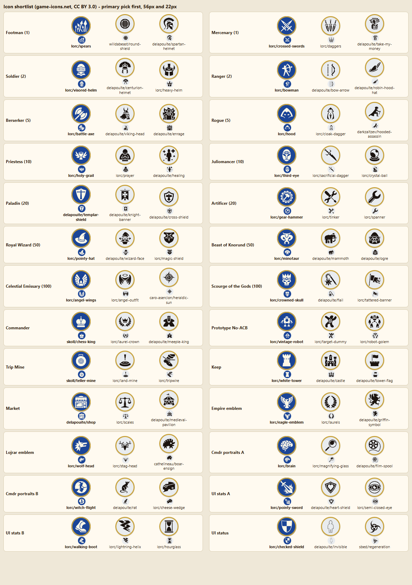
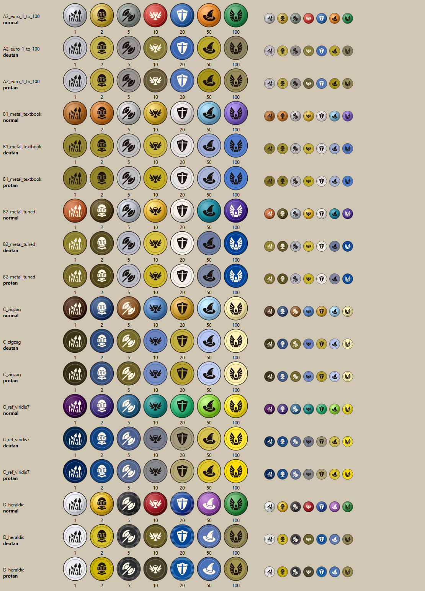
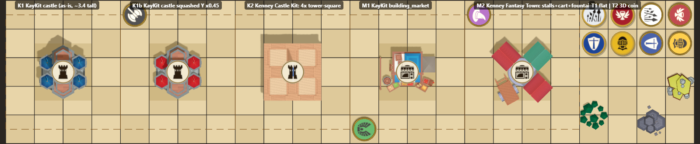
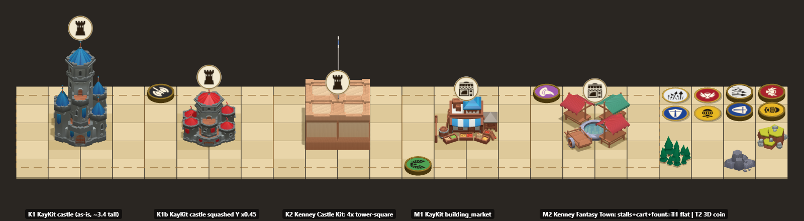
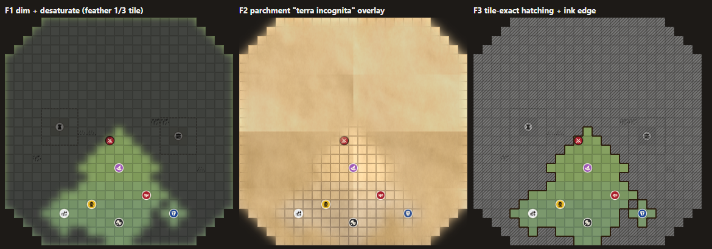
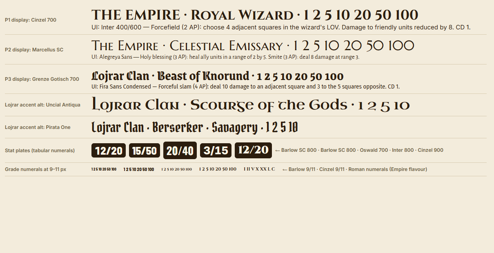

# Art direction research: tokens, grade palettes, factions, objectives, board, fog

Research step that feeds the later mock page. Source spec: `docs/SPEC.md` (owner, 2026-10-24).
All licences, URLs, file names and counts were checked online on **2026-10-24**. The "Verified" columns say how each was checked.
Colour claims were computed (method in Appendix B). Model claims come from real three.js renders of the actual files (Appendix C).

**Supporting files** (all in `docs/analysis/research-art/`, next to this document):

| File | What it shows |
|---|---|
| `icon-shortlist.png` | Every recommended symbol plus two alternates, rendered at 56 px and 22 px on tokens |
| `icon-candidates-1.png` … `icon-candidates-4.png` | All ~200 game-icons candidates screened (8 per subject) at 64 px and 24 px |
| `palettes-cvd.png` | Palettes A2, B1, B2, C, C-ref and D as tokens, in normal vision and simulated deuteranopia/protanopia, at 64 px and 28 px |
| `objectives-v1-top.png`, `objectives-v1-iso.png` | First render pass: KayKit and Kenney Keep/Market candidates, including the hex-based Kenney ones |
| `objectives-v2-top.png`, `objectives-v2-iso.png`, `objectives-v2-iso45.png` | Second pass: tuned Keep candidates, Market candidates, T1 flat vs T2 3D tokens, blockers, true-isometric 45° view |
| `fog-styles-manhattan-cut.png`, `fog-styles-euclid-cut.png` | 25×25 board under both corner-cut readings, with three fog-of-war styles |
| `font-pairings.png` | Google Fonts pairing specimens, including stat-plate numerals |
| `ref-kenney-3d-packs.png`, `ref-kenney-2d-packs.png`, `ref-kenney-tower-defense-kit.png`, `ref-kaykit-medieval-hexagon-buildings.jpg` | The packs' own CC0 preview sheets |
| `palettes.json` | All palette data, machine-readable: base/highlight/shadow hex, L*, icon ink and contrast, simulated deutan/protan/tritan/grey hex, min ΔE |
| `palettes-input.json`, `cvd_check.py` | Lets you re-run the colour-blindness check after changing a hex (`python cvd_check.py palettes-input.json`) |
| `icons.json` | Every shortlisted icon with author, game-icons page URL, raw SVG URL and Iconify id |

---

## 0. Recommended defaults at a glance

Every row below is a default chosen so implementation can start without waiting. The mock page must still show all listed contenders.

| # | Decision | Recommended default | Other contenders to show in the mock | Confidence |
|---|---|---|---|---|
| 1 | Overall style | **S1 "toy diorama" low-poly** (KayKit + Kenney, all CC0), with a war-table/parchment skin on the UI only | S2 painterly parchment war-table; S3 "Clarity mode" | Medium |
| 2 | Token form | **T2 3D coin** (cylinder with embossed rim) whose top face is exactly the T1 flat design | T1 flat disc | Medium-high |
| 3 | Grade palette | **D "Heraldic euro"**: Argent, Or, Sable, Gules, Azure, Purpure, Vert | A2 euro-literal (reference), B2 tuned metal ladder, C warm/cool zig-zag (offered as an accessibility palette toggle) | Medium |
| 4 | Non-colour grade cue | **Numeral cartouche** on the rim (toggleable), plus a subtle size ladder, plus Petra Sancta hatching on the bezel when palette D is used. Thickness ladder applies in iso only | Rank pips; euro-edge outlines | Medium |
| 5 | Unit symbols | **game-icons.net primaries** in §4 (all 103 cited icon pages verified) | Two alternates per subject | Medium-high |
| 6 | Owner cue (you vs opponent) | **Light brass/ivory bezel for you, dark blackened-iron bezel for the opponent**, plus a smooth outline for you and a milled outline for the opponent | Faction-coloured bezels; shogi-style pointer notch | Medium |
| 7 | Factions | **Empire E1** "Imperial crimson & gold" (eagle). **Lojrar L1** "Northern clan" (wolf, pine, iron) | E2 Azure & Argent; L2 Steppe stag & turquoise; L3 Druidic raven & moss | Low-medium |
| 8 | Keep model | **KayKit `building_castle_<colour>.gltf`**, fitted to 2×2 and squashed to Y×0.45 (about 1.5 tiles tall) | KayKit castle as-is (about 3.4 tall); Kenney Castle Kit 4× `tower-square.glb` | Medium |
| 9 | Market model | **KayKit `building_market_<colour>.gltf`** fitted to 2×2 (about 1.06 tall) | Kenney Fantasy Town `stall-red/stall-green/cart` around `fountain-round` | Medium |
| 10 | Objective symbol | Ivory emblem disc on the roof in top view, camera-facing badge in iso. Keep = `lorc/white-tower`, Market = `delapouite/shop` | `delapouite/castle`, `delapouite/tower-flag`; `lorc/scales`, `delapouite/medieval-pavilion` | Medium-high |
| 11 | Board surface | **B3 sand-table slabs** (two sand tones) with 3D blockers | B1 parchment war map; B2 Kenney Tower Defense Kit square tiles | Medium |
| 12 | Fog of war | **F3-lite**: tile-exact vision boundary with an ink edge; fogged tiles dimmed and desaturated; hatching optional | F1 soft dim; F2 parchment "terra incognita" | Medium-high |
| 13 | Fonts | **Cinzel** (display) + **Inter** (UI) + **Barlow Semi Condensed 800** (numerals), with **Grenze Gotisch** as the Lojrar accent | Marcellus SC + Alegreya Sans; Grenze Gotisch + Fira Sans Condensed | Medium |
| 14 | Camera | Top view: orthographic, straight down, own side at the bottom. Iso view: orthographic true isometric (35.264° elevation, 45° yaw). Buildings go x-ray when they occlude a unit or the cursor | Iso rotatable in 90° steps | Medium |

---

## 1. Spec lines that drive the art (verbatim)

- L5: "The units available follow the Euro distribution: 1, 2, 5, 10, 20, 50, 100: Each unit represents a coin, and like coins, each unit has 2 variations."
- L44: "Despite being inspired in the euro distribution, each unit will be represented by a token. The color of the token will represent the grade of the unit. The symbol on top of the token will represent the particular unit that token represents."
- L43: "The game features, for now, 2 clans or factions. It may be possible to add new factions later into the game."
- L45: "...two optional objectives: The keep, The market. Each one will occupy a 2x2 square and will be conquered when at least one unit, without opposition, is in range of 1(including corners) of that building."
- L46: "The neutral objectives are represented by 3d objects and a symbol in the middle that represents this building."
- L47: "The style of the graphics is stylized."
- L48: "The view can switch from top to isometric. Top by default."
- L13: "The game takes place in a square grid system. There may be a scenario with blockers."
- L17: "Each player will only have vision around the vision field of each unit. Everything outside will be in the fog of war."
- L30: "The size of the battlefields are 25x25, where the corners are cut off with a radius of 4."
- L31: "The normal deployment zone covers the first 5 rows closest to the player. The extended deployment zone covers 2 extra rows."
- L37: "A LOV of 1 will only show the 4 orthogonal adjacent squares. A LOV of 2, will show 12 squares around the unit, and so on." This is a Manhattan diamond, so fog edges are diamond-shaped staircases.
- L136: "For the artstyle and graphics, references and/or free asset packs may be used if suitable; otherwise design the graphics. Any artistic decision will show a quick mock in a page, as well as justification for the use. If there are several contenders, all should be represented and justified."

---

## 2. Questions, perceived ambiguities, and the default used

Each item gives the spec quote, the issue, the default, and how confident I am in that default.

**Q1. Which faction owns the 14 listed units?**
Quote: "### The Empire" is immediately followed by "### Lojrar Clan", and only then by "#### 1 … Footman". In Markdown that places all 14 units under *Lojrar Clan* and leaves *The Empire* empty, yet this research brief calls them "Empire units".
Default: one **shared roster** for both factions for now (a mirror match in stats). Faction is expressed visually through bezel ornament, banners, UI and building tints, never through different symbols. The art pipeline keeps a per-faction symbol override table, so a second roster can drop in later.
Confidence: medium.

**Q2. What are the "2 variations"?**
Quote: "Each unit represents a coin, and like coins, each unit has 2 variations."
Default: there are 2 units per grade, exactly as listed. Art consequence: the two units of a grade share the token colour, so their symbols must have maximally different silhouettes. §4 picks every pair with that in mind: spears vs X, helm vs archer, axe vs hood, chalice vs eye-mask, shield vs gear, hat vs horned head, wings vs skull.
Alternative reading: euro coins have a common side and a national side. This could inspire a coin-flip "acted" state (§6.5), or a per-faction reverse face.
Confidence: high that there are 2 units per grade; low for the two-faces reading.

**Q3. "Units of white" (Baba Yaga).**
Quote: "Units of white gain the ability to regenerate 2 toughness for 2 AP (each instance)."
No grade or faction is called "white" anywhere in the spec, so the rule cannot be resolved without knowing the palette.
Default: the rules should name grades by number ("type-1 units"), with colour as presentation only. If the owner did picture a white grade, palette D has one (grade 1 = Argent, white/silver), as do B2 (grade 20 = platinum) and C (grade 100 = ivory).
Confidence: low. Needs the owner.

**Q4. Does "Size 2" mean a 2×2 footprint?**
Quote: "Beast of Knorund, 20/40, 2, 2, 2, 3", read against the format line "Name, Power/Toughness, Size, LOV, Movement, AP". Trip Mine also adds damage "if the unit has a size of 2 or greater".
Default: Size 2 means a 2×2 footprint. The token is one coin of diameter 1.84 tiles centred on the block, so the icon gets four times the area (`delapouite/mammoth` becomes viable there).
Confidence: medium.

**Q5. Corner cut shape.**
Quote: "25x25, where the corners are cut off with a radius of 4."
Three readings, all rendered in `research-art/fog-styles-*.png`:
- (a) Manhattan triangle: remove cells with `x + y < 4` from each corner, 10 cells per corner, giving an octagon.
- (b) Euclidean rounding, like CSS `border-radius: 4`: only 3 cells per corner removed, barely visible.
- (c) Concave quarter-disc "bite" of radius 4 centred on the corner: 13 cells per corner.

Default: (a), because the spec measures LOV in Manhattan steps, and (b) is hardly a visible cut. Board art is defined as a cell mask, so any reading works.
Confidence: low.

**Q6. Do blockers block vision, or only movement?**
Quote: "There may be a scenario with blockers." Nothing is said about LOV.
Default: blockers block movement only. Fog is a pure union of LOV diamonds, with no shadow casting.
Confidence: low. If they also block vision, the fog renderer must cast "shadows", and F3's crisp edges show those shadows best.

**Q7. Does the token colour change when a commander changes a unit's grade?**
Quote: Sabrina: "Artificers now are considered type 10."
Default: yes. Tokens always show the effective grade (colour and numeral), plus a tiny commander-effect pip on the rim.
Confidence: medium.

**Q8. Commander token appearance.**
Quote: "The commander is by default a 1/1 unit … and doesn't count from the budget."
The commander has no grade, so no grade colour applies.
Default: ivory face `#F3EAD2`, a crest on the bezel (laurel for Empire, antlers or wolf ears for Lojrar), the commander's portrait icon on the face, and a small `skoll/chess-king` badge.
Six commanders are listed in two groups of three, separated by a blank line. Is that a split by faction? Default: commanders are faction-agnostic.
Confidence: low.

**Q9. Iso camera details.**
Quote: "The view can switch from top to isometric. Top by default."
Default: orthographic true isometric (elevation `atan(1/√2)` = 35.264°, yaw 45°) with a 300 ms animated switch. Each player sees their own deployment zone at the bottom. Rotation in 90° steps is optional (Q/E keys).
Confidence: medium.

**Q10. What is visible under fog?**
Quote: "Everything outside will be in the fog of war."
Default:
- Terrain, blockers, objectives **and objective ownership** are always visible. The Keep and Market buffs are global, so their owner is public information anyway.
- Only enemy units (and enemy mines) are hidden.
- No last-known-position ghosts by default; offer them as an option.

Confidence: medium-high.

**Q11. Mirror matches.**
Not stated: can both players pick the same faction?
Default: yes. Therefore the owner cue (you vs opponent) must not depend on faction (§6.3).
Confidence: medium.

**Q12. Placement of the objective symbol.**
Quote: "3d objects and a symbol in the middle".
Default:
- Top view: a flat ivory emblem disc sits on the roof centre.
- Iso view: a camera-facing badge floats about 0.55 tiles above the roof.

Both are rendered in `objectives-v2-*.png` and read well.
Confidence: medium-high.

**Q13. What "stylized" means.**
Quote: "The style of the graphics is stylized."
Default: low-poly toy diorama (S1). Painterly (S2) stays as a contender.
Confidence: medium.

**Q14. Name puns that drive icon choice.**
"Juliomancer / Julio Vernification" (a Jules Verne pun?), Kulega "The Fine Printer", Sabrina "The Reelfinisher", Queso "The Beacon of hope", Trill "The Hydrocephalic", Ratasius I.
Default: the literal readings in §4.3: brain, magnifying glass, film reel, cheese, rat, witch.
Confidence: low. The owner should confirm the intended jokes.

**Q15. Mines and stealth visibility.**
Quotes: Rogue: "This unit becomes invisible. It will be revealed when it's 1 square away from an enemy unit, or when receiving damage inside enemy LOV." Mine: "Mines can be triggered from distance by attacking the square with a ranged attack."
Default:
- The owner sees their own stealthed units and mines as translucent with a dashed bezel.
- The opponent sees nothing, even inside their LOV, until revealed.
- The opponent's UI must allow targeting an empty-looking tile, shown with a crosshair on an empty tile.

Confidence: high.

**Q16. Grade wording in the UI.**
The spec uses "type-1", "type-20" and also "grade".
Default: the UI says "Type 10" to match the rules text, and the coin numeral shows "10".
Confidence: medium.

**Q17. Typo.**
L45: "One conquered, the building can be reconquered" presumably means "Once conquered". No art impact.

---

## 3. Asset & reference sources (verified 2026-10-24)

| Source | URL | Licence (exact) | Attribution required? | What we would use it for | Verified |
|---|---|---|---|---|---|
| **game-icons.net** | https://game-icons.net | "Icons provided under the Creative Commons 3.0 BY or CC0 if mentioned below". CC0 applies only to the *Viscious Speed* and *Zeromancer* folders | **Yes.** "Please, include a mention 'Icons made by {author}' in your derivative work". FAQ: for video games, credits must be reachable from a menu | All unit, commander, building, faction and UI symbols (§4) | **Yes.** Read `license.txt` in the repo and the FAQ. Counted 4,239 SVGs in 37 author folders. HTTP 200 for all 103 icon pages cited here |
| game-icons GitHub repo | https://github.com/game-icons/icons | Same as above | Same | Raw SVGs (`/master/{author}/{name}.svg`) | Yes, full git tree downloaded |
| Iconify "game-icons" set | https://icon-sets.iconify.design/game-icons/ (API `https://api.iconify.design/collection?prefix=game-icons`) | CC BY 3.0 (`spdx: CC-BY-3.0`) | Yes, credit the authors | Convenient delivery: 4,133 icons, no background square, `currentColor`. Ids drop the author, so look authors up in the repo | Yes, API JSON |
| **Kenney – Castle Kit 2.0** | https://kenney.nl/assets/castle-kit | "Creative Commons CC0" (zip `License.txt`: "Creative Commons Zero, CC0") | No. "Support by crediting 'Kenney' or 'www.kenney.nl' (this is not a requirement)" | Keep option K2; flags; blockers `rocks-large.glb`, `rocks-small.glb`, `tree-large.glb`, `tree-small.glb` | Yes: page, zip licence, full file list, 3D render |
| **Kenney – Fantasy Town Kit 2.0** | https://kenney.nl/assets/fantasy-town-kit | CC0 | No (optional credit) | Market option M2: `stall.glb`, `stall-red.glb`, `stall-green.glb`, `cart.glb`, `cart-high.glb`, `fountain-round.glb` (2×2), `banner-red.glb`, `banner-green.glb`, `lantern.glb`; blockers `rock-large.glb`, `rock-wide.glb`, `tree.glb`, `tree-crooked.glb` | Yes: page, zip licence, file list, render |
| **Kenney – Tower Defense Kit 2.1** | https://kenney.nl/assets/tower-defense-kit | CC0 | No | Board option B2 with **square** 1×1 tiles: `tile.glb` (1×0.2×1), `tile-rock.glb`, `tile-tree.glb`, `tile-tree-double.glb`, `tile-hill.glb`, `tile-crystal.glb`, `snow-tile-*.glb`; cursor markers `selection-a.glb`, `selection-b.glb` | Yes: page, file list, bounding boxes, preview |
| Kenney – Hexagon Kit 2.0 | https://kenney.nl/assets/hexagon-kit | CC0 | No | Reference only. `building-castle.glb` and `building-market.glb` exist but sit on a hex base (1×1.15 footprint) that clashes with a square grid (see `objectives-v1-top.png`) | Yes: file list, render |
| Kenney – Nature Kit | https://kenney.nl/assets/nature-kit | CC0 | No | Blockers: `rock_largeA…F.glb`, `rock_tallA…J.glb`, `stone_*.glb`, `tree_pineRoundA…F.glb`, `tree_oak.glb`, `stump_*.glb`, `log*.glb`, and `cliff_block_rock.glb` for board-edge skirts. 329 models, each in GLB/FBX/OBJ, plus pre-rendered isometric PNGs | Yes: page, zip listing |
| Kenney – Retro Fantasy Kit 2.0 | https://kenney.nl/assets/retro-fantasy-kit | CC0 | No | Not recommended: textured retro style mismatches S1 | Yes, page and file list |
| **Kenney – Cartography Pack** | https://kenney.nl/assets/cartography-pack | CC0 | No | Style S2, board B1 and fog F2: `Textures/parchmentBasic.png`, `parchmentAncient.png`, `parchmentCrinkled.png`, `parchmentFolded.png` (1024²); ink symbols `castle.png`, `tower.png`, `rocks.png`, `rocksMountain.png`, `treePines.png`, `flag.png`, `banner.png`, `compass.png` | Yes: page, zip listing, used in the fog mock |
| Kenney – Board Game Icons 1.1 | https://kenney.nl/assets/board-game-icons | CC0 | No | Generic UI glyphs (SVG + PNG 64/128): `arrow_counterclockwise` (take-back), `hourglass`, `flag_square`, `pouch` (budget), `structure_tower`, `crown_a`, `token`, `chess_king` | Yes, page and file list |
| Kenney – Boardgame Pack | https://kenney.nl/assets/boardgame-pack | CC0 | No | Reference for poker-chip **edge spots** as a value cue (`PNG/Chips/chipBlue*.png`, `*_side.png`). Bonus CC0 sounds `Bonus/chipsCollide1-3.ogg` could serve as a token-placement click | Yes, page and file list |
| Kenney – Fantasy UI Borders / UI Pack (RPG Expansion) | https://kenney.nl/assets/fantasy-ui-borders, https://kenney.nl/assets/ui-pack-rpg-expansion | CC0 | No | Panel frames for the faction-skinned UI (`panel-border-000…`) | Yes, pages |
| Kenney – Medieval RTS, Platformer Kit 4.1, Mini Market 1.0, Mini Dungeon 2.0 | https://kenney.nl/assets/medieval-rts (and so on) | CC0 | No | **Not used.** Medieval RTS is 2D top-down and clashes with 3D objectives. Platformer Kit and Mini Market (a modern supermarket) don't fit the theme | Yes, pages |
| **KayKit – Medieval Hexagon Pack 1.0** (Kay Lousberg) | https://kaylousberg.itch.io/kaykit-medieval-hexagon, mirrored at https://github.com/KayKit-Game-Assets/KayKit-Medieval-Hexagon-Pack-1.0 | "Creative Commons Zero, CC0" for the free tier (repo `LICENSE.txt`, created 26/04/2024). Paid "Extra" ($9.99+) and "Source" ($14.99+) tiers add models and are not needed | No. "Support me by crediting Kay Lousberg, www.kaylousberg.com (this is not mandatory)" | **Keep K1** `Assets/gltf/buildings/<colour>/building_castle_<colour>.gltf` (+`.bin`); **Market M1** `building_market_<colour>.gltf`; colours `blue`, `green`, `red`, `yellow`; also `building_tower_A/B_*`, `building_barracks_*`, `flag_<colour>.gltf`; blockers `rock_single_A…E`, `trees_A_small/medium/large`, `hills_A/B/C(_trees)`, `mountain_A/B/C*`. Formats FBX, GLTF, OBJ | **Yes**: licence file, git tree, bounding boxes, 3D renders |
| KayKit – Medieval Builder Pack 1.0 | https://kaylousberg.itch.io/kaykit-medieval-builder-pack | CC0 | No | **Not used.** The page marks it "(Legacy)": "won't be updated anymore", superseded by the Hexagon pack | Yes, itch page |
| Quaternius (Ultimate Fantasy RTS, Medieval Village MegaKit, Fantasy Props MegaKit, Stylized Nature MegaKit) | https://quaternius.com/packs/ultimatefantasyrts.html (and so on) | **Conflicting.** Pack pages say "CC0 License". The site-wide https://quaternius.com/license.html now says "Quaternius Asset License (QAL) v1.0", "Last updated: 8/28/2026" | No ("No attribution is required.") | Backup only. QAL forbids redistributing the raw assets, which is a risk if the game repo is public. Prefer Kenney or KayKit | **Partly.** Both pages read; conflict unresolved |
| Poly Pizza | https://poly.pizza | **Per model.** E.g. "Village Market" by Quaternius https://poly.pizza/m/0TsHLxX6CB, "Market Stalls Compact" https://poly.pizza/m/fmHUuX9AS3 and "Stone Tower" https://poly.pizza/m/Rz4U5dZJz8 are all "Public Domain (CC0)" (FBX/GLTF). Google-Poly-era models such as "Castle Tower" by sirkitree https://poly.pizza/m/7ZiHr3enyWJ are "Creative Commons Attribution" (CC BY 3.0) | CC0: no. CC BY: name the author, licence and link | Fallback for single props. Check every model page | Yes, 4 model pages and a search page |
| OpenGameArt | https://opengameart.org | **Per asset**: CC0, CC-BY 3.0/4.0, CC-BY-SA 3.0/4.0, OGA-BY 3.0/4.0, GPL 2.0/3.0. FAQ: "you should assume that all work … requires [attribution] unless otherwise specified". Previews: assume "All rights reserved" | Usually yes | Nothing selected, because the packs above cover everything. Avoid SA/GPL art if the game might stay closed | Yes, FAQ |
| **Google Fonts** | https://fonts.google.com | **SIL Open Font License 1.1** for every font listed in §12 (each sits in the `ofl/` folder of github.com/google/fonts) | No credit needed for use. Bundle the OFL text if you ship the font files | Display, UI and numeral fonts (§12) | Yes: CSS2 API returned 200 for each, and the repo folders were checked |
| ECB Decision 2013/10, Art. 1 (euro note colours) | https://www.legislation.gov.uk/eudn/2013/10/article/1/data.html | n/a (facts) | n/a | Palettes A2 and D: €5 grey, €10 red, €20 blue, €50 orange, €100 green, €200 yellow-brown, €500 purple | Yes (search plus mirror) |
| Euro coin specifications | https://en.wikipedia.org/wiki/Euro_coins | n/a | n/a | Edge and size cues (§5.4) | Yes |
| Heraldic tinctures and Petra Sancta hatching | https://en.wikipedia.org/wiki/Tincture_(heraldry) | n/a | n/a | Palette D and its hatching cue | Yes |
| three.js r160 | https://cdn.jsdelivr.net/npm/three@0.160.0/ | MIT | Keep the licence notice | Iso/top previews in the mock page (used for the test renders) | Yes, used |

**Notes that matter for implementation**

- **Kenney 3D kits** ship `Models/GLB format/*.glb` (plus FBX and OBJ). Every GLB references an **external** `Textures/colormap.png` by relative path, so keep it beside the GLBs.
  - Castle Kit also ships `Models/Textures/variation-a…d.png`. Swapping the colormap recolours the whole kit, which is the cheap way to make neutral, "you" and "enemy" variants.
  - Unit scale: 1.0 = one tile. `tower-square.glb` is 1×1.31×1, `stall-red.glb` 1×1.24×1, `fountain-round.glb` 2×0.28×2.
- **KayKit GLTFs** reference `hexagons_medieval.png` by bare file name, but the repo keeps it in `addons/kaykit_medieval_hexagon_pack/Textures/`. Copy it next to the `.gltf` files.
  - The atlas is 1024², an 8×4 grid of vertical gradient swatches. Team colour lives in dedicated swatches, so a **neutral grey variant is a one-swatch edit** of a cloned texture.
  - KayKit scale is about 2 units per hex. Props therefore need ×0.5 for 1-unit tiles. The castle is 1.98×3.98×2.26 and the market 1.8×0.98×1.32 (bounding boxes measured from the files).
- **Payload for the mock page**:
  - All candidate models come to under 2 MB: KayKit castle 313 KB, market 152 KB, atlas 15 KB; every Kenney GLB is 4–90 KB.
  - Icons: primaries 39 KB, all 78 shortlisted 138 KB.
  - The artifact rules allow scripts only from CDNs and fonts only from Google Fonts. So: three.js from `cdn.jsdelivr.net/npm/three@0.160.0`, models as supporting `files` or `data:` URIs, icon paths inline.

---

## 4. Unit and object symbols (game-icons.net)

### 4.1 How the icons were chosen

1. **The two units of a grade must differ in silhouette**, because colour is shared (Q2).
2. **Legibility at 16–22 px.** At 1080p a 25-row board gives about 36 px per tile, so the icon is about 20 px. Every primary was checked at 22 px (small discs in the sheet).
3. **One visual family.** 36 of the 39 primaries in this section (§4.2 and §4.3) are by **Lorc** or **Delapouite**, the two authors with matching stroke weight. The three exceptions are Skoll's chess-king and teller-mine and Sbed's regeneration.
4. **Meaning comes from the unit's ability** where possible (Line Formation becomes a phalanx of spears, Mind's Eye becomes a third eye).
5. **No reuse across roles.** `lorc/crossed-swords` is the Mercenary, so the UI "Power" stat uses `lorc/pointy-sword` instead.

URL pattern: page `https://game-icons.net/1x1/{author}/{name}.html`, raw SVG `https://raw.githubusercontent.com/game-icons/icons/master/{author}/{name}.svg`.

### 4.2 Units, commander, prototypes, mines, buildings

| Subject | Grade | **Primary** | Alt 1 | Alt 2 | Why the primary |
|---|---|---|---|---|---|
| Footman | 1 | [lorc/spears](https://game-icons.net/1x1/lorc/spears.html) | [willdabeast/round-shield](https://game-icons.net/1x1/willdabeast/round-shield.html) | [delapouite/spartan-helmet](https://game-icons.net/1x1/delapouite/spartan-helmet.html) | A phalanx of spears reads as "Line Formation". Vertical strokes contrast with the Mercenary's X |
| Mercenary | 1 | [lorc/crossed-swords](https://game-icons.net/1x1/lorc/crossed-swords.html) | [lorc/daggers](https://game-icons.net/1x1/lorc/daggers.html) | [delapouite/take-my-money](https://game-icons.net/1x1/delapouite/take-my-money.html) | An X silhouette for the aggressive pack fighter. The "paid" pun icon (Alt 2) turns to mush at 22 px |
| Soldier | 2 | [lorc/visored-helm](https://game-icons.net/1x1/lorc/visored-helm.html) | [delapouite/centurion-helmet](https://game-icons.net/1x1/delapouite/centurion-helmet.html) | [lorc/heavy-helm](https://game-icons.net/1x1/lorc/heavy-helm.html) | A compact, round, defensive shape for the 2/7 regenerating infantry. The centurion helmet would suit the Empire flavour |
| Ranger | 2 | [lorc/bowman](https://game-icons.net/1x1/lorc/bowman.html) | [delapouite/bow-arrow](https://game-icons.net/1x1/delapouite/bow-arrow.html) | [delapouite/robin-hood-hat](https://game-icons.net/1x1/delapouite/robin-hood-hat.html) | The only figure drawing a bow, so it reads "range 2" instantly. A diagonal figure vs the round helm |
| Berserker | 5 | [lorc/battle-axe](https://game-icons.net/1x1/lorc/battle-axe.html) | [delapouite/viking-head](https://game-icons.net/1x1/delapouite/viking-head.html) | [delapouite/enrage](https://game-icons.net/1x1/delapouite/enrage.html) | A heavy diagonal weapon for 12 power and a double attack |
| Rogue | 5 | [lorc/hood](https://game-icons.net/1x1/lorc/hood.html) | [lorc/cloak-dagger](https://game-icons.net/1x1/lorc/cloak-dagger.html) | [darkzaitzev/hooded-assassin](https://game-icons.net/1x1/darkzaitzev/hooded-assassin.html) | A faceless hood means stealth. The boldest shape of the whole set at 16 px |
| Priestess | 10 | [lorc/holy-grail](https://game-icons.net/1x1/lorc/holy-grail.html) | [lorc/prayer](https://game-icons.net/1x1/lorc/prayer.html) | [delapouite/healing](https://game-icons.net/1x1/delapouite/healing.html) | A winged chalice for the aura and life transfer ("Shared wounds"). Avoids a figure-vs-figure clash with the Celestial Emissary. `delapouite/healing` uses crosses that echo the Paladin |
| Juliomancer | 10 | [lorc/third-eye](https://game-icons.net/1x1/lorc/third-eye.html) | [lorc/sacrificial-dagger](https://game-icons.net/1x1/lorc/sacrificial-dagger.html) | [lorc/crystal-ball](https://game-icons.net/1x1/lorc/crystal-ball.html) | "Mind's Eye". Alt 1 depicts "Julio Vernification" (sacrifice) |
| Paladin | 20 | [delapouite/templar-shield](https://game-icons.net/1x1/delapouite/templar-shield.html) | [delapouite/knight-banner](https://game-icons.net/1x1/delapouite/knight-banner.html) | [delapouite/cross-shield](https://game-icons.net/1x1/delapouite/cross-shield.html) | A kite shield with a cross for "Reinforced Armor" |
| Artificer | 20 | [lorc/gear-hammer](https://game-icons.net/1x1/lorc/gear-hammer.html) | [lorc/tinker](https://game-icons.net/1x1/lorc/tinker.html) | [lorc/spanner](https://game-icons.net/1x1/lorc/spanner.html) | The maker. A toothed ring vs the Paladin's solid kite shield |
| Royal Wizard | 50 | [lorc/pointy-hat](https://game-icons.net/1x1/lorc/pointy-hat.html) | [delapouite/wizard-face](https://game-icons.net/1x1/delapouite/wizard-face.html) | [lorc/magic-shield](https://game-icons.net/1x1/lorc/magic-shield.html) | The most legible "wizard" at tiny sizes. Alt 2 is literally the Forcefield |
| Beast of Knorund | 50 | [lorc/minotaur](https://game-icons.net/1x1/lorc/minotaur.html) | [delapouite/mammoth](https://game-icons.net/1x1/delapouite/mammoth.html) | [delapouite/ogre](https://game-icons.net/1x1/delapouite/ogre.html) | A horned beast head. On a 2×2 token (Q4) the mammoth becomes an option |
| Celestial Emissary | 100 | [lorc/angel-wings](https://game-icons.net/1x1/lorc/angel-wings.html) | [lorc/angel-outfit](https://game-icons.net/1x1/lorc/angel-outfit.html) | [caro-asercion/heraldic-sun](https://game-icons.net/1x1/caro-asercion/heraldic-sun.html) | A haloed winged figure. A wide horizontal silhouette |
| Scourge of the Gods | 100 | [lorc/crowned-skull](https://game-icons.net/1x1/lorc/crowned-skull.html) | [delapouite/flail](https://game-icons.net/1x1/delapouite/flail.html) | [lorc/tattered-banner](https://game-icons.net/1x1/lorc/tattered-banner.html) | The "Scourge of God" (Attila's epithet) as a crowned death. Compact and round vs the wings. Alt 2 shows the Command Aura |
| Commander | – | [skoll/chess-king](https://game-icons.net/1x1/skoll/chess-king.html) | [lorc/laurel-crown](https://game-icons.net/1x1/lorc/laurel-crown.html) | [delapouite/meeple-king](https://game-icons.net/1x1/delapouite/meeple-king.html) | The piece you must protect, as in chess. Used as a badge; the face shows the commander's portrait (§4.3) |
| Prototype No-ACB (dummy) | – | [lorc/vintage-robot](https://game-icons.net/1x1/lorc/vintage-robot.html) | [lorc/target-dummy](https://game-icons.net/1x1/lorc/target-dummy.html) | [lorc/robot-golem](https://game-icons.net/1x1/lorc/robot-golem.html) | "Prototype" automaton that can move with "Mad inventor". Alt 1 is the literal dummy |
| Trip Mine | – | [skoll/teller-mine](https://game-icons.net/1x1/skoll/teller-mine.html) | [lorc/land-mine](https://game-icons.net/1x1/lorc/land-mine.html) | [lorc/tripwire](https://game-icons.net/1x1/lorc/tripwire.html) | A mine seen **from above**, matching the default top camera |
| Keep | – | [lorc/white-tower](https://game-icons.net/1x1/lorc/white-tower.html) | [delapouite/castle](https://game-icons.net/1x1/delapouite/castle.html) | [delapouite/tower-flag](https://game-icons.net/1x1/delapouite/tower-flag.html) | A donjon tower. Its rook-like silhouette pairs with the chess-king commander |
| Market | – | [delapouite/shop](https://game-icons.net/1x1/delapouite/shop.html) | [lorc/scales](https://game-icons.net/1x1/lorc/scales.html) | [delapouite/medieval-pavilion](https://game-icons.net/1x1/delapouite/medieval-pavilion.html) | A storefront with awning reads "market" at every size |

### 4.3 Commander portraits, faction emblems, UI and status icons

| Subject | Primary | Alternates | Note |
|---|---|---|---|
| Trill "The Hydrocephalic" | [lorc/brain](https://game-icons.net/1x1/lorc/brain.html) | – | Literal reading (Q14) |
| Kulega "The Fine Printer" | [lorc/magnifying-glass](https://game-icons.net/1x1/lorc/magnifying-glass.html) | lorc/quill-ink, lorc/scroll-unfurled | Reading the fine print. Note that `delapouite/contract` is **not** a document; it shows four inward arrows |
| Sabrina "The Reelfinisher" | [delapouite/film-spool](https://game-icons.net/1x1/delapouite/film-spool.html) | delapouite/fishing | The pun is unclear; ask the owner |
| Baba Yaga "The Bwitch" | [lorc/witch-flight](https://game-icons.net/1x1/lorc/witch-flight.html) | cathelineau/witch-face, lorc/chicken-leg (her hut on chicken legs) | |
| Ratasius I "The Great" | [delapouite/rat](https://game-icons.net/1x1/delapouite/rat.html) | – | |
| Queso "The Beacon of hope" | [lorc/cheese-wedge](https://game-icons.net/1x1/lorc/cheese-wedge.html) | delapouite/lighthouse | "Queso" is Spanish for cheese; the alternate is the beacon |
| Empire emblem | [lorc/eagle-emblem](https://game-icons.net/1x1/lorc/eagle-emblem.html) | lorc/laurels, delapouite/griffin-symbol, delapouite/fleur-de-lys (for E2) | |
| Lojrar emblem | [lorc/wolf-head](https://game-icons.net/1x1/lorc/wolf-head.html) | lorc/stag-head (L2), lorc/raven (L3), cathelineau/boar-ensign, lorc/heavy-thorny-triskelion, delapouite/knot | |
| Power | [lorc/pointy-sword](https://game-icons.net/1x1/lorc/pointy-sword.html) | lorc/broadsword | |
| Toughness | [delapouite/heart-shield](https://game-icons.net/1x1/delapouite/heart-shield.html) | – | |
| LOV | [lorc/semi-closed-eye](https://game-icons.net/1x1/lorc/semi-closed-eye.html) | – | |
| Movement | [lorc/walking-boot](https://game-icons.net/1x1/lorc/walking-boot.html) | – | |
| AP | [lorc/lightning-helix](https://game-icons.net/1x1/lorc/lightning-helix.html) | – | |
| Cooldown | [lorc/hourglass](https://game-icons.net/1x1/lorc/hourglass.html) | – | |
| Defend state | [lorc/checked-shield](https://game-icons.net/1x1/lorc/checked-shield.html) | – | |
| Stealth state | [delapouite/invisible](https://game-icons.net/1x1/delapouite/invisible.html) | – | |
| Regeneration | [sbed/regeneration](https://game-icons.net/1x1/sbed/regeneration.html) | – | |
| Take-back | [delapouite/anticlockwise-rotation](https://game-icons.net/1x1/delapouite/anticlockwise-rotation.html) | Kenney Board Game Icons `arrow_counterclockwise` (CC0) | |
| Achievements | [delapouite/laurels-trophy](https://game-icons.net/1x1/delapouite/laurels-trophy.html) | – | |
| Budget | [lorc/crown-coin](https://game-icons.net/1x1/lorc/crown-coin.html) | delapouite/two-coins | |

### 4.4 Implementation notes

- **Repo SVG structure.** Each repo SVG is `<path d="M0 0h512v512H0z"/>` (a black square) followed by `<path fill="#fff" d="…"/>`. Drop the first path and recolour the second. The Iconify copies already have no background.
- **Sanitising.** Only keep path data matching `[0-9MmLlHhVvCcSsQqTtAaZz.,\-\s eE]`; the test renders did exactly that.
- **Drawing.** Canvas `new Path2D(d)` draws them directly, which is how the 3D tests textured the coin faces.
- **Credits.** Required, reachable from a menu. Ready-made text is in Appendix A.

---

## 5. Grade colour palettes (7 grades)

### 5.1 Method (short; details in Appendix B)

- **Simulation.** Each grade colour was put through **deuteranopia, protanopia and tritanopia** simulation (Machado, Oliveira & Fernandes 2009, severity 1.0, i.e. full dichromacy, the worst case) and through greyscale.
- **Distance.** I then computed the **CIEDE2000** distance between every pair of grades.
- **Working thresholds** (a heuristic for small tokens):
  - ΔE00 ≥ 20: distinct at a glance.
  - 12–20: distinct side by side.
  - < 10: confusable, so the pair needs a non-colour cue.
- **Why it matters.** Roughly 1 in 12 men and 1 in 200 women have a red-green deficiency. As the brief says, colour alone cannot carry 7 grades for everyone, so §5.4 adds non-colour cues regardless of the palette.

### 5.2 Summary

| Palette | Idea | min ΔE00 normal | deutan | protan | tritan | Verdict |
|---|---|---|---|---|---|---|
| **A1** | Euro cents, literal metals (1c–50c, 100 = €1) | 0.0 | 0.0 | 0.0 | 0.0 | Colour carries only 3 classes (copper, Nordic gold, bimetal). Viable only if size and edge do the work, as on real coins |
| **A2** | Euro €1–€100: two bimetal coins plus five Europa-series note colours | 15.3 | **4.4** | 7.5 | 13.0 | Most faithful, but fails CVD: €2 gold vs €50 orange (4.4), €10 red vs €100 green (9.0) |
| **B1** | Metal ladder, textbook web hexes (copper `#B87333` … celestial) | **5.5** | 5.6 | 5.2 | 5.1 | Fails even for normal vision: copper ≈ bronze (5.5), silver ≈ platinum (8.6) |
| **B2** | Metal ladder tuned (darker bronze, lighter platinum, teal mythril, deep violet celestial) | 15.0 | 15.5 | 12.0 | 15.2 | OK. Weakest pairs are silver/platinum and copper/dark bronze (protan). Greyscale 0.5 (silver ≈ gold) |
| **C** | Ordered warm/cool **zig-zag**: lightness rises monotonically while hue alternates warm/cool | 19.2 | 18.3 | 17.9 | 18.4 | **Most CVD-robust** (no pair below 17.9 in any simulation). Intrinsically ordered, since brighter means more valuable |
| C-ref | Viridis 7-step (reference) | 14.6 | 9.7 | 6.8 | 10.3 | Shows that a smooth ramp is *worse* than the zig-zag for 7 categories |
| **D** | **Heraldic euro**: tinctures mapped to euro values, with Petra Sancta hatching | **24.8** | 18.4 | 13.2 | 21.1 | Best normal-vision separation, good CVD, a historical non-colour cue built in, on theme. **Recommended** |

### 5.3 The contenders in detail

Highlight and shadow are the gradient stops for a lit coin face (OKLab: L+0.16 / L−0.20). "Icon ink" is whichever of `#1B1410` and `#FFF8E7` gives the higher WCAG contrast. The simulated hex values let the mock page show "what a colour-blind player sees" swatches.

#### A1: Euro cents, literal (faithful baseline)

| Grade | Coin | Base | Highlight | Shadow | Ink |
|---|---|---|---|---|---|
| 1, 2, 5 | 1c / 2c / 5c, copper-covered steel | `#B5693E` | `#DDA080` | `#733100` | `#1B1410` |
| 10, 20, 50 | 10c / 20c / 50c, Nordic gold | `#C9A548` | `#F6DA98` | `#896900` | `#1B1410` |
| 100 | €1 (= 100 cents): nickel-brass (gold-coloured) ring `#CDAE4E` around a cupronickel (silver-coloured) centre `#C0C5CA` | `#C0C5CA` | `#F2F6F9` | `#83878B` | `#1B1410` |

Real euro coins separate same-metal coins by **size and edge**: 1c 16.25 mm smooth; 2c 18.75 mm "smooth with a groove"; 5c 21.25 mm smooth; 10c 19.75 mm "shaped edge with fine scallops"; 20c 22.25 mm "plain with seven indents (Spanish flower)"; 50c 24.25 mm scalloped. Thickness runs 1.67 → 2.38 mm. A1 is only playable with the euro-edge cue in §5.4.

A nice touch: with A1, the grade numbers equal the cent values exactly, and grade 100 is literally €1.

#### A2: Euro €1–€100 (coins plus notes)

Note hexes are my approximations of the dominant colours; the ECB publishes colour names, not sRGB values.

| Grade | Material / meaning | Base | Highlight | Shadow | L* | Icon ink (contrast) | Deutan sim | Protan sim | Tritan sim |
|---|---|---|---|---|---|---|---|---|---|
| 1 | €1 coin: cupronickel centre `#C0C5CA` inside nickel-brass ring `#CDAE4E` | `#C0C5CA` | `#F2F6F9` | `#83878B` | 79.3 | `#1B1410` (10.47:1) | `#C2C4CA` | `#C3C5CA` | `#BEC6C7` |
| 2 | €2 coin: nickel-brass centre `#CDAE4E` inside cupronickel ring `#C0C5CA` | `#CDAE4E` | `#FAE39F` | `#8D7101` | 72.1 | `#1B1410` (8.46:1) | `#C7B552` | `#BFAC44` | `#DDA199` |
| 5 | €5 note grey (classical) | `#8E9891` | `#C2C9C4` | `#545D57` | 61.9 | `#1B1410` (6.11:1) | `#969591` | `#989691` | `#8D9896` |
| 10 | €10 note red (Romanesque) | `#C8413B` | `#ED857B` | `#800000` | 47.5 | `#FFF8E7` (4.64:1) | `#887B37` | `#675E39` | `#DC1A41` |
| 20 | €20 note blue (Gothic) | `#3A6CB2` | `#779ED5` | `#013370` | 45.4 | `#FFF8E7` (5.0:1) | `#3B66B1` | `#4C72B5` | `#007C86` |
| 50 | €50 note orange (Renaissance) | `#E98A2B` | `#FFC588` | `#A34F00` | 66.3 | `#1B1410` (7.05:1) | `#BEAA2C` | `#A79419` | `#FF7478` |
| 100 | €100 note green (baroque & rococo) | `#3E9A5F` | `#87C899` | `#005D29` | 57.0 | `#1B1410` (5.19:1) | `#8E8563` | `#9A8E5B` | `#21988B` |

Minimum ΔE00: normal **15.3**, deutan **4.4**, protan **7.5**, tritan **13.0**, greyscale 2.3. Worst pairs:
- normal: 1–5 (15.3), 2–50 (18.4)
- deutan: 2–50 (4.4), 10–100 (9.0)
- protan: 2–50 (7.5)

The €1/€2 pair is the coin's own "2 variations": the same two metals, inverted.

#### B1: Metal/rarity ladder, textbook hexes (shown to document why it fails)

| Grade | 1 | 2 | 5 | 10 | 20 | 50 | 100 |
|---|---|---|---|---|---|---|---|
| Metal | copper | bronze | silver | gold | platinum | mythril | celestial |
| Hex | `#B87333` | `#CD7F32` | `#C0C0C0` | `#D4AF37` | `#E5E4E2` | `#7FB8D6` | `#8A6FD1` |

Minimum ΔE00 is 5.5 (normal), 5.6 (deutan), 5.2 (protan) and 5.1 (tritan). Copper and bronze are nearly the same colour for everyone, and silver and platinum are close (8.6).

#### B2: Metal/rarity ladder, tuned (contender)

| Grade | Material / meaning | Base | Highlight | Shadow | L* | Icon ink (contrast) | Deutan sim | Protan sim | Tritan sim |
|---|---|---|---|---|---|---|---|---|---|
| 1 | copper | `#B85C2C` | `#DF9674` | `#742200` | 49.5 | `#FFF8E7` (4.31:1) | `#8C7E2A` | `#766926` | `#CA4952` |
| 2 | dark bronze | `#5A4A1E` | `#857858` | `#251700` | 32.2 | `#FFF8E7` (8.15:1) | `#564E20` | `#524919` | `#614440` |
| 5 | silver | `#B6BDC6` | `#EBF1F8` | `#798087` | 76.3 | `#1B1410` (9.6:1) | `#B8BCC6` | `#BABDC6` | `#B2BFC0` |
| 10 | gold | `#E6B83C` | `#FFEF9C` | `#A47A00` | 76.9 | `#1B1410` (9.78:1) | `#D9C342` | `#CEB728` | `#F9A89F` |
| 20 | platinum | `#F4F1EA` | `#F7F5F0` | `#B3B0AA` | 95.2 | `#1B1410` (16.13:1) | `#F4F2EA` | `#F3F1EA` | `#F6F0EF` |
| 50 | mythril (teal) | `#1E8FA3` | `#78BECD` | `#005365` | 54.6 | `#1B1410` (4.78:1) | `#6F7DA3` | `#808AA4` | `#009795` |
| 100 | celestial (deep violet plus star-sparkle overlay) | `#4A2D99` | `#7366B8` | `#1D0056` | 28.5 | `#FFF8E7` (9.33:1) | `#004097` | `#00459C` | `#2E495F` |

Minimum ΔE00: normal **15.0**, deutan **15.5**, protan **12.0**, tritan **15.2**, greyscale 0.5.

- Pros: the strongest "value" fantasy of all the palettes.
- Cons: in top view, metallic rendering washes towards white under specular light (keep face metalness ≤ 0.2), and silver vs gold have the same luminance.

#### C: Warm/cool zig-zag ramp (the CVD-safe contender)

Lightness rises in roughly equal steps (L* 21 → 95) while hue alternates between the **warm** side (umber, copper, gold, ivory: the coin metals) and the **cool** side (slate, steel, ice). Adjacent grades therefore differ in both lightness and the blue-yellow axis, which every common colour-vision deficiency preserves.

| Grade | Material / meaning | Base | Highlight | Shadow | L* | Icon ink (contrast) | Deutan sim | Protan sim | Tritan sim |
|---|---|---|---|---|---|---|---|---|---|
| 1 | umber (warm) | `#4A2C17` | `#725949` | `#150100` | 21.3 | `#FFF8E7` (11.92:1) | `#3C3617` | `#352F15` | `#512627` |
| 2 | slate (cool) | `#2F4C7C` | `#637BA1` | `#011740` | 32.3 | `#FFF8E7` (8.11:1) | `#2D497B` | `#38507E` | `#00575E` |
| 5 | copper (warm) | `#8E5B2A` | `#B78E6B` | `#512500` | 43.4 | `#FFF8E7` (5.39:1) | `#776B2B` | `#6B5F25` | `#9B5050` |
| 10 | steel blue (cool) | `#5C8CC4` | `#99BEEA` | `#255182` | 57.1 | `#1B1410` (5.2:1) | `#6884C3` | `#758FC6` | `#2199A0` |
| 20 | gold (warm) | `#D2A43C` | `#FDDA93` | `#916800` | 69.9 | `#1B1410` (7.9:1) | `#C3B041` | `#B8A42E` | `#E4958F` |
| 50 | ice (cool) | `#A3D0F2` | `#D8FAFF` | `#6891AF` | 81.5 | `#1B1410` (11.14:1) | `#B7C7F1` | `#C2CFF4` | `#8AD8DB` |
| 100 | pale gold / ivory, plus a glow so the top tier feels special | `#FFF1B5` | `#FFF6C9` | `#BDB079` | 95.0 | `#1B1410` (16.03:1) | `#FFF3B7` | `#FDEEB1` | `#FFE8E1` |

Minimum ΔE00: normal **19.2**, deutan **18.3**, protan **17.9**, tritan **18.4**, greyscale 8.2.

- Pros: best accessibility; "brighter = stronger" can be read at a glance.
- Cons: the alternation can look arbitrary, the link to the euro is weak, and the cheap grade-1 tokens are dark and need a light outline on dark fog edges.

#### D: Heraldic euro, with Petra Sancta hatching (recommended)

Heraldry has exactly **two metals (Or, Argent) and five colours** (Gules, Azure, Vert, Purpure, Sable), so seven tinctures for seven grades. Since the 17th century it has also had a monochrome code for them (Petra Sancta hatching), which makes an off-the-shelf, colour-blind-safe secondary cue that is native to the medieval theme.

The mapping follows the euro:
- Argent is the silver of the €1 centre; Or is the gold of the €2 centre.
- Sable stands in for the €5 grey, pushed to black for separation.
- Gules = €10 red; Azure = €20 blue; Vert = €100 green.
- **Purpure replaces €50 orange.** Orange collides with Or and Vert under deutan/protan; I measured a Tenné (orange) variant at deutan 8.7 and protan 7.9.

| Grade | Tincture | Petra Sancta hatching | Base | Highlight | Shadow | L* | Icon ink (contrast) | Deutan sim | Protan sim | Tritan sim |
|---|---|---|---|---|---|---|---|---|---|---|
| 1 | Argent (metal) | plain | `#E9ECEF` | `#F3F5F8` | `#A9ACAE` | 93.3 | `#1B1410` (15.34:1) | `#EAEBEF` | `#EBECEF` | `#E8EDED` |
| 2 | Or (metal) | dots | `#E8B923` | `#FFF094` | `#A67B00` | 77.3 | `#1B1410` (9.87:1) | `#DBC42E` | `#D0B700` | `#FCA89F` |
| 5 | Sable | horizontal and vertical grid | `#2B2B2E` | `#555557` | `#060607` | 17.6 | `#FFF8E7` (13.33:1) | `#2A2B2E` | `#2A2B2E` | `#2A2B2C` |
| 10 | Gules | vertical lines | `#A81E2B` | `#CE6866` | `#610000` | 36.8 | `#FFF8E7` (6.87:1) | `#6C6126` | `#4A442A` | `#B90025` |
| 20 | Azure | horizontal lines | `#1B4597` | `#5577B7` | `#000755` | 31.2 | `#FFF8E7` (8.46:1) | `#004495` | `#034F9A` | `#005967` |
| 50 | Purpure | diagonals, top-right to bottom-left | `#A05BB8` | `#CA96DE` | `#622176` | 50.0 | `#FFF8E7` (4.23:1) | `#5D79B5` | `#4873BB` | `#9F6981` |
| 100 | Vert | diagonals, top-left to bottom-right | `#4DA457` | `#93D297` | `#06661F` | 60.6 | `#1B1410` (5.86:1) | `#9A8F5C` | `#A69751` | `#3EA092` |

Minimum ΔE00: normal **24.8**, deutan **18.4**, protan **13.2**, tritan **21.1**, greyscale 4.8. Worst pairs:
- normal: 5–20 (24.8), 20–50 (25.3)
- deutan: 10–100 (18.4), 20–50 (18.9)
- protan: 20–50 (13.2), 2–100 (14.2)
- The greyscale weak pair Gules/Azure (4.8) is covered by the hatching.

**Rendering rule from heraldry itself:**
- Metal grades (Argent, Or) render as polished metal coins.
- The five colours render as **enamel inlays** on a metal coin; heraldry calls them "enamels".
- The "rule of tincture" (no metal on metal, no colour on colour) gives the icon-ink rule: dark ink on the metals, light ink on the colours.
- Exception: Vert, where light ink reaches only about 2.9:1, so Vert keeps dark ink.
- Tinctures are not standardised ("any shade … as long as it cannot be confused with another tincture"), so these exact hexes are legitimate.

### 5.4 Non-colour grade cues (contenders)

| Cue | Spec | Pros | Cons |
|---|---|---|---|
| **N. Numeral cartouche** (recommended) | Grade value ("1", "2", "5", "10", "20", "50", "100") in a small cartouche at 12 o'clock on the bezel. Barlow Semi Condensed 800, at least 10 px, auto-hidden below 8 px | Euro coins literally print their value. No learning needed. Exact | Small at default zoom. Must not be confused with the P/T plate, so place it at the top while P/T sits below |
| **P. Rank pips** | 1–7 dots (dot 0.05 tile) along the lower bezel arc: grade 1 = 1 pip … grade 100 = 7 pips | Readable at tiny sizes. Like poker-chip edge spots | Ordinal, so it must be learned ("4 pips = 10") |
| **E. Euro-edge outlines** (top-view silhouette of the coin edge) | 1 smooth; 2 smooth with one inner groove; 5 smooth with two grooves; 10 fine scallops (24); 20 Spanish flower (7 indents); 50 fine scallops (36) with a groove; 100 interrupted milling (8 segments) with a bimetal ring | The most euro-faithful. Shape cues survive any colour deficiency | Scallop counts can't be read when small. Conflicts with outline-based owner cues (§6.3, OW-3) |
| **S. Size ladder** (on, subtle) | Diameter = 0.76 + 0.03·i tiles, i = 0…6 (0.76 → 0.94) | Gestalt "bigger = stronger"; mirrors real coin sizes | Adjacent steps can't be compared in isolation |
| **T. Thickness ladder** (iso only) | T2 coin height = 0.10 + 0.012·i (0.10 → 0.17); euro coins run 1.67 → 2.38 mm | Free with T2; tactile | Invisible in the default top view |
| **H. Heraldic hatching** (palette D only) | Petra Sancta pattern on the bezel band at 18–25 % contrast. Full-face hatch in "colour-assist" mode | Historically grounded; unambiguous once known | Line patterns can moiré at about 2 px spacing. Keep them on the band, not behind the icon |

**Default:** N + S always, T in iso, and H when palette D is active. P and E are options in the settings.
**Accessibility toggle:** "Clarity mode" switches to palette C and turns on rank pips (P).

---

## 6. Tokens

### 6.1 Token form contenders

Dimensions are in tile units (1 tile = 1.0).

| | **T1: Flat disc with icon** (printed chit / decal) | **T2: 3D coin cylinder with embossed rim** |
|---|---|---|
| Geometry | A textured quad or SVG. Layers, outside in: soft drop shadow (offset 0.03, 25 % black) → owner outline → bezel ring 0.07 wide (owner tone plus faction ornament) → face (grade colour, radial gradient highlight → base → shadow at 35 %/30 %) → hairline ring (ink at 35 %) → icon box 0.62 × face diameter → numeral cartouche → status badges | `CylinderGeometry(r, r, h, 64)` with r from the size ladder (§5.4) and h from the thickness ladder. A raised rim torus (tube 0.025–0.03). The top face carries **the same T1 face** as a `CanvasTexture` (256² is enough). The side is reeded (milled-edge normal map) for metal grades and plain enamel for colour grades |
| Materials | Unlit or flat | Bezel/side: brass `#C9A23A` (metalness 0.75, roughness 0.35) for you, blackened iron `#2E2A27` (0.6/0.55) for the opponent. Face: metalness ≤ 0.2 so specular highlights don't wash out the grade colour |
| Top view | Crisp, identical to the 2D design | Looks the same as T1 (verified in `objectives-v2-top.png`) |
| Iso view | Looks like a sticker: the icon is foreshortened to 0.58× vertically and there's no thickness | Reads as a real coin with shadow and rim. The icon is foreshortened the same way, but the lit edge keeps the token's identity (`objectives-v2-iso.png`) |
| Selection and lift | Needs fake shadow tricks | Natural: lift by 0.15 and the shadow grows |
| Cost | Cheapest. Trivial palette swaps | Still trivial for fewer than 100 tokens. Needs MSAA for small sizes |
| Fit with spec | Fine for the top view | Matches the 3D objectives the spec requires (L46) and the iso toggle (L48) |

**Default: T2 geometry carrying the T1 face.** It gives "the same pixels in top view and a physical coin in iso".
Confidence: medium-high.

### 6.2 Size and layout reference

| Token | Diameter | Face | Icon / ink | Notes |
|---|---|---|---|---|
| Size-1 units | 0.76–0.94 (size ladder), or a flat 0.86 | Grade colour | Primary icon, auto ink | Numeral cartouche at 12 o'clock; P/T plate below |
| Size-2 unit (Beast of Knorund) | 1.84, centred on its 2×2 block | Grade colour | Icon box 1.1 | Q4 |
| Commander | 0.96, with a crest protruding 0.08 at the top (laurel for Empire, antlers or wolf ears for Lojrar) | Ivory `#F3EAD2` (no grade) | Portrait icon (§4.3) in `#2B1D0E`; small `skoll/chess-king` badge | Must be findable at a glance; it is the win condition |
| Prototype No-ACB | 0.70, a bare **planchet** (an unstruck coin blank: no bezel ornament, no numeral) | Matte steel `#8D949B` | `lorc/vintage-robot` in `#1B1410` | When "Mad inventor" is active, add a small `lorc/gear-hammer` badge and +1 power on the plate |
| Trip Mine | 0.50, hexagonal-nut outline | Blackened iron `#3A3632` | `skoll/teller-mine` in `#E9ECEF` | **Owner only**: 55 % opacity with a dashed outline. Path-warning state: a pulsing ring plus "!" (pulse, not only colour) |

**P/T plate.** A rounded rectangle 0.5 × 0.18 tiles overlapping the bottom bezel. Fill `#1B1410` at 85 %, text Barlow Semi Condensed 800, showing "power/current toughness". Damage is shown as a thin remaining-toughness bar under the plate. Contenders: (a) plate always on (default); (b) plate on hover/selection, with a toughness arc around the bezel.

### 6.3 Owner cue: telling your tokens from the opponent's (contenders)

The token's colour is taken by the grade, so ownership needs another channel. It must also work in mirror matches (Q11).

| Option | Description | Pros | Cons |
|---|---|---|---|
| **OW-1 Light/dark bezel** (default) | Your tokens have a brass/ivory bezel (`#F1E6C8` with a `#7A5A14` edge). The opponent's have blackened iron (`#2A2622` with a `#6B625A` highlight). Relative to each client; an "absolute P1/P2" option serves replays | Contrast is lightness-based (CVD-proof), mirror-proof, and no hue conflicts with grades | Thin at small sizes, so pair it with OW-3 |
| **OW-2 Faction-coloured bezel** | Empire crimson/gold vs Lojrar pine/iron; a mirror match swaps in an alternate colourway | Most thematic | Hue conflicts with grade colours (crimson ≈ Gules); mirror matches need a second scheme |
| **OW-3 Outline shape** (default, paired with OW-1) | Your outline is a smooth circle; the opponent's has milled (serrated) teeth | Shape cue, readable even in greyscale | Uses up the outline, so the euro-edge grade cue (E) is no longer possible |
| **OW-4 Shogi pointer** | A small notch on the rim points towards the enemy's side (as in shogi, where ownership is shown by orientation) | Colour-free; mirror-proof | Subtle on a round token |

Faction identity is then carried *inside* the bezel as an ornament: Empire has 24 "pearls" (a beaded border, like Roman/Byzantine coins); Lojrar has 3 rune notches with a knot band. Banners and UI chrome carry it too (§8).

### 6.4 State overlays the mock must show

These states come from L11, L15, L35, L81, L99–101 and L106–107.

| State | Visual |
|---|---|
| Ready | Normal |
| Selected | T2 lifts +0.15 with a larger shadow; 2 px glow ring `#FFF3B0` |
| Acted / no actions left | Face saturation −60 % and brightness −25 %, plus a `lorc/hourglass` badge. **Contender:** a "coin flip" to the tails side (faction emblem large, unit icon small), playing on Q2's two-faces idea, though it costs legibility |
| Defending | `lorc/checked-shield` badge and a thicker inner bezel ring |
| Stealthed (owner's view) | 45 % opacity, dashed bezel, `delapouite/invisible` badge |
| Stealth revealed (Mind's Eye, Ratasius, adjacency) | Full opacity, a dashed violet ring (`#B07CFF`) and a `lorc/semi-closed-eye` badge |
| Forcefield (4 squares) | Tile overlay of a hex-cell pattern plus a `lorc/energy-shield` corner glyph |
| Pajazon (3×3, 2 turns) | Swirl decal with a turn counter, plus `sbed/regeneration` (your turn) and damage-glyph icons. Pattern plus icon, never colour alone |

---

## 7. Overall style contenders

| | **S1 "Toy diorama" low-poly** (default) | **S2 Painterly / hand-drawn war-table** | S3 "Clarity mode" (accessibility, can be an option) |
|---|---|---|---|
| Look | Chunky low-poly 3D with gradient-atlas or flat shading, soft short shadows, saturated accents on neutral ground | Parchment map on a general's table, inked symbols, painted coins; 3D objects drawn with a toon or ink shader (inverted-hull outline about 0.02 plus a paper-texture multiply) | Flat colours, no textures, high contrast, palette C, pips on |
| Assets | KayKit Medieval Hexagon and Kenney Castle / Fantasy Town / Tower Defense / Nature kits, all CC0 (§3) | Kenney Cartography Pack parchment and ink symbols (CC0) as a base. **Original art** is needed for painted buildings and tokens to stay consistent | Built from the same assets as S1 or S2, re-skinned flat |
| Pros | Free, coherent, fast; both cameras work (tested); ownership recolouring is easy (KayKit colour variants, Kenney colormap swaps) | Distinctive, and fits the "coins on a war map" fiction; fog as "terra incognita" is thematic; matches the parchment UI | Best readability; cheap |
| Cons | Generic indie look ("asset-pack" risk); textures must stay quiet so tokens pop | More production. Texture noise threatens legibility. Integrating 3D objects needs NPR shaders; otherwise it looks pasted on | Plain |
| Well-known references | *The Battle of Polytopia* (low-poly square grid, tribes coded by colour and architecture), *Dorfromantik* (tile-based stylised diorama), *Bad North* (minimal low-poly) | *Pendragon* (inkle; pieces on a drawn map), *Root* digital (hand-drawn tabletop), *Armello* (painterly digital board game) | Chess-site board themes |

**Default: S1 for the 3D world, with S2's parchment and ink language in the UI** (panels, fonts, menus).
Confidence: medium.

---

## 8. Faction identity contenders

Faction colours live in **UI chrome, banners, building tints and the commander crest, never on token faces**, which belong to the grade palette (§6.3).

| | **E1 Imperial crimson & gold** (default Empire) | E2 Royal azure & argent | **L1 Northern clan: wolf & iron** (default Lojrar) | L2 Steppe horde: stag & turquoise | L3 Druidic: raven & moss |
|---|---|---|---|---|---|
| Inspiration | Roman / Byzantine / Holy Roman heraldry | French royal and Napoleonic | Norse / Germanic clans ("Knorund" sounds Germanic); clan animal totems as in *Northgard* | Scythian animal style. Also fits "Scourge of the Gods" (Attila's Huns) | Celtic forest cult |
| Primary / secondary / light / dark | `#7E1F2B` / `#C9A23A` / `#F3EAD2` / `#2B1D0E` | `#1E3A6E` / `#E9ECEF` / `#C9A23A` / `#141B2B` | `#24473A` / `#E6DCC3` / `#4B5157` / accent rust `#A4462B` | `#2A7F7A` / `#B5652B` / `#EADFC8` / `#1E1E1E` | `#4F6B3A` / `#C98A1E` / `#EEE8DA` / `#3B2E25` |
| Emblem | `lorc/eagle-emblem` (motif `lorc/laurels`) | `delapouite/fleur-de-lys` or `delapouite/griffin-symbol` | `lorc/wolf-head` (motif `delapouite/knot`, `lorc/rune-stone`) | `lorc/stag-head` (sun motif `caro-asercion/heraldic-sun`) | `lorc/raven` or `lorc/heavy-thorny-triskelion` |
| Bezel ornament (§6.3) | 24 beads (pearled border) | Fleur-de-lys stamps at 4 points | 3 rune notches plus a knot band | Animal-style scrolling band | Triskelion stamps |
| Banner shape | Crimson vexillum with gold fringe | Swallow-tailed azure pennon | Tattered triangle (`lorc/tattered-banner`) | Horse-tail standard | Leaf-cut pennant |
| Commander crest | Laurel | Crown | Wolf ears | Antlers | Antlers or feathers |
| Display font (§12) | Cinzel | Marcellus SC | Grenze Gotisch | Metamorphous | Uncial Antiqua |
| Building tint (KayKit variant) | `red` | `blue` | `green` | `yellow` | `green` |
| Clashes to watch | Crimson ≈ D-Gules, so never put it on tokens | Azure ≈ D-Azure; same rule | None on tokens | Turquoise vs C-ice | Moss vs D-Vert |

KayKit's four building colours map neatly onto **2 factions × 2 colourways**: Empire red with blue as the mirror alternate, Lojrar green with yellow as the mirror alternate. The neutral colour needs the one-swatch atlas edit described in §3.

---

## 9. Neutral objectives: the Keep and the Market

### 9.1 Model contenders (all rendered from the real files)

| Id | Model | Footprint / height after fitting to 2×2 | Top view | Iso view | Verdict |
|---|---|---|---|---|---|
| **K1b** | KayKit `building_castle_<colour>.gltf` with Y squashed ×0.45 | about 1.7 × 1.9 / ~1.5 | Cluster of coloured cone roofs; reads as "castle"; the ownership colour is obvious | Still reads as a castle; occludes about 2 rows behind it | **Default Keep** |
| K1 | The same model as-is | about 1.7 × 1.9 / ~3.4 | Same as K1b | Very tall; occludes about 5 rows | Show as a contender |
| K2 | Kenney Castle Kit, 4× `tower-square.glb` in a 2×2 block with `flag-banner-long.glb` (v1 tried a 3-piece stack ×1.6, `tower-square-base` + `-mid-windows` + `-top-roof-high`, which came out about 5.4 tall plus the flag) | 2 × 2 / ~1.3 | A flat featureless square | A boxy block | Weak; needs custom roofs |
| K3 | Kenney Hexagon Kit `building-castle.glb` | Hex base | The hex tile shows | Charming, but a hex on a square grid | Reject |
| **M1** | KayKit `building_market_<colour>.gltf` | about 1.95 × 1.4 / ~1.06 | Busy stall cluster with a striped awning | Very readable "market" (awning, produce crates) | **Default Market** |
| M2 | Kenney Fantasy Town: `stall-red` + `stall-green` + `stall-red` + `cart` around `fountain-round` (×0.5) | 2 × 2 / ~1.0 | Red and green roof squares | A good market square | Strong contender; recolour stalls via the colormap for ownership |
| M3 | Kenney Hexagon Kit `building-market.glb` | Hex base | As K3 | As K3 | Reject |

**Height budget:** keep objectives at **≤ 1.6 tiles**. In true isometric, an object of height h hides about h × 1.41 tiles behind it. Also add x-ray (35 % opacity plus an outline) whenever a building covers a unit or the hovered tile.

### 9.2 Symbol "in the middle" (L46)

- **Top view:** a flat disc (r 0.42) on the roof centre: ivory `#F3EAD2` face, `#8A6A1C` ring, icon in `#2B1D0E`.
- **Iso view:** the same disc as a camera-facing sprite 0.55 tiles above the roof, drawn on top of the scene (`depthTest: false`).
- **Icons:** Keep `lorc/white-tower`, Market `delapouite/shop` (alternates in §4.2).

### 9.3 Ownership and capture visuals

- **Capture zone.** "In range of 1 (including corners)" is a Chebyshev ring: the 4×4 square around the 2×2 footprint, i.e. 12 cells. Show it as a dashed outline, which is drawn in the renders.

| State | Visuals |
|---|---|
| Neutral | Dashed gold outline (`#7A4B12`), neutral grey roof swatch, ivory emblem ring, no banner |
| Yours | Solid outline in your bezel tone; your faction banner (KayKit `flag_<colour>.gltf` or Kenney `flag.glb`, recoloured); roof in your faction colour; emblem ring in brass |
| Enemy's | The same with their tone and colours; emblem ring in iron |

- **Contested** (units of both sides in range): the outline pulses and crossed-swords glyphs mark the contested edge.
- **Captured** (event): the banner drops in and the emblem flips (0.4 s).
- **Active buff** (Keep +3 power, Market extra action for type-1): a small Keep or Market glyph on the affected tokens' P/T plates, so the cause of the bonus stays visible.

---

## 10. Board, tiles and camera

### 10.1 Surface contenders

| | **B3 Sand-table slabs** (default) | B1 Parchment war map | B2 Low-poly terrain tiles |
|---|---|---|---|
| Build | One 0.98 × 0.08 × 0.98 slab per cell with 0.02 gaps; two tones `#D9CBA6` / `#CFBF97` (rendered in `objectives-v2-*`); wooden frame | Kenney `parchmentBasic.png` (1024²) over the 25×25 board (about 41 px/tile), or tiled 2×; ink grid 1 px `#5A4022` at 30 %; torn-edge alpha at the cut corners | Kenney Tower Defense Kit `tile.glb` (1×0.2×1) recoloured via colormap to sand or sage (default grass is saturated green, which fights D-Vert tokens); height jitter ±0.015 and lightness jitter ±3 %; Nature Kit `cliff_block_rock.glb` skirts visible in iso |
| Blockers | KayKit `trees_A_medium` (×0.55), `rock_single_*`, `hills_A` (×0.55); Kenney Castle Kit `rocks-large.glb` (×0.8), `tree-large.glb` | Ink symbols `rocks.png` and `treePines.png` in top view; 3D blockers with an ink outline in iso | `tile-rock.glb`, `tile-tree.glb`, `tile-hill.glb`, or Nature Kit `rock_largeA…F`, `tree_pineRoundA…F` |
| Pros | Quiet, neutral ground that lets all 7 grade colours pop; best with heavy overlays (range, fog, zones) | Strongest theme; pairs with S2 and F2 | Most "game-like"; good iso relief |
| Cons | Plain | Texture noise under overlays; 3D integration effort | Tile tops compete with tokens; colour clash risk |

### 10.2 Zones and lines on the board

- **Corner cut:** per Q5 (default: Manhattan triangle, 10 cells per corner). The board is a cell mask, and every overlay and fog effect must be clipped to it. Without clipping, the blur in the fog mock bled past the corners.
- **Deployment (L31), during the deployment phase only:**
  - normal zone (5 rows): 12 % wash in your tone;
  - extended zone (+2 rows): 6 % wash with a dashed boundary.
  - For the opponent, a dark wash in the same layout.
- **Goal row (L32):** the opponent's last row gets a thin gold dashed line with small flag glyphs. Highlight it whenever your commander is selected.
- **Range overlays** (UI, not art assets): movement tiles in a cyan wash (`#4FC3F7` at 35 %); attack range as a red-orange wash with diagonal hatch (`#E4572E` at 35 %). The hatch means the two are distinguishable without colour.

### 10.3 Camera

| View | Projection | Angles | Notes |
|---|---|---|---|
| Top (default) | Orthographic | Straight down | Own deployment at the bottom (player 2's board is rotated 180°); shadows short (key light at about 60° elevation) |
| Iso | Orthographic | 35.264° elevation, 45° yaw | The board shows as a diamond (`objectives-v2-iso45.png`); 300 ms animated switch; x-ray for occluders; optional 90° rotation steps |

Icons on coin faces are foreshortened to 0.58× in iso. This is acceptable with hover inspection. Optional "standee mode" billboards the icon above each token in iso.

---

## 11. Fog of war

| | F1 Dim + desaturate | F2 Parchment "terra incognita" | **F3-lite Tile-exact boundary** (default) |
|---|---|---|---|
| Fogged tiles | Saturation ×0.15, brightness ×0.45 | Parchment `parchmentBasic.png` at 92 % plus a 25 % sepia overlay | Greyscale ×0.8 brightness, dimmed like F1; optional diagonal hatch (`#1E1914` at 55 %, 1.2 px lines every 5 px) |
| Boundary | Feathered, at most 1/3 tile (a blurred per-tile mask) | Soft torn-paper edge (feather 0.5 tile plus noise) | **Crisp 2 px ink line (`#2B1D0E`) along the exact LOV boundary** |
| Pros | Familiar RTS look | Most thematic, especially for S2 | Shows exactly which tiles are seen. Rules depend on it: Rogue stealth needs "not inside the LOV of another enemy creature" |
| Cons | Diamond edges blur into blobs, so the exact LOV becomes ambiguous | Hides terrain detail (keep blockers and objectives drawn on top as ink); the visible area needs stronger contrast than the quick mock had | Busier with hatching on; can look "technical" |

**Rules for what is drawn** (Q10, Q15):
- Terrain, blockers and objectives, including ownership, are always drawn.
- Enemy units and mines are never drawn in fog. The server should not even send them, which also prevents cheating.
- Your own stealthed units and mines appear as in §6.4.
- Hovering a unit previews its LOV diamond as an outline.

**Implementation hint (both cameras):**
- Use a 25×25 single-channel visibility texture.
- Sample it in every material (three.js `onBeforeCompile`) by world XZ; nearest filtering gives F3, bilinear gives F1.
- This way tall objects in fog darken correctly in iso, and no volumetric fog is needed.

---

## 12. Typography (Google Fonts, all SIL OFL 1.1)

| Role | P1 "Imperial" (default) | P2 "Chronicle" | P3 "Clan" |
|---|---|---|---|
| Display / headings | **Cinzel** 700–900 (Trajan-like capitals; lining numerals) | Marcellus SC (Roman inscriptional, but **old-style numerals** that are poor for stats) | Grenze Gotisch 500–700 (blackletter-lite, legible) |
| UI text | **Inter** 400/600 | Alegreya Sans 400/700 | Fira Sans Condensed 400/600 |
| Numerals (P/T plates, coin numerals) | **Barlow Semi Condensed 800**, the most legible at 9–11 px in the specimen | Oswald 700 | Barlow Semi Condensed 800 |
| Faction accents | Empire: Cinzel. Lojrar: **Grenze Gotisch** (alternates Uncial Antiqua, Pirata One, Metamorphous) | | |

Notes:
- **Cinzel at 9 px is too thin** for coin numerals; use Barlow there.
- Roman numerals (I, II, V, X, XX, L, C) are an optional Empire flavour. The euro values map onto them exactly, but they are slower to read than Arabic digits.
- **Verified OFL fonts** (each in `ofl/` of github.com/google/fonts, CSS2 API 200): Cinzel, Cinzel Decorative, Marcellus, Marcellus SC, IM Fell English SC, Uncial Antiqua, Pirata One, Grenze Gotisch, MedievalSharp, Metamorphous, Almendra SC, Germania One, New Rocker, Inter, Source Sans 3, Alegreya Sans, Alegreya Sans SC, Fira Sans Condensed, Barlow Semi Condensed, Barlow Condensed, Signika, IBM Plex Sans, Cormorant SC, Spectral SC, Texturina, Oswald, Rubik.
- **Production:** self-host the WOFF2 files, which OFL permits. Loading fonts from Google's CDN sends player IP addresses to Google, and a 2022 Munich Regional Court ruling (LG München I, 3 O 17493/20) found that breached the GDPR. The mock page may use the Google Fonts CSS API (artifact rules require it).

---

## 13. Checklist for the mock page (next step)

Each panel shows **all** contenders side by side, with a one-line justification under each. Data comes from `palettes.json` and `icons.json` and from the model and texture files named in §3.

1. **Style:** the same 9×9 mini-scene (2 objectives, 6 tokens, 3 blockers, fog edge) in S1, S2 and S3.
2. **Grade palettes:** rows A1, A2, B1, B2, C, C-ref and D, each as 7 tokens. Under each row: deutan, protan and tritan simulation rows (use the `*sim` hexes) and the min-ΔE table (§5.2).
3. **Non-colour cues:** palette D tokens with N, P, E, S, T and H applied one at a time, then the recommended combination.
4. **Token form:** T1 and T2 in top and iso (three.js); size ladder on and off.
5. **Symbols:** shortlist grid (primary plus alternates) at 56 px and 22 px; click to swap.
6. **Owner cue:** OW-1 to OW-4 on a mixed board, plus a mirror-match example.
7. **Factions:** E1/E2 and L1/L2/L3 cards: banner, emblem, swatches, bezel ornament, font, building tint.
8. **Objectives:** K1b, K1, K2 / M1, M2 in top and iso; neutral, yours, enemy's and contested states; the capture-zone outline.
9. **Board:** B1, B2 and B3; the three corner-cut readings (Q5); deployment and goal-row overlays.
10. **Fog:** F1, F2 and F3 on the same LOV layout; own-stealth and mine views; revealed state.
11. **Typography:** P1, P2 and P3 with real UI strings and stat plates.
12. **Token states:** the table in §6.4.
13. **Credits footer:** Appendix A (required by CC BY 3.0).

---

## Appendix A: credits text (ready to paste)

> Icons made by Lorc, Delapouite, Skoll and Sbed, from https://game-icons.net, licensed under CC BY 3.0 (https://creativecommons.org/licenses/by/3.0/).
> *(If alternates are adopted, add the relevant authors: Willdabeast, Cathelineau, Caro Asercion, DarkZaitzev.)*
> 3D models by Kenney (www.kenney.nl) and Kay Lousberg / KayKit (www.kaylousberg.com), CC0 (credit optional, given with thanks).
> Fonts: Cinzel, Inter, Barlow Semi Condensed and Grenze Gotisch, SIL Open Font License 1.1.

## Appendix B: colour-check method and files

- **Pipeline:** sRGB → linear RGB → Machado et al. (2009) dichromacy matrices at severity 1.0 → sRGB (clamped) → CIELAB (D65) → **CIEDE2000** for every pair of the 7 grades. Greyscale uses Rec. 709 relative luminance.
- **Matrices** (rows applied to linear RGB):
  - protan `[[0.152286,1.052583,-0.204868],[0.114503,0.786281,0.099216],[-0.003882,-0.048116,1.051998]]`
  - deutan `[[0.367322,0.860646,-0.227968],[0.280085,0.672501,0.047413],[-0.011820,0.042940,0.968881]]`
  - tritan `[[1.255528,-0.076749,-0.178779],[-0.078411,0.930809,0.147602],[0.004733,0.691367,0.303900]]`
- **Icon ink:** whichever of `#1B1410` and `#FFF8E7` has the higher WCAG 2.x contrast. The graphics minimum is 3:1; every recommended pairing is at least 4.2:1.
- **Gradient stops:** OKLab, highlight L+0.16 with chroma ×0.75, shadow L−0.20 with chroma ×0.95.
- **Files:** `research-art/palettes-input.json` holds the hexes. `research-art/cvd_check.py` (pure Python 3, no dependencies) prints the tables above. `research-art/palettes.json` contains the full output, including simulated colours, for the mock page.

## Appendix C: how the test renders were made

- **Icon sheets:**
  - downloaded the full git tree of `game-icons/icons` (4,239 SVGs) and searched it by keyword;
  - downloaded about 200 candidate SVGs;
  - sanitised the path data and rendered contact sheets with headless Chrome.
  - All 103 icon page URLs cited in §4 returned HTTP 200.
- **3D renders:**
  - three.js r160 (from jsDelivr) in headless Chrome 155 (SwiftShader WebGL), driven over the DevTools protocol;
  - files served from a local folder: KayKit GLTFs from the GitHub mirror, Kenney GLBs from the official zips;
  - models fitted to a 2×2 footprint by bounding box; orthographic top and true-isometric cameras.
  - v1 included the tall Kenney stack and the hex-based Kenney buildings; v2 has the squashed KayKit castle, the 4×tower Kenney keep, Kenney stalls with fountain, T1 vs T2 tokens, and blockers.
- **Fog mock:** 2D canvas on a 25×25 board under both corner-cut readings (`?cut=manhattan` / `?cut=euclid`). LOV is the Manhattan diamond from L37. Fog styles F1, F2 and F3, using Kenney Cartography `parchmentBasic.png`, `rocks.png` and `treePines.png`.
- Nothing in this list was installed into the project; only the images, JSON and the checker script above were added under `docs/analysis/research-art/`.
