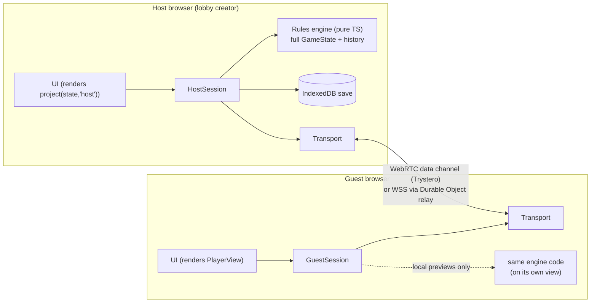
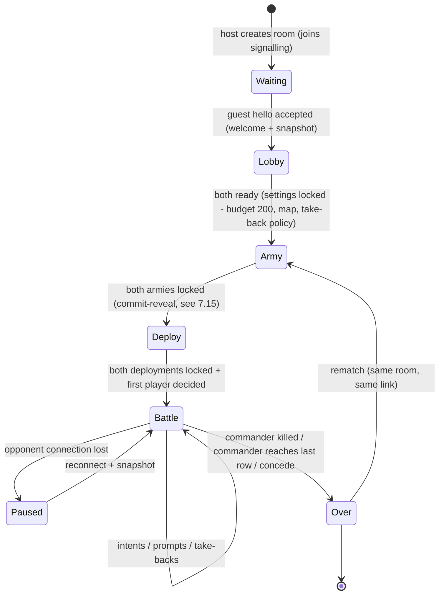
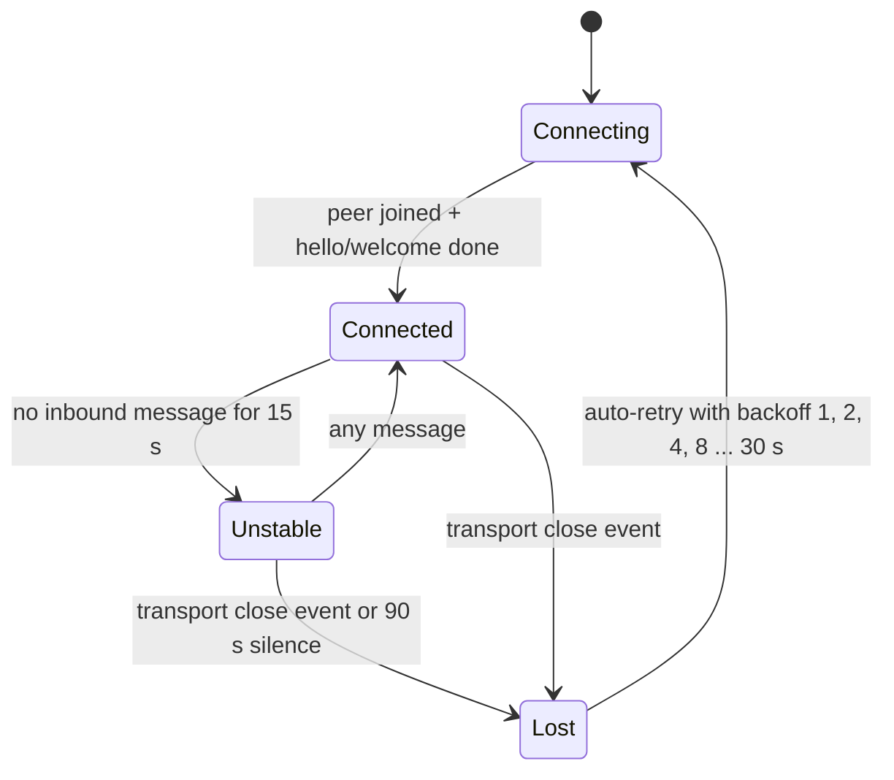
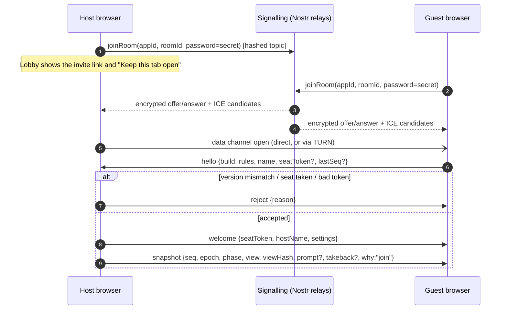
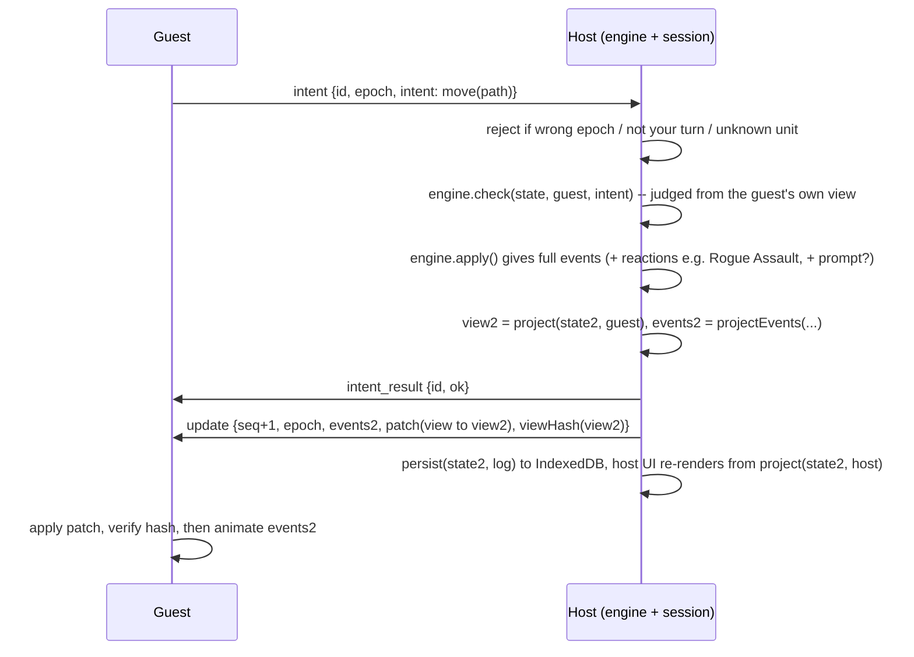
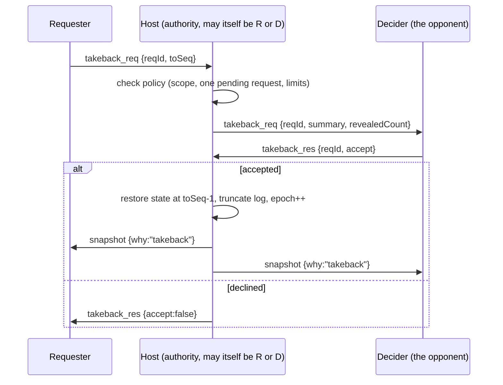

# Multiplayer transport research ("netcode")

| | |
|---|---|
| **Status** | Research complete. Recommendation ready for owner review |
| **Date** | 2026-10-24. Every "current status" claim below was checked on this date |
| **Scope** | How two browsers connect for a 1v1 turn-based game with fog of war, with the least possible setup. Also covers the protocol sketch (lobby link, host authority, snapshots, events, resync, heartbeat, reconnection, take-back) and static hosting |
| **Input** | `docs/SPEC.md` (owner's spec, verbatim) |

**Confidence legend.** Every default and recommendation is tagged:
- **High:** verified in primary documentation or by a live probe, or standard practice.
- **Medium:** a reasoned default, or backed only by secondary sources.
- **Low:** a judgement call that the owner should confirm.

---

## 0. TL;DR

1. **Primary: serverless peer-to-peer.**
   - Library: [Trystero](https://github.com/dmotz/trystero) `0.26.x`, using its default Nostr signalling, over a WebRTC data channel.
   - The browser of the player who creates the lobby (the **host**) runs the rules engine and is the authority.
   - The other player (the **guest**) sends *intents* and receives only *its own fog-filtered view*.
   - Owner networking setup: **none.** No account, server or key.
   - Player setup: **open the invite link.** (High)
2. **Add a free TURN relay before inviting friends.**
   - Vendors report that about **15–20 % of consumer WebRTC connections cannot connect directly** (enterprise networks are worse). Some of these only work through a TURN relay.
   - **No free TURN that works without an account is left** (verified today):
     - PeerJS's built-in TURN hosts (`eu-0/us-0.turn.peerjs.com`) no longer have DNS records.
     - The legacy Open Relay host `openrelay.metered.ca` resolves to blackhole addresses.
     - Open Relay's static-auth host does not accept connections.
   - **Metered** has a free plan (500 MB/month, no card) and a key that works client-side. Setup takes about 5 minutes and is enough for hundreds of games. (High)
3. **Fallback: a tiny Cloudflare Worker + Durable Object (DO) WebSocket relay.**
   - About 60 lines of code, on the free plan, deployed once with `npx wrangler deploy`.
   - It works on any network where HTTPS works and makes reconnection trivial.
   - It is also the **upgrade path to server-authoritative play**: the same TypeScript engine runs inside the DO, and then neither player can peek through the fog.
   - Build it only when needed. The session protocol below doesn't depend on the transport, so the relay drops in. (High)
4. **Hosting: GitHub Pages**, assuming the code lives on GitHub. It is free and needs no server rewrites, because the invite data lives in the URL `#hash`. If the Cloudflare relay is ever deployed, the same Worker can also serve the site. (High)
5. **Running from a local file:**
   - A default Vite build does **not** run from `file://`.
   - A single-file build (`vite-plugin-singlefile`) does, but invite *links* can't point at a local file, so "paste invite" is needed.
   - **`npx vite preview`** is fine for local testing at `localhost`.
   - **LAN/Internet play from `vite preview` is a trap.** Plain `http://192.168.x.x` is not a secure context, so `crypto.subtle` is missing and Trystero fails. It needs HTTPS or a tunnel. (High)
6. **Host-authoritative is acceptable for two friends.**
   - The guest can't peek or make illegal moves.
   - The host *could* peek with devtools.
   - Cheap commit-reveal steps for army, deployment and the first-player coin flip, plus an optional end-of-game audit, make most host cheating *detectable*.
   - The DO upgrade makes it *impossible*. (High)
7. **Rejected:**

   | Option | Reason |
   |---|---|
   | PeerJS public server | Works today (100–190 ms handshake). But it is one volunteer-run server, a multi-minute stall incident from October 2025 is still unanswered, its built-in TURN is dead, and maintenance is light. Kept as plan C. |
   | Croquet/Multisynq | Every client holds the full state, so fog of war is impossible. |
   | Supabase | Free projects pause after 7 idle days. |
   | Render | Sleeps, with about a 1-minute cold start. |
   | Fly / Railway | Not free. |
   | Glitch | Hosting ended July 2025. |
   | Deno Deploy | Shutting down. Announced 2026-10-09. |
   | Hosted PartyKit | Shut down **yesterday**, 2026-10-23. |

---

## 1. What the spec asks of the network layer

| Spec line (verbatim) | Netcode implication |
|---|---|
| "The game, preferably, should be made for the browser, with a way to connect with another player. This should be done in a way that requires the least setup. For now, assume that only another player will play." | Browser only. Exactly two seats. No accounts and no matchmaking. Minimise **both** owner setup (accounts, deploys, keys) and player setup. |
| "Choose to play, in which case he will create a lobby and will have a link to invite another player." | The client creates the room. A shareable URL carries the room identity. The lobby creator is the natural host. |
| "It's a turn-based game. In each player's turn, that player will receive a number of Action points." | Latency barely matters. We need reliable, ordered messages. No client-side prediction or rollback. |
| "Each player will only have vision around the vision field of each unit. Everything outside will be in the fog of war." | **Hidden information.** Each client may only receive what it is allowed to see. That needs an authority plus a per-player *projection*. It rules out lockstep and shared-state models, where every client has everything. |
| "Stealth:1:Only activate this ability if not inside the LOV of another enemy creature. This unit becomes invisible. ..." / "Trip Mine B20:2: Deploy an invisible mine ..." / "Mind's Eye:P: This unit reveals invisible units in its LOV" | Invisibility sits on top of fog. The projection must hide invisible units *even inside line of sight* unless something reveals them. |
| "Assault: When an enemy unit comes into the melee range of this unit, if this unit is in stealth, perform an automatic attack without spending AP to the entering unit. (This can also occur in opponents turn)" | Reactions resolve *inside the other player's action*. The authority resolves them automatically, and their events go to both players, each filtered. |
| "Queso "The Beacon of hope": ... When a unit in that area dies you can choose to sacrifice 1 max toughness to revive that unit with half of its base toughness rounded up" | Mid-resolution choices can fall to the **non-active** player. We need a prompt/response message and an engine that can pause and resume. |
| "There will be a take back option for each player. The opponent player has to accept the take back." | Request/accept handshake. The authority keeps history and can rewind, followed by a full resync. |
| "Army compositions don't have to be made only from the menu option. If a player wants to create a new one when a game starts, he can do so there aswell." | Pre-game phases can be long and asynchronous. Show the opponent's status ("choosing army..."). Room state must survive this. |
| "The player first chooses the units that wants to have for that encounter." / "After that follows a deployment phase: ..." | Simultaneous hidden phases. With host authority this raises a fairness question, covered in §7.15. |
| "The player will have a budget of 200, which can be edited in the future, but for now the default is 200." | Room settings are owned by the host and shown in the lobby. The authority re-validates the guest's army against them. |
| "(NOTE about pathing ...) Ask the player if he wants a unit to go to a mined square. The player can deactivate this warning from options)" | Purely local UI. But it means **the move intent must carry the full chosen path**, because path choice matters. |
| "- Check his achivements" | Stored locally. Not trustworthy in peer-to-peer play, which is fine for now (§9 Q19). |

**Derived requirements.**

| ID | Requirement |
|---|---|
| R1 | Zero or near-zero owner operations. No paid services. |
| R2 | Players only open a link. No install, no account. |
| R3 | Works across typical home networks, ideally also mobile data. |
| R4 | Hidden information is never sent to a client that must not see it. |
| R5 | One authority validates every action. |
| R6 | A game survives reloads and disconnects. |
| R7 | Take-back handshake with rewind. |
| R8 | Prompts can go to either player mid-resolution. |
| R9 | Both players are guaranteed to run the same rules version. |
| R10 | Any round-trip time under about 1 s is fine. The connection should be up within seconds. |

---

## 2. How this was verified (evidence log)

Live probes were run on 2026-10-24 from this development machine, using small self-written scripts and Node built-ins only (no third-party packages executed). The results are a single-location snapshot, not long-term uptime data.

| Probe | Result |
|---|---|
| `GET https://0.peerjs.com/peerjs/id` (PeerJS free cloud) | HTTP 200 in 59 ms, ID issued |
| PeerJS signalling WebSocket until `{"type":"OPEN"}`, 3 runs | 187 / 126 / 105 ms |
| Claim the same PeerJS ID twice | Second claim gets `ID-TAKEN`. After a *clean* close the ID could be reclaimed at +1.1 s |
| DNS `eu-0.turn.peerjs.com`, `us-0.turn.peerjs.com` (PeerJS default TURN) | NOERROR with **no A/AAAA records**, via both Google DNS-over-HTTPS and 1.1.1.1. **Unusable** |
| DNS `openrelay.metered.ca` (legacy free Open Relay) | Resolves to `192.0.2.1` / `100::1` (documentation/discard ranges). **Deliberately retired** |
| `staticauth.openrelay.metered.ca` (documented shared-secret Open Relay) | TCP connect to :80 and :443 timed out. A UDP :80 TURN Allocate got no reply. **Unusable from here** |
| STUN binding `stun.l.google.com:19302`, `stun1.l.google.com:19302` | OK, 7–11 ms |
| STUN binding `stun.cloudflare.com:3478` | OK, 7 ms |
| STUN binding `stun.relay.metered.ca:80` | OK, 43 ms |
| Unauthenticated TURN Allocate `global.relay.metered.ca:80` (UDP and TCP) | `401` challenge (realm `metered.ca`). Alive, needs account credentials |
| Unauthenticated TURN Allocate `turn.cloudflare.com` (3478/udp, 80/tcp) | `401` challenge. Alive, needs credentials minted server-side |
| NAT mapping test: one local socket queried against Google and Cloudflare STUN | Same mapped port from both, i.e. endpoint-independent mapping. This network is STUN-friendly |
| Trystero's 29 default Nostr relays: WebSocket open plus `REQ` | **27/29** answered (`bendernostur.duckdns.org:8443` and `nostr.robosats.org` failed) |
| Trystero's 5 default WebTorrent trackers | 3/5 reachable. **All 3 that Trystero uses by default** were up. `tracker.btorrent.xyz` and `tracker.files.fm` failed |
| Trystero's 4 default MQTT brokers | 4/4 reachable |
| GitHub Pages response headers | `Cache-Control: max-age=600`, so HTML is cached for 10 minutes. This matters for version skew (§7.17) |

**npm registry, latest versions and publish dates:**

| Package | Version | Published |
|---|---|---|
| `trystero` and all `@trystero-p2p/*` | 0.26.0 | 2026-10-04 |
| `peerjs` | 1.5.5 | 2025-06-07 |
| `peer` (PeerServer) | 1.0.2 | 2023-12-05 |
| `partyserver` | 0.5.10 | 2026-08-03 |
| `partysocket` | 1.3.0 | 2026-06-23 |
| `@croquet/croquet` | 2.0.4 | 2025-06-09 |
| `@multisynq/client` | 1.1.0 | 2025-07-24 |
| `@metered-ca/realtime` | 1.2.1 | 2026-10-20 (package created 2026-06-05) |
| `simple-peer` | 9.11.1 | 2022-02-17 |
| `ws` | 8.22.0 | 2026-09-26 |
| `firebase` | 13.1.0 | 2026-10-21 |
| `@supabase/supabase-js` | 2.118.0 | 2026-10-15 |
| `vite` | 8.3.5 | 2026-10-21 |
| `vite-plugin-singlefile` | 2.3.4 | 2026-10-17 |
| `wrangler` | 4.152.0 | 2026-10-22 |

**Latest GitHub commits:**

| Repository | Last commit |
|---|---|
| `dmotz/trystero` | 2026-10-05 |
| `peers/peerjs` | 2025-07-18 (dependency bump) |
| `peers/peerjs-server` | 2025-08-25 (dependency bump) |
| `cloudflare/partykit` | 2026-08-03 |
| `croquet/croquet` | 2026-07-26 |

**Source code read directly:**
- Trystero's `packages/core/src/peer.ts` (default ICE servers), `packages/nostr|torrent|mqtt/src/index.ts` (default relay lists and redundancy), `packages/core/src/utils.ts` (relay selection) and `packages/core/src/crypto.ts` (uses `crypto.subtle`).
- PeerJS's `lib/util.ts` (default config and cloud host).

---

## 3. NAT traversal in one page

```
            (1) signalling: who are you, which codecs/ports? (SDP + ICE candidates)
 Browser A  <------- via a relay: Nostr relays / PeerServer / WebSocket relay ------->  Browser B
     |                                                                                   |
     |--(2) STUN: "what is my public ip:port?" --> stun.l.google.com / stun.cloudflare.com
     |                                                                                   |
     |===(3a) direct UDP "hole punching", DTLS-encrypted ===============================| most pairs
     |                                                                                   |
     '--(3b) TURN relay (UDP, TCP, or TLS on 443) --> turn server -----------------------' when 3a fails
```

- **Signalling and data take different paths.**
  - Signalling services (PeerServer, Nostr relays, a WebSocket relay) only carry the connection setup messages.
  - Game data then flows directly, encrypted with DTLS, or through a TURN relay that cannot read it.
  - The Trystero README says: "Beyond peer discovery, your app's data never touches the strategy medium and is sent directly peer-to-peer and end-to-end encrypted between users." (High)
- **STUN** is a tiny public service that tells a browser its public address. It is free in practice:
  - Google: `stun:stun.l.google.com:19302`, plus `stun1`–`stun4`.
  - Cloudflare: `stun:stun.cloudflare.com:3478`. Cloudflare's FAQ: "Cloudflare's STUN service at `stun.cloudflare.com` is free and unlimited."
  - Both answered today in 7–11 ms. Trystero already uses Google ×3 plus Cloudflare by default. (High)
- **When a direct connection fails:**
  - Both sides are behind *endpoint-dependent ("symmetric")* NATs. This is typical of some mobile carriers and carrier-grade NAT (CGNAT).
  - UDP is blocked, as on corporate, school and some hotel or public Wi-Fi networks.
  - A browser or extension has disabled non-proxied UDP for privacy.
  - The PeerJS FAQ is blunt: between two symmetric NAT users, "NAT traversal is impossible and no connection can be made", except through a TURN relay.
- **How often it fails:**
  - Vendors commonly cite about **15–20 % of consumer WebRTC sessions needing TURN**, and 40–60 % in enterprise settings.
  - No primary measurement study was found, so treat this as order-of-magnitude.
  - Two home-broadband players will usually connect directly. **A guest on a phone hotspot is the classic failure case.** (Medium)
- **TURN over TCP or TLS on port 443** gets through almost every firewall that allows HTTPS. Prefer providers that offer it. Both Cloudflare and Metered do.
- **Our traffic is tiny** (estimate in §7.18), so *any* free TURN quota is effectively unlimited for this game.

### 3.1 Free TURN in October 2026

| Provider | Status (verified 2026-10-24) | Free quota | Owner setup | Credentials usable client-side? | Notes |
|---|---|---|---|---|---|
| PeerJS built-in (`turn:eu-0/us-0.turn.peerjs.com:3478`, user `peerjs` / `peerjsp`) | **Dead.** No DNS records | – | – | Hard-coded | Still in PeerJS 1.5.5 `DEFAULT_CONFIG`, so **PeerJS is effectively STUN-only out of the box** |
| Open Relay legacy (`openrelay.metered.ca`, static `openrelayproject` credentials) | **Retired.** DNS points to `192.0.2.1` / `100::1` | – | – | – | Old tutorials still show it. Don't use |
| Open Relay static-auth (`staticauth.openrelay.metered.ca`, shared secret `openrelayprojectsecret`) | **Unreachable** (TCP 80/443 timeouts) | Unknown | None | Yes (HMAC-derived) | Still documented, but doesn't work. Don't depend on it |
| **Metered** account (`global.relay.metered.ca`, `*.metered.live` credentials API) | **Alive** (401 challenge) | Pricing page: "500 MB monthly TURN usage (ingress + egress)", "No credit card required". The Open Relay page advertises 20 GB/month (a third-party report says that tier needs a card) | Sign up, create an app, copy app name and API key | **Yes.** Metered's own example fetches `https://<app>.metered.live/api/v1/turn/credentials?apiKey=...` from browser JavaScript | The key ships in the bundle, so someone could burn the monthly quota. Low risk; if it happens, direct P2P still works for most pairs |
| **Cloudflare Realtime TURN** (`turn.cloudflare.com`) | **Alive** (401 challenge) | "There is a free tier of 1,000 GB before any charges start", then $0.05/GB, shared with Cloudflare's SFU | Cloudflare account, create a TURN key, deploy a small endpoint that mints credentials | **No.** "You should keep your TURN key on the server side". Credential TTL is at most 48 h | Ports 3478/udp, 443/udp, 3478/tcp, 80/tcp, 5349/tls, 443/tls. Filter out port 53 (blocked by browsers). Whether a card is needed is unverified |
| Self-hosted coturn / eturnal / Pion | n/a | VPS cost | VPS, TLS certificate, firewall | Via shared secret | Not "least setup" |
| Others (ExpressTURN, Xirsys, Turnix, ...) | Not verified | Third-party list (Mar 2026) | Account | Varies | Only if the above fail |

**Recommendation:**
- Use **Metered** while there is no backend (client-side key, 5 minutes).
- Switch to **Cloudflare TURN** if the Cloudflare Worker (§4.5) gets deployed anyway, because minting credentials is then about 15 extra lines.

(High)

### 3.2 Diagnostics worth building into the lobby

```ts
// Which path did the connection take? Works on any RTCPeerConnection (Trystero: room.getPeers()).
export async function connectionPath(pc: RTCPeerConnection) {
  const stats = await pc.getStats();
  let pair: any;
  stats.forEach((s: any) => { if (s.type === 'candidate-pair' && s.nominated && s.state === 'succeeded') pair = s; });
  if (!pair) return { path: 'unknown' as const };
  const local: any = stats.get(pair.localCandidateId);
  return {
    path: local?.candidateType as 'host' | 'srflx' | 'prflx' | 'relay', // relay = TURN in use
    protocol: local?.protocol,                                          // udp / tcp
    rttMs: Math.round((pair.currentRoundTripTime ?? 0) * 1000),
  };
}

// Rough "will I need TURN?" hint: query two STUN servers from one RTCPeerConnection.
// More than one distinct IPv4 server-reflexive port suggests endpoint-dependent (symmetric) NAT.
// This is a heuristic: multi-homed machines can give false positives.
export async function natHint(): Promise<'cone-like' | 'symmetric-like' | 'unknown'> {
  const pc = new RTCPeerConnection({ iceServers: [
    { urls: 'stun:stun.l.google.com:19302' }, { urls: 'stun:stun.cloudflare.com:3478' }] });
  pc.createDataChannel('probe');
  const ports = new Set<number>();
  pc.onicecandidate = (e) => {
    const c = e.candidate;
    if (c?.type === 'srflx' && c.port != null && c.address && !c.address.includes(':')) ports.add(c.port);
  };
  await pc.setLocalDescription(await pc.createOffer());
  await new Promise((r) => setTimeout(r, 2500));
  pc.close();
  return ports.size === 0 ? 'unknown' : ports.size > 1 ? 'symmetric-like' : 'cone-like';
}
```

Show a small badge: "Connected: direct" or "Connected: relayed (TURN)", with the round-trip time. A "Copy debug info" button that includes relay counts, the NAT hint and the path will save hours of remote debugging with friends. (Medium)

---

## 4. Options evaluated

Every option is assessed on:
- Owner setup.
- Player setup.
- Reliability across home NATs.
- Latency.
- Cheat resistance under fog of war.
- Reconnection.
- Take-back support.
- Cost.

Latency is listed, but **for a turn-based game every option is fast enough.** The only latency that users notice is *connection setup time*.

### 4.1 PeerJS with the free public PeerServer (`0.peerjs.com`)

**What it is.** A WebRTC wrapper with a broker server:
1. Each peer registers an ID on the PeerServer over a WebSocket.
2. Another peer calls `peer.connect(id)`.
3. Data flows over a `DataConnection`.

**2026 status (verified):**
- **The cloud server is alive and fast today** (HTTP 200 in 59 ms, WebSocket OPEN in 105–187 ms).
  - It sits behind Cloudflare.
  - The status page monitors only `0.peerjs.com` and showed 200 OK.
  - Library constants: `CLOUD_HOST = "0.peerjs.com"`, `CLOUD_PORT = 443`, key `peerjs`.
  - Docs: "By default, it connects to the free PeerJS Cloud server." and "For production, you can host your own."
  - No SLA, quotas or rate limits are published.
- **Incident history.**
  - Issue [#1350](https://github.com/peers/peerjs/issues/1350), opened 2025-10-14: the server took **6–10 minutes** to send OPEN, intermittently, for several users on different networks.
  - The status page said "all systems operational" throughout.
  - **No maintainer response**, and the issue is still open.
  - Older issues (#423, #462, #693, #851, #939, #977) report earlier outages.
  - Issue [#1367](https://github.com/peers/peerjs/issues/1367), 2026-06-09, notes the public server has **no privacy policy**.
- **Library maintenance is light.**
  - `peerjs` 1.5.5 (2025-06-07) is the only release since May 2024, and there have been none in 2026.
  - Commits since mid-2025 are dependency bumps.
  - There are about 180 open issues.
  - The self-hostable server, `peer` 1.0.2, dates from 2023.
- **The built-in TURN is dead.** The default config still lists `turn:eu-0.turn.peerjs.com:3478` and `turn:us-0.turn.peerjs.com:3478`, but those names have no DNS records. Out of the box, PeerJS is STUN-only.
- The FAQ says the server "may hold a connection offer for up to 5 seconds before rejecting it". Networks that block port 443 can't use the cloud server.

| Criterion | Assessment |
|---|---|
| Owner setup | `npm i peerjs` and nothing else (plus static hosting). TURN is optional (Metered key). |
| Player setup | Open the link. |
| NAT reliability | STUN-only by default (about 80–85 % of pairs by vendor estimates). About 100 % once TURN is configured. |
| Latency / setup time | Signalling about 0.2 s (measured), then ICE takes about 1–3 s (estimate). |
| Fog cheat resistance | Same as any host-authoritative peer-to-peer design (§7.15 threat table). |
| Reconnection | **Fiddly.** The host must re-register the *same* ID; it can be derived from the room ID, e.g. `bg-<roomId>`. After a clean close the ID was free again within about 1 s (measured). After an *unclean* drop the server keeps it until it times out the old socket. The self-hosted default is `alive_timeout` = 60 s; the cloud value is unknown. So expect `ID-TAKEN` for up to about a minute: retry with backoff. The guest must recreate the `DataConnection`. `peer.reconnect()` only restores signalling. |
| Take-back | App-level (same for all transports). |
| Cost | $0. |
| Other | IDs share one namespace across *all* PeerJS users, so use an app prefix plus long random IDs. |

**Verdict: plan C.** It's the simplest API, but it depends on a single volunteer-run server with unanswered incidents and dead defaults. The `Transport` interface (§7.3) keeps a 50-line PeerJS adapter possible if Trystero ever misbehaves. (High)

### 4.2 Trystero: serverless WebRTC with BitTorrent, Nostr, MQTT or IPFS signalling

**What it is.** "Serverless WebRTC matchmaking":
- Peers find each other through *public* networks: Nostr relays (the default), BitTorrent/WebTorrent trackers, MQTT brokers or IPFS.
- Alternatively they use Supabase, Firebase or a self-hosted `ws-relay`.
- It then opens WebRTC data channels.
- It includes rooms, automatic serialisation and chunking, typed "actions", `ping()`, an `onPeerHandshake` admission hook and an `onJoinError` callback.
- Connection setup messages (SDP) are encrypted with AES-GCM using the room `password`.

**2026 status (verified):**
- **Very actively maintained.**
  - Nine releases since March 2026 (0.23.0 to 0.26.0). The latest, 0.26.0, was published 2026-10-04. The last commit was 2026-10-05.
  - 0.23.0 split the library into `@trystero-p2p/*` packages. "The root `trystero` package still defaults to Nostr."
- **Breaking changes happen.**
  - 0.25.0 changed the action API and the room event handlers.
  - 0.26.0 changed the wire format ("requires all peers to upgrade") and added a default 256 MiB receive budget.
  - **Pin an exact version.** Both peers load the same bundle from our site, so wire breaks are invisible to us.
- **Defaults read from source:**
  - ICE servers: `stun:stun.l.google.com:19302`, `stun1`, `stun2` and `stun:stun.cloudflare.com:3478`. **No TURN** (add it with `turnConfig`).
  - **Nostr:** 29 default relays. Each room uses 5, chosen by a *deterministic shuffle seeded by `appId`*, so both peers pick the same 5. 27/29 were alive today.
  - **Torrent:** the first 3 of 5 trackers (all 3 alive).
  - **MQTT:** all 4 brokers (all alive).
  - Tunable with `relayConfig.redundancy` or `relayConfig.urls`.
- README guidance:
  - Nostr is the default because it is "highly decentralized with hundreds of active relays running".
  - The others are ranked "MQTT, BitTorrent, and IPFS, based on robustness".
  - For TURN it suggests Cloudflare's free tier or Open Relay.
- Privacy and security:
  - The announced topic is a SHA-256 hash of library name, `appId` and `roomId`.
  - Relays see hashed topics, encrypted SDP and client IP addresses (like any website does).
  - **The two players see each other's IP addresses.** That's inherent to peer-to-peer and fine between friends.
- **Needs a secure context.**
  - `crypto.subtle` is used for hashing and encryption.
  - Works on `https://`, on `localhost`, and (per the Secure Contexts spec) on `file://`, which still needs testing.
  - **Fails on plain `http://<LAN-IP>`** (§8.4).
- `selfId` is random on every page load (`genId(20)`), so **player identity must come from our own seat tokens**, not the peer ID.

| Criterion | Assessment |
|---|---|
| Owner setup | `npm i trystero@0.26.0`. Pick a unique, permanent `appId`, because it also seeds relay choice. Static hosting. TURN is optional (Metered key, 2 environment variables). |
| Player setup | Open the link. |
| NAT reliability | Same as WebRTC: about 80–85 % with STUN only, about 100 % with TURN. `onJoinError` fires when "peers exchange SDP but WebRTC still cannot establish a direct connection". That gives a clean hook to fall back automatically. |
| Latency / setup time | Relay WebSocket connects took 0.25–1.8 s (measured). A full connection is estimated at about 2–8 s; measure this in the spike (§11). Data round trips are peer-to-peer (tens of ms). |
| Fog cheat resistance | Host-authoritative (§7.15). |
| Reconnection | **Natural.** Rooms are symmetric: either side just calls `joinRoom()` again, and the library reconnects to relays automatically. Identity is handled by seat tokens (§7.11). |
| Background tabs | **Bonus.** Chrome's intensive timer throttling (wake-ups once per minute after 5 min hidden) does *not* apply when "there's an `RTCPeerConnection` with an 'open' `RTCDataChannel`". WebSockets get no such exemption. |
| Take-back | App-level. |
| Cost | $0. |
| Risks | Public relays are run by third parties and can disappear or rate-limit. Since 0.25.4, Trystero backs off rate-limited relays and drops incompatible ones. Bump the pinned version a few times a year to pick up refreshed relay lists. The library releases breaking changes quickly. |

**Verdict: primary.** It needs zero accounts or servers and has redundant signalling. It is actively maintained, can switch signalling backend by changing one import, and has a first-class self-hosted option (`@trystero-p2p/ws-relay`). (High)

### 4.3 A tiny self-hosted WebSocket relay (Node `ws`) on a free tier

Instead of WebRTC, both browsers open a `wss://` connection to a small relay that forwards messages between the two seats.

**Advantages:**
- **No NAT problems at all.** It is plain HTTPS/WSS on 443.
- Reconnection is simple.
- Players don't see each other's IP addresses.
- The relay can keep the last snapshot.

**The catch:** something has to host it, and free hosting has churned badly:

| Host | 2026 status (verified) | What the owner must do | Fit |
|---|---|---|---|
| **Render** (free web service) | Free. "spins down" after "15 minutes without receiving any inbound traffic". Since **2026-02-24**, incoming **WebSocket messages count as traffic**; previously only HTTP did. Spin-up "takes about one minute". 750 free instance-hours per workspace per month. "Render might restart a Free web service at any time." The local filesystem is lost on spin-down. The docs only mention a payment method in the context of overages. | 1. Account (GitHub login). 2. Repo with `server.js` and `package.json`. 3. New Web Service: build `npm ci`, start `node server.js`, Free instance. 4. Put `wss://<name>.onrender.com` in client config. 5. Optionally warm it up: `fetch('/health')` when the host opens the lobby. | Works, but the first join after idle waits about 1 minute, and a restart drops in-memory rooms (the protocol's resync covers that) |
| **Fly.io** | "New organizations don't have a free tier or a monthly free usage allowance." Trial is "up to 2 hours of Machine runtime or 7 days", no card for the trial, then a card is needed. Smallest always-on machine is $2.19 per 30 days. | Account and card, `fly launch`, `fly deploy` | Not free |
| **Railway** | One-time $5 trial credit. Hobby plan is $5/month (includes $5 of usage). | Account, deploy from repo | Not free |
| **Glitch** | **Project hosting ended 2025-07-08.** | – | Gone |
| **Deno Deploy** | Classic was shut down 2026-07-20. On **2026-10-09** Deno announced "the entire Deno team is joining Cloudflare" and that "Deno Deploy will continue operating for six months before shutting down". | – | Avoid |
| **Cloudflare Workers + Durable Objects** | Free plan includes SQLite-backed Durable Objects (details in §4.5) | Cloudflare account, `wrangler deploy` | **Best free relay host.** Not Node `ws`, but the same idea |

Node `ws` relay sketch (for Render, or for a Raspberry Pi at home):

```js
// server.js — dumb two-seat relay. Session/authority logic stays in the host browser.
import http from 'node:http';
import { WebSocketServer } from 'ws';

const ALLOWED_ORIGINS = new Set(['https://<owner>.github.io']);
const server = http.createServer((req, res) => { res.writeHead(200).end('ok'); }); // /health + wake-up
const wss = new WebSocketServer({ server });
const rooms = new Map(); // roomId -> { host?: WebSocket, guest?: WebSocket }

wss.on('connection', (ws, req) => {
  if (!ALLOWED_ORIGINS.has(req.headers.origin ?? '')) return ws.close(1008, 'origin');
  const url = new URL(req.url ?? '/', 'http://relay');
  const roomId = url.searchParams.get('room') ?? '';
  const role = url.searchParams.get('role');
  if (!/^[0-9A-Z]{10}$/.test(roomId) || (role !== 'host' && role !== 'guest')) return ws.close(1008, 'params');
  const room = rooms.get(roomId) ?? {};
  rooms.set(roomId, room);
  room[role]?.close(4000, 'replaced');               // reconnect wins
  room[role] = ws;
  const other = () => room[role === 'host' ? 'guest' : 'host'];
  other()?.send(JSON.stringify({ t: 'peer_joined', role }));
  ws.on('message', (data, isBinary) => { const o = other(); if (o?.readyState === 1) o.send(data, { binary: isBinary }); });
  ws.on('close', () => {
    if (room[role] === ws) delete room[role];
    other()?.send(JSON.stringify({ t: 'peer_left', role }));
    if (!room.host && !room.guest) rooms.delete(roomId);
  });
});
server.listen(process.env.PORT ?? 8080);
```

Trystero's `@trystero-p2p/ws-relay` (`createWsRelayServer({port})`) is a self-hosted *signalling* relay only. Data still goes peer-to-peer, so it does **not** fix NAT failures. It's useful only if the public Nostr relays become a problem.

**Verdict.** The relay pattern is the right fallback, but host it on Cloudflare Durable Objects (§4.5), not Node on Render: no sleep, no cold start, hibernation, generous free limits, and the option of running the engine on the server. (High)

### 4.4 Firebase Realtime Database / Supabase Realtime

They can play two roles:
- **(a) Signalling only**, via the Trystero strategies `@trystero-p2p/firebase` or `@trystero-p2p/supabase`. This adds an account *without* fixing NAT failures. Pointless for us.
- **(b) Message or state relay, replacing WebRTC.** This works on every network.

**Firebase Realtime Database, free "Spark" plan (verified on the pricing and limits pages):**

| | |
|---|---|
| Quotas | 100 simultaneous connections, 1 GB stored, 360 MB/day downloaded ("about 10 GB/month"), about 1,000 writes/s per database. "Multiple databases per project" is not on Spark. |
| Owner setup | 1. Google account, then Firebase console, then add a project. 2. Create a Realtime Database (pick a region). 3. **Write security rules.** Test-mode rules expire after about 30 days, after which "your database rules will deny all requests". 4. Register a web app and paste its config into the client (the config is public by design). 5. Recommended: enable Anonymous Auth so rules can restrict each seat's path. 6. `npm i firebase`. |
| Strengths | The SDK handles offline queueing, automatic reconnect and presence (`onDisconnect`). **The game state persists**, so a game survives both browsers closing. Excellent reliability. |
| Weaknesses | A Google account, a project, security rules and a heavy SDK. **Running the engine on the server** would need Cloud Functions, which require the Blaze (billing) plan. So it stays host-authoritative: the host writes *per-seat views* to per-seat paths, protected by rules. |

**Supabase Realtime, Free plan (verified):**

| | |
|---|---|
| Quotas | 200 concurrent connections, 2 million messages/month, 100 messages/s, 256 KB payload, 2 active projects |
| Main drawback | **Free projects are paused after 1 week of inactivity** and must be restored from the dashboard. For an occasionally played hobby game, a friend's link would silently stop working. |
| Other | "Broadcast" messages are ephemeral; persistence would need Postgres writes. Owner setup: account, project, URL plus anon key. |

**Verdict.**
- **Firebase is a credible "no server code" alternative fallback** if the owner already lives in Google/Firebase.
- **Supabase is not recommended** because of pausing.
- Neither beats a Durable Object relay here, because the DO can later run the engine.

(High)

### 4.5 Cloudflare Durable Objects / PartyKit

**Durable Objects** are single-threaded, stateful objects addressed by name. Our room ID would map to one object with `env.ROOMS.getByName(roomId)`, with built-in storage and WebSockets. The **WebSocket Hibernation API** matters here:
- `ctx.acceptWebSocket(ws, tags)`, `webSocketMessage()`, `webSocketClose()`, `ctx.getWebSockets(tag)`.
- `ctx.setWebSocketAutoResponse(new WebSocketRequestResponsePair("ping","pong"))` answers keep-alives **without waking** the object.

**Free plan limits (verified):**

| Limit | Value |
|---|---|
| Storage backend | "Only Durable Objects with SQLite storage backend are available" on Workers Free |
| Requests | 100,000 / day |
| Duration | 13,000 GB-s / day |
| Rows read | 5 million / day |
| Rows written | 100,000 / day |
| Stored data | 5 GB |
| WebSocket billing | Each connection is a request. "a 20:1 ratio is applied to incoming WebSocket messages". "There is no charge for outgoing WebSocket messages". Hibernation avoids duration charges while idle |
| Over the limit | "further operations of that type will fail with an error". Daily limits "reset at 00:00 UTC" |
| Workers Free | 100,000 requests/day. "Requests to static assets are free and unlimited" |

**Capacity for us.** One game with about 1,500 inbound messages costs about 75 billable requests plus a few connects. That allows roughly **1,000+ games per day** before any limit. (Medium)

**PartyKit (verified).**
- The *hosted* PartyKit platform was shut down on **2026-10-23**. New projects stopped 2026-10-09 and deploys were turned off 2026-10-16.
- "`npx partykit deploy` ... stops working on Fri 23 Oct" even for deploys to your own Cloudflare account.
- The successor is **PartyServer** (`partyserver` 0.5.10, from `cloudflare/partykit`). It has the same model (rooms, connections, hibernation, broadcast), runs as a normal Worker plus DO in *your* account via `npx wrangler deploy`, and "works on the Workers free plan".
- `partysocket` (1.3.0) is a reconnecting WebSocket client with message buffering. It is handy even without PartyServer.

| Criterion | Assessment |
|---|---|
| Owner setup | **One time, about 15–30 min:** 1. Cloudflare account (free). 2. `npm i -D wrangler`. 3. Add `wrangler.jsonc` and `src/worker.ts` (§7.3). 4. `npx wrangler login` (browser OAuth). 5. `npx wrangler deploy`, which gives `https://<name>.<account>.workers.dev`. After that, `npm run deploy`. |
| Player setup | Open the link. |
| NAT reliability | About 100 %: plain WSS on 443. |
| Latency | Edge-routed WebSocket. An object is created near its first client, so tens of ms is typical (estimate). Instant setup, no cold start. |
| Fog cheat resistance | **Relay mode** is host-authoritative, same as peer-to-peer. **Server mode** runs the same pure-TypeScript engine inside the DO; both browsers become thin clients and *neither* can see hidden state. That also makes achievements trustworthy later. |
| Reconnection | Easiest of all: the WebSocket reconnects (e.g. `partysocket`), and in server mode the DO holds the state, so the game no longer needs the host's tab to be open. |
| Take-back | App-level. In server mode the DO keeps the history. |
| Cost | $0 within the free plan. Workers Paid starts at $5/month if ever exceeded. |
| Extras | The same Worker can serve the static site and mint Cloudflare TURN credentials. |
| Risks | Vendor-specific APIs: keep the DO code tiny. Platforms churn: PartyKit's hosted service closed even though it belongs to Cloudflare. |

**Verdict: fallback, and the long-term upgrade path.** (High)

### 4.6 Croquet / Multisynq

**What it is.** "Client-side multiplayer":
- A deterministic *model* runs identically in **every** client.
- A *reflector* server only orders and timestamps input events.
- Multisynq is the decentralised (DePIN) network that hosts reflectors. "By default Croquet runs on the Multisynq DePIN network".

**Status:**
- `@croquet/croquet` 2.0.4 (2025-06-09) and `@multisynq/client` 1.1.0 (2025-07-24). GitHub commits continue through 2026-07.
- An API key comes from `multisynq.io/coder`, and "Multisynq keys are always restricted, you need to add a domain".
- The reflector is self-hostable (Node.js).
- `multisynq.io` returned HTTP 403 to automated fetches. **2026 pricing and limits could not be verified.**

**Fatal mismatch.** Replicated computation means **both browsers hold the complete game state**: every hidden unit, every mine, the opponent's army. Either player can read it with devtools. There is no per-player projection. It's great for open-information apps such as whiteboards or chess, and wrong for fog of war.

| Owner setup | Account, domain-restricted key, and the game written as Croquet Model/View classes. |
|---|---|

**Verdict: not suitable.** (High)

### 4.7 Also considered

| Option | Notes | Verdict |
|---|---|---|
| **Metered Realtime SDK** (`@metered-ca/realtime`) | New. Created 2026-06-05; 1.2.1 published 2026-10-20. A PeerJS-like room API using Metered's signalling (free: 100 connections and 100,000 messages/month), with Open Relay TURN injected automatically (20 GB/month). Needs an account and a publishable `pk_live_...` key. One key gives both signalling and TURN, but it is very young and single-vendor. | Re-evaluate in 2027 (Medium) |
| `simple-peer` | Last release 2022. | Unmaintained |
| Manual copy-paste of SDP | Truly zero infrastructure, but players exchange two long text blobs, and hard NATs still need TURN. | Debug tool only |
| Public MQTT brokers or Nostr relays as the *data* relay | Technically possible (encrypted, low volume), zero setup. But the brokers are explicitly "for testing", give no delivery guarantees, and it bends their intended use. | No |
| Hosted pub/sub (Ably, Pusher, PubNub), game backends (Colyseus, Nakama), WebTransport | All need accounts or servers. No advantage for two-player turn-based play. | Not researched in depth |

---

## 5. Side-by-side

| Option | Owner setup | Player setup | Home-NAT reliability | Connect time | Fog cheat resistance | Reconnection | Cost | Longevity risk | Verdict |
|---|---|---|---|---|---|---|---|---|---|
| **Trystero (Nostr) + STUN** | None | Open link | About 80–85 % of pairs (vendor est.) | About 2–8 s (est.) | Host-authoritative | Rejoin room + seat token | $0 | Medium (public relays, fast-moving library) | **Primary** |
| **+ Metered TURN** | 5-min signup, 2 environment variables | Open link | About 99 %+ | +0–2 s when relayed | Host-authoritative | Same | $0 (500 MB/mo) | Medium (exposed key, quota) | **Recommended add-on** |
| PeerJS + `0.peerjs.com` | None | Open link | STUN-only by default (built-in TURN dead) | About 1–4 s (est.) | Host-authoritative | Re-register ID (`ID-TAKEN` window) | $0 | High (single server, stale) | Plan C |
| Node `ws` relay on Render | Account, repo, service | Open link (about 1 min wait if asleep) | About 100 % | <1 s warm, about 60 s cold | Host-auth (server-auth possible) | Easy, but restarts drop rooms | $0 (sleeps) | Medium | Inferior to DO |
| Fly.io / Railway relay | Account + card | Open link | About 100 % | <1 s | Either | Easy | About $2–5/mo | Low–Medium | No (not free) |
| Glitch / Deno Deploy | – | – | – | – | – | – | – | Shut down / shutting down | No |
| **Cloudflare DO relay** | Cloudflare account + `wrangler deploy` (once) | Open link | About 100 % | <1 s | Host-auth, **server-auth possible** | Easiest | $0 | Low–Medium (vendor API) | **Fallback / upgrade** |
| Hosted PartyKit | – | – | – | – | – | – | – | Shut down 2026-10-23 | No (PartyServer is a DO) |
| Firebase RTDB relay | Google account, project, rules, config | Open link | About 100 % | <1 s | Host-auth (server-auth needs Blaze) | Excellent, persistent | $0 (Spark) | Low | Alternative fallback |
| Supabase Realtime | Account, project, key | Open link | About 100 % | <1 s | Host-auth | Good | $0 | Medium (7-day pause) | No |
| Croquet / Multisynq | Account, domain key, rewrite as replicated model | Open link | About 100 % | <1 s | **None** (all state on every client) | Built-in | Free dev keys? (2026 terms unverified) | Medium–High | No |

Take-back is implemented in the application on top of whichever transport (§7.13), so it does not differentiate the options. What differs is *where the history lives*: in the host's browser, or on the server in DO server mode.

---

## 6. Recommendation

### 6.1 Primary and fallback

| | Primary: "no server" | Fallback / upgrade: "tiny relay" |
|---|---|---|
| Transport | Trystero 0.26.x (Nostr signalling), WebRTC data channel | WebSocket to a Cloudflare Worker + Durable Object (one object per room) |
| Authority | Host browser (lobby creator) | Host browser (relay mode), later the DO (server mode) |
| NAT | STUN plus Metered TURN key | Not applicable (WSS 443) |
| Owner setup | Static hosting only. Optional 5-minute Metered signup | Cloudflare account and one `npx wrangler deploy` |
| Cost | $0 | $0 (free plan) |

**Phases:**
1. **Phase 1 (now):** Trystero peer-to-peer, plus the Metered TURN key (optional but recommended before friends test), plus GitHub Pages.
2. **Build the fallback when any of these happens:**
   - A real pair of players can't connect even with TURN.
   - The public relays prove flaky in practice.
   - The owner wants fog that can't be peeked at, or trustworthy achievements.
   - Games should survive the host closing the tab.
3. **Phase 2:** add the DO relay and a "P2P first, relay second" switch in the client (§6.2). The session protocol is unchanged.
4. **Phase 3 (optional):** server-authoritative mode, with the engine running in the DO.

**If the owner would rather create one Cloudflare account now** in exchange for maximum robustness, swap the order: make the DO relay primary and host the site on the same Worker, with peer-to-peer as the backup. That is a fully legitimate choice. The protocol and the 15–30 minute one-time setup are the same.

### 6.2 Automatic fallback (Phase 2)

- **The host listens on both transports at once.** It joins the Trystero room *and* opens the DO room socket. A `MultiTransport` merges the peers from both.
- **The guest tries peer-to-peer first.** It switches to the relay if:
  - no `welcome` arrives within 12 s, or
  - Trystero's `onJoinError` reports an ICE failure, or
  - the invite carries `?via=relay`.
- The first `welcome` wins, and the other attempt is closed.
- The session layer never knows which transport is in use. (Medium)

### 6.3 Host authority is acceptable for this game, stated explicitly

- The **guest cannot cheat**:
  - It never receives hidden state, so it has nothing to peek at.
  - Every intent is validated by the host, so it cannot make illegal moves.
- The **host can technically peek** at fog with devtools, and could run a modified engine.
- For two friends, that is an acceptable trust model. Every peer-to-peer and relay-only design has it, and it's the same trust you extend to a friend sitting across a physical board.
- §7.15 adds cheap commit-reveal steps and an optional post-game audit that make *pre-game counter-picking* and *rule tampering* detectable.
- Only server authority (Phase 3) removes peeking.

(High)

---

## 7. Protocol and architecture sketch

### 7.1 Layers



- **Engine:** pure functions only.
- **Session:** handshake, sequence numbers, persistence, take-back, prompts.
- **Transport:** moves envelopes and nothing else.

Keeping these apart is what makes transport swaps, offline tests and server mode cheap. (High)

### 7.2 The engine contract the netcode relies on

```ts
// engine/ — deterministic: no DOM, no timers, no Math.random (seeded RNG if ever needed), integer math only.
export type Seat = 'host' | 'guest';

export interface Engine {
  createMatch(setup: MatchSetup): GameState;
  // Legality is judged from what `seat` can see. Conflicts with hidden state are NOT rejections:
  // they are resolved inside apply() as game events (e.g. movement interrupted by an unseen unit).
  check(state: GameState, seat: Seat, intent: Intent): { ok: true } | { ok: false; code: RejectCode };
  apply(state: GameState, seat: Seat, intent: Intent): ApplyResult;
  project(state: GameState, seat: Seat): PlayerView;                       // fog/stealth/mine filter
  projectEvents(events: GameEvent[], seat: Seat, before: GameState, after: GameState): VisibleEvent[];
  resolvePrompt(state: GameState, promptId: string, choice: unknown): ApplyResult; // resumable resolution
}
export interface ApplyResult { state: GameState; events: GameEvent[]; prompt?: PendingPrompt }
```

**Why not lockstep** (both clients simulate and only inputs are exchanged)? In lockstep both clients hold the full state, so fog leaks to both. The same reason rules out Croquet. **Host authority plus per-seat projection is the correct model for hidden information.** (High)

### 7.3 Transport interface and implementations

```ts
export type PeerId = string;
export interface Transport {
  readonly kind: 'p2p' | 'relay' | 'loopback' | 'tabs';
  send(to: PeerId, msg: Envelope): void;
  onMessage: ((from: PeerId, msg: Envelope) => void) | null;
  onPeerJoin: ((peer: PeerId) => void) | null;
  onPeerLeave: ((peer: PeerId) => void) | null;
  onProblem: ((p: { kind: 'signalling' | 'ice-failed' | 'closed'; detail?: string }) => void) | null;
  close(): void;
}
```

**Trystero (primary):**

```ts
import { joinRoom } from 'trystero'; // package.json: "trystero": "0.26.0"  (exact pin)

const APP_ID = 'boardgame-<owner>-v1'; // unique and permanent: it also seeds which 5 Nostr relays are used

export async function createP2PTransport(roomId: string, secret: string): Promise<Transport> {
  const turn = await fetchTurnServers().catch(() => [] as RTCIceServer[]);
  const t: Transport = { kind: 'p2p', onMessage: null, onPeerJoin: null, onPeerLeave: null,
                         onProblem: null, send: () => {}, close: () => {} };
  const room = joinRoom(
    { appId: APP_ID, password: secret, turnConfig: turn },       // password encrypts SDP (AES-GCM)
    roomId,
    { onJoinError: (d) => t.onProblem?.({ kind: 'ice-failed', detail: String(d.error) }) },
  );
  const channel = room.makeAction<Envelope>('m');                 // one channel for all protocol messages
  channel.onMessage = (data, { peerId }) => t.onMessage?.(peerId, data);
  room.onPeerJoin = (p) => t.onPeerJoin?.(p);
  room.onPeerLeave = (p) => t.onPeerLeave?.(p);
  t.send = (to, m) => { void channel.send(m, { target: to }); };
  t.close = () => room.leave();
  return t;
}

// Metered free TURN (client-side key by design; Vite exposes VITE_* to the bundle)
async function fetchTurnServers(): Promise<RTCIceServer[]> {
  const app = import.meta.env.VITE_METERED_APP, key = import.meta.env.VITE_METERED_KEY;
  if (!app || !key) return [];
  const r = await fetch(`https://${app}.metered.live/api/v1/turn/credentials?apiKey=${key}`);
  return r.ok ? r.json() : [];
}
```

- Before launch, log `getRelaySockets()` and check that the 5 relays your `appId` maps to are healthy.
- If they aren't, change the `appId` (only before real users exist), or pass `relayConfig: { urls: [...] }` with known-good relays.
- If the invite carries a non-default strategy (e.g. `?sig=mqtt`), dynamically import `@trystero-p2p/mqtt`. **Both peers must use the same strategy.**

(High)

**Cloudflare Durable Object relay (fallback):**

```ts
// src/worker.ts — dumb two-seat pipe; the host stays authoritative. Verify API names against current docs.
import { DurableObject } from 'cloudflare:workers';

interface Env { ROOMS: DurableObjectNamespace<Room>; ASSETS: Fetcher; TURN_KEY_ID?: string; TURN_KEY_API_TOKEN?: string }

export default {
  async fetch(req: Request, env: Env): Promise<Response> {
    const url = new URL(req.url);
    const m = url.pathname.match(/^\/room\/([0-9A-Z]{10})$/);
    if (m && req.headers.get('Upgrade') === 'websocket') return env.ROOMS.getByName(m[1]).fetch(req);
    if (url.pathname === '/turn' && env.TURN_KEY_ID) return mintTurn(env);   // optional, see below
    return env.ASSETS.fetch(req);                                            // optional: serve the static site
  },
};

export class Room extends DurableObject<Env> {
  constructor(ctx: DurableObjectState, env: Env) {
    super(ctx, env);
    // Keeps client<->relay sockets alive without waking the object (no duration billed).
    ctx.setWebSocketAutoResponse(new WebSocketRequestResponsePair('{"t":"ka"}', '{"t":"ka"}'));
  }
  async fetch(req: Request): Promise<Response> {
    const role = new URL(req.url).searchParams.get('role');
    if (role !== 'host' && role !== 'guest') return new Response('bad role', { status: 400 });
    // Hardening (optional): require ?k=HMAC(secret, role) registered by the first host connection.
    for (const old of this.ctx.getWebSockets(role)) old.close(4000, 'replaced');   // reconnect wins
    const { 0: client, 1: server } = new WebSocketPair();
    this.ctx.acceptWebSocket(server, [role]);                                       // hibernatable, tagged
    for (const p of this.other(role)) p.send(JSON.stringify({ t: 'peer_joined', role }));
    return new Response(null, { status: 101, webSocket: client });
  }
  webSocketMessage(ws: WebSocket, data: string | ArrayBuffer) {
    const [role] = this.ctx.getTags(ws);
    for (const p of this.other(role)) p.send(data);
  }
  webSocketClose(ws: WebSocket) {
    const [role] = this.ctx.getTags(ws);
    for (const p of this.other(role)) p.send(JSON.stringify({ t: 'peer_left', role }));
  }
  private other(role: string) { return this.ctx.getWebSockets(role === 'host' ? 'guest' : 'host'); }
}

async function mintTurn(env: Env): Promise<Response> {     // Cloudflare TURN: key stays server-side
  const r = await fetch(`https://rtc.live.cloudflare.com/v1/turn/keys/${env.TURN_KEY_ID}/credentials/generate-ice-servers`, {
    method: 'POST',
    headers: { Authorization: `Bearer ${env.TURN_KEY_API_TOKEN}`, 'Content-Type': 'application/json' },
    body: JSON.stringify({ ttl: 4 * 3600 }),                // max 48 h per Cloudflare FAQ
  });
  const { iceServers } = await r.json<{ iceServers: RTCIceServer[] }>();
  for (const s of iceServers) if (Array.isArray(s.urls)) s.urls = s.urls.filter((u) => !/:53(\?|$)/.test(u)); // port 53 is browser-blocked
  return Response.json(iceServers, { headers: { 'Access-Control-Allow-Origin': '*' } });
}
```

```jsonc
// wrangler.jsonc
{
  "name": "boardgame",
  "main": "src/worker.ts",
  "compatibility_date": "2026-10-01",          // >= 2026-04-07 gets automatic Close-frame replies
  "assets": { "directory": "./dist", "binding": "ASSETS", "run_worker_first": ["/room/*", "/turn"] },
  "durable_objects": { "bindings": [{ "name": "ROOMS", "class_name": "Room" }] },
  "migrations": [{ "tag": "v1", "new_sqlite_classes": ["Room"] }]   // SQLite class = Free-plan eligible
}
```

- Secrets: `npx wrangler secret put TURN_KEY_API_TOKEN`.
- The client side of the relay is `new WebSocket('wss://<worker>/room/<roomId>?role=guest')` with reconnect and backoff, or `partysocket`.
- `peer_joined` and `peer_left` are mapped to the `Transport` callbacks.

(High for the overall shape; Medium for exact API spellings, which should be checked at implementation time.)

**For tests:**
- `LoopbackTransport`: in memory, two sessions in one page.
- `TabsTransport`: `BroadcastChannel`, two tabs with no network at all.

Build these **first**, so the whole protocol and engine can be developed and unit-tested offline. They also give a free "hotseat" mode. (High)

### 7.4 Invite link format and room identity

```
https://<owner>.github.io/<repo>/#/join/9F3KQ2M7TX/Q2xhdWRlUm9ja3NIZXJlISE
                                       \roomId--/ \--------secret------/
```

| Part | Format | Purpose |
|---|---|---|
| `roomId` | 10 characters of Crockford base32 from `crypto.getRandomValues` (about 50 bits) | Trystero room name, DO name, and human-readable code shown as `9F3K-Q2M7-TX` ("does your friend see the same code?") |
| `secret` | 22 characters of base64url (128 bits) | Trystero `password` (encrypts SDP) and proof of invitation. Never sent to any server in plaintext |
| Optional `?via=relay` | flag | Force the relay transport |
| Optional `&sig=mqtt` | strategy name | Non-default signalling strategy; both peers must match |
| Optional `&v=1` | number | Protocol hint |

**Why the `#fragment`:**
- It is **never sent to the HTTP server**. GitHub Pages and CDN logs don't see it, and link-preview bots don't receive it.
- It needs **no server rewrites** (GitHub Pages has none for single-page apps).
- It works the same on `file://`.

**Other link rules:**
- The **host's own resume URL** is `#/host/9F3KQ2M7TX`. The secret stays in the host's storage, so a reload resumes the room.
- The link is valid for the room's lifetime, including rematches.
- There is **one guest seat** (§9 Q3).
- UI: a "Copy link" button, `navigator.share()` on mobile, and optionally a QR code for phone players.
- **Tell the host clearly: "Keep this tab open until your friend joins."** In peer-to-peer mode, the host's browser *is* the server.

(High for the fragment and random tokens; Medium for the exact layout.)

### 7.5 Session lifecycle



Connection status, shown as a small badge on both sides:



### 7.6 Message catalogue

```ts
export const PROTOCOL = 1;
interface Msg<T extends string, B> { v: typeof PROTOCOL; t: T; b: B }

// ---------- guest -> host ----------
type Hello        = Msg<'hello', { build: string; rules: number; name: string; seatToken?: string; lastSeq?: number; epoch?: number }>;
type Ready        = Msg<'ready', { phase: 'lobby' | 'army' | 'deploy'; ready: boolean }>;
type ArmySubmit   = Msg<'army', { commander: CommanderId; units: UnitTypeId[] }>;        // validated vs budget by host
type DeploySubmit = Msg<'deploy', { placements: { unit: UnitId; at: Square }[] }>;        // validated vs zones by host
type IntentMsg    = Msg<'intent', { id: string; epoch: number; intent: Intent }>;
type PromptReply  = Msg<'prompt_reply', { promptId: string; choice: unknown }>;
type ResyncReq    = Msg<'resync', { lastSeq: number; reason: 'gap' | 'hash' | 'reconnect' }>;

// ---------- host -> guest ----------
type Welcome      = Msg<'welcome', { seatToken: string; hostName: string; settings: RoomSettings }>;
type Reject       = Msg<'reject', { reason: 'version' | 'full' | 'bad-token' | 'closed'; hostBuild?: string }>;
type Settings     = Msg<'settings', { settings: RoomSettings; ready: Record<Seat, boolean> }>;
type Snapshot     = Msg<'snapshot', { seq: number; epoch: number; phase: Phase; view: PlayerView; viewHash: string;
                                      prompt?: PromptBody; takeback?: TakebackBody; why: 'join' | 'resync' | 'takeback' }>;
type Update       = Msg<'update', { seq: number; epoch: number; cause?: string /* intent id */;
                                    events: VisibleEvent[]; patch: ViewPatch; viewHash: string }>;
type IntentResult = Msg<'intent_result', { id: string; ok: boolean; code?: RejectCode }>;
type Prompt       = Msg<'prompt', PromptBody>;      // { promptId, kind: 'queso_revive' | ..., data, deadline? }
type GameOver     = Msg<'game_over', { winner: Seat; reason: 'commander_killed' | 'commander_last_row' | 'concede' | 'abandon' }>;
type Audit        = Msg<'audit', { initial: GameState; log: LoggedIntent[]; salts: Record<Seat, string> }>; // after game over only

// ---------- both directions ----------
type Commit       = Msg<'commit', { phase: 'coin' | 'army' | 'deploy'; hash: string }>;   // SHA-256(payload || salt)
type CoinReveal   = Msg<'coin_reveal', { nonce: string }>;
type Ping         = Msg<'ping', { n: number; t: number }>;
type Pong         = Msg<'pong', { n: number; t: number }>;
type Presence     = Msg<'presence', { state: 'active' | 'hidden' }>;
type TakebackReq  = Msg<'takeback_req', TakebackBody>;  // { reqId, toSeq, summary, revealedCount? }
type TakebackRes  = Msg<'takeback_res', { reqId: string; accept: boolean }>;
type Chat         = Msg<'chat', { text: string }>;
type Bye          = Msg<'bye', { reason: 'leave' | 'replaced' | 'game_over' }>;

// ---------- intents (what a player wants; the host decides what happens) ----------
type Intent =
  | { k: 'move';    unit: UnitId; path: Square[] }   // explicit orthogonal path: mines, Assault and reveals depend on it
  | { k: 'attack';  unit: UnitId; target: Square }   // target a SQUARE so fogged/mined squares can be attacked
  | { k: 'defend';  unit: UnitId }
  | { k: 'ability'; unit: UnitId; ability: AbilityId; targets?: Square[] }
  | { k: 'end_turn' }
  | { k: 'concede' };
```

- Serialisation is plain JSON. Trystero serialises objects itself; the relay sends strings.
- Every message carries `v` (protocol version).
- Unknown `t` values are ignored, which leaves room for forward-compatible additions.

(High)

**Move paths.** The spec says "The movement is orthogonal, a movement-piece cannot be diagonal" (line 34) but also "movement (1 square by default, including diagonals)" (line 15). The rules analysis will settle that. **The protocol carries an explicit path either way**, so the network layer doesn't depend on the answer.

### 7.7 Join and snapshot



The **snapshot** contains:
- protocol, build and rules versions;
- room settings;
- phase, turn number, active seat, and the active seat's remaining AP if public (§9 Q9);
- the guest's `PlayerView`: terrain (known to both, §9 Q8), the guest's own units in full, visible enemy units, visible effects, and objective status;
- the guest's own submitted army and deployment, if a pre-game phase is in progress;
- any pending prompt or take-back;
- `seq`, `epoch` and `viewHash`.

Size: about 5–30 KB of JSON (§7.18). (High)

### 7.8 Intent, validation, events and projection



Rules:
1. **Rejection reasons are computed from the requester's view only.** An error like "square occupied" would leak an unseen unit.
2. **Conflicts with hidden state become events**, not errors. Examples: movement stops before an unseen blocker, which is then revealed; a hidden mine explodes; an Assault triggers. (Medium; the rule consequences are owner questions §9 Q12–Q13.)
3. **Events are cosmetic** (animation, log). **The patch and hash are authoritative.** A missed or misread event can never desync a client: the patch fixes the state.
4. **The host plays through the same pipeline.** Its own intents go through `check` and `apply`, and its UI renders `project(state,'host')`. So the host UI never *shows* hidden information, even though the memory holds it.
5. **Intents are idempotent.** The guest generates `id`. The host caches results per epoch and answers a retransmitted intent from the cache, which matters after reconnects.
6. **No optimistic application on the guest.** It shows a pending state until `update` arrives, which takes tens to hundreds of ms. The guest may use the engine locally *only* for previews: highlighting reachable squares and legal targets from its own view.

(High)

### 7.9 Sequence numbers, epochs, hashes and resync

| Item | Meaning |
|---|---|
| `seq` | Increments by one per `update`, per guest. |
| `epoch` | Increments when the timeline is rewritten (take-back). Updates and intents from an old epoch are dropped. |
| `viewHash` | SHA-256 (via `crypto.subtle`), truncated, over canonical JSON (sorted keys) of the guest's `PlayerView`. |

**Resync triggers on the guest:**
- `seq !== lastSeq + 1`;
- an unexpected epoch change;
- a hash mismatch after applying a patch;
- any reconnect.

The guest sends `resync`, and the host answers with a **full `snapshot`**. Snapshots are small, so the simplest correct design is "always send a snapshot to resync". Replaying a small buffer of recent updates is an optimisation for later.

**Order and reliability.**
- WebRTC data channels in Trystero and WebSockets are both reliable and ordered.
- Gaps only happen across reconnects.
- No acknowledgements are needed. An optional `ack {seq}` lets the host trim buffers.

(High)

### 7.10 Heartbeat and presence

- Send `ping` every **5 s** in both directions and answer with `pong`. Show the round-trip time. Trystero also offers `room.ping(peerId)`.
- **Unstable** after 15 s without *any* inbound message. **Lost** on a transport close event or after **90 s** of silence. A timeout above 60 s is deliberate: Chrome throttles chained timers in tabs hidden for more than 5 minutes to one wake-up per minute, *unless an `RTCDataChannel` is open* (Chrome's documentation). The relay transport doesn't get that exemption.
- On `visibilitychange`, send `presence: hidden/active`, so the other side shows "Opponent switched tabs" instead of "Disconnected".
- Mobile browsers may suspend background tabs entirely. Treat that as a reconnect, not as an error.
- On the DO relay, the auto-response keep-alive (§7.3) keeps each client's socket to the relay alive without waking the object. The app-level `ping`/`pong` still travels end to end.

(High for the mechanism; Medium for the exact timings.)

### 7.11 Reconnection scenarios

| Scenario | What happens | Confidence |
|---|---|---|
| Guest network blip | Trystero fires `onPeerLeave` on the host, which shows "Opponent disconnected — waiting". The guest keeps retrying (Trystero reconnects relays automatically; the session re-calls `joinRoom` after `peer_left` plus backoff). On rejoin: `hello{seatToken,lastSeq}`, then `welcome` and `snapshot`. | High |
| Guest reload or tab crash | The guest reads `join:<roomId>` = {secret, seatToken, name} from `localStorage`, then the same flow as above. | High |
| Guest switches device (no token) | The seat is taken, so the host gets a prompt: "A new device wants to take the guest seat. Allow?" If allowed, a new token is issued and the old one is revoked. | Medium |
| Host network blip | The guest shows "Host disconnected". The host session re-joins, and the guest, seeing a new peer, sends `hello`, then gets `snapshot`. | High |
| Host reload | The host loads `room:<roomId>` from IndexedDB (§7.12) and resumes from its last saved state. Then as above. **Only one host tab per room is allowed**: use the Web Locks API (`navigator.locks.request('host:'+roomId, {ifAvailable:true}, ...)`). | High |
| Host closed for hours | The game is paused. The guest sees "Host is offline — they need to reopen the game". When the host returns, the **same link still works**. | High |
| Both closed | The host resumes from its save. The guest's token is still in its storage. | High |
| A third person with the link | Trystero's `password` admits only people with the link. The seat is already taken, so they get `reject{full}` (spectators come later). | High |
| Relay restart (Render/DO) | Sockets drop, clients reconnect, and resync. The host is authoritative, so nothing is lost. | High |
| Deploy happened in between | Version check: `reject{version}` and the message "reload to update" (§7.17). | High |

**Policy defaults.**
- No automatic forfeit. Either player may click "Abandon", which counts as conceding.
- An optional "claim win after N minutes of disconnection" comes later. (Medium, §9 Q18)

**Same-browser testing pitfall.** Host and guest tabs on one origin **share `localStorage` and IndexedDB**.
- Key everything by role: `room:` for the host, `join:` for the guest.
- Keep "which role is this tab" in `sessionStorage`.
- If a host save exists for the room being joined, ask: "You're hosting this room in another tab — join as guest anyway?"

(High)

### 7.12 Persistence

**Host, in IndexedDB** (e.g. via the tiny `idb-keyval`), under `room:<roomId>`:
- `secret`, settings, seats `{guestTokenHash, guestName}`;
- `state`, plus `log` (intents with seq and epoch), plus snapshots at turn starts (for take-back and fast replay);
- commitments and salts (§7.15);
- protocol and rules versions.

It is saved after every applied intent. Each save is a few KB to a few hundred KB. `localStorage` (about 5 MB) would be too tight once history is included.

**Guest, in `localStorage`**, under `join:<roomId>`:
- `secret`, `seatToken`, `name`, `lastSeq`;
- optionally the last view, for read-only board viewing while the host is offline.

**Cleanup.** Keep finished rooms for 7 days for rematch or replay export, then delete them.

**Saves record the rules version.** Resuming a save made with older rules should warn or refuse (§7.17).

(High)

### 7.13 Take-back protocol

Spec: "There will be a take back option for each player. The opponent player has to accept the take back."



When the host is the requester or the decider, that leg is a local call instead of a message.

**Defaults (Medium; owner to confirm in §9 Q14–Q15):**

| Rule | Default |
|---|---|
| Scope | The requester may undo **their own most recent action in the current turn**, repeatedly, one action per request. They may also undo **"end turn"**, if the opponent hasn't acted yet. Nothing that comes after an opponent action can be undone. |
| What gets undone | Everything caused by the undone action: reactions (Assault), triggered mines, prompts already answered. |
| What the decider sees | The decider's dialog says: "Undo: Berserker attacks Footman (−12)". **It also flags information the action revealed**, for example "This move let them see 2 of your units". That information concerns the decider's own units, so showing it leaks nothing, and it lets them refuse scouting abuse. |
| Requests | One pending request at a time, with a 10 s cooldown after a decline. The lobby setting "take-backs per game" defaults to unlimited; 3, 1 or 0 are alternatives. |
| Fog | Rewind restores the state, but a player can't "unsee" things. The UI should remove any last-seen markers that came from the undone action. |
| Mechanism | The host keeps a snapshot at each turn start and replays the log up to `toSeq-1`. The engine is deterministic, so this is cheap and exact. |

### 7.14 Mid-resolution prompts for either player

Spec: "When a unit in that area dies you can choose to sacrifice 1 max toughness to revive that unit ..." The unit can die during the *opponent's* turn, so the decision belongs to the non-active player.

- `apply()` returns a `prompt`. The host stores a `pending` state and sends `prompt {promptId, kind:'queso_revive', data:{unit, cost}}` to the deciding seat. It resolves locally if the host is the decider.
- The active player sees "Opponent is deciding (Queso: revive?)". Intents are blocked until `prompt_reply` arrives, which calls `engine.resolvePrompt()`.
- **Default: no timeout while the decider is connected.** If the lobby enables a turn timer, the prompt auto-declines after 60 s. A pending prompt is part of the snapshot, so it survives reconnects. (Low; §9 Q16)
- **Automatic reactions don't prompt.** Rogue Assault, Kulega regeneration and Pajazon end-of-turn damage resolve inside `apply()`.

### 7.15 Pre-game fairness: commit-reveal

**Threat table for host authority:**

| Threat | Can the guest do it? | Can the host do it? | Mitigation |
|---|---|---|---|
| See hidden enemy units or mines | No (never receives them) | **Yes** (devtools) | Accept for friends. Server mode removes it |
| Make illegal moves | No (host validates) | Yes, with a modified client | Post-game audit detects it. Server mode prevents it |
| Counter-pick army or deployment after seeing the opponent's | No | **Yes**, unless it commits first | Commit-reveal (below) |
| Rig "random" choices (first player) | – | Yes, if the host generates them | Commit-reveal coin flip |
| Use take-back to scout | Needs the opponent's acceptance | Same | "Revealed info" warning in the dialog (§7.13) |
| Fake achievements | Yes (local) | Yes | Accept: local only |
| Tamper with traffic in transit | – | – | DTLS or WSS encryption |

**Coin flip for the first player (§9 Q7):**
1. Both players send `commit{coin, SHA-256(nonce)}`.
2. Once both commitments are in, both send `coin_reveal{nonce}`.
3. Each side checks the other's hash. The first player is the low bit of `nonceA XOR nonceB`.

No one can bias it. (High)

**Army and deployment:**
1. The **host sends `commit{army, SHA-256(hostArmy || salt)}` *before* the guest submits its army in clear.** The host needs the guest's army in clear to adjudicate.
2. Deployment uses the same pattern.
3. After `game_over`, the host reveals its salts and initial state in `audit`.
4. The guest checks the hashes and replays the whole log with the same engine, verifying every `viewHash` it received.
5. The result is a "Verified ✓" badge or a clear "Game record mismatch" warning.

This makes counter-picking and rule tampering detectable. It cannot stop in-battle peeking. Cost: about 40 lines plus the audit replay. (Medium; optional for v1, cheap to add)

### 7.16 Game end, replay and rematch

- `game_over {winner, reason}`. Reasons: commander killed, commander reaches the last row, concede, or abandon.
- The optional `audit` follows (§7.15). Since the game is over, revealing everything is fine.
- **Replay export:** the host can download `{initial, log}` as JSON. The deterministic engine replays it without fog, and it is useful for bug reports.
- **Rematch:** same room, same link. The first player alternates, or is re-flipped.

(Medium)

### 7.17 Version skew

- `hello` carries `build` (the git SHA, injected at build time through Vite `define`) and `rules` (an integer bumped on any rules change).
- If they don't match, the guest gets `reject{version}` and the message "Your friend is on a different version — both reload the page".
- GitHub Pages caches HTML with `max-age=600`, so mismatches are realistic for about 10 minutes after each deploy.
- **Avoid a service worker in v1.** Stale-cache bugs would make version skew worse. If you add one later (for a PWA), add an explicit "update available" flow.
- Pin Trystero to an exact version. Wire-format breaks (0.26.0) don't matter when both peers load the same bundle.

(High)

### 7.18 Bandwidth and quota estimates

| Item | Estimate |
|---|---|
| A long game | 2 players × 30 turns × ~8 actions ≈ **500 intents** |
| Per intent | `intent` ~150 B, `intent_result` ~80 B, `update` (filtered events + view patch) ~0.3–2 KB |
| Per game (patches) | **~0.5–1.5 MB** including WebRTC/TURN overhead |
| Per game, worst case (full snapshot of ~5–30 KB on *every* update) | ~5–15 MB |
| Join, resync, take-back | One snapshot each, ~5–30 KB |

**How far the free tiers go:**

| Service | Capacity |
|---|---|
| Metered free (500 MB/month, ingress plus egress) | ≥ 30 *relayed* games/month even in the worst-case design, and hundreds with patches. Most games won't touch TURN at all |
| Cloudflare TURN (1,000 GB/month free) | Effectively unlimited |
| Durable Objects free plan | About 1,000+ games/day (§4.5) |

(Medium; measure in the spike.)

**Army size bounds message size.** A budget of 200 allows up to 200 one-cost units on paper, but the deployment zones cap how many fit. The engine should still be tested with the largest legal army.

### 7.19 Fog-leak checklist (code review gate)

1. Never send `GameState` to the guest. Only `PlayerView`, `VisibleEvent` and `ViewPatch` (enforce with TypeScript types).
2. **Unit IDs must be random and opaque.** Sequential IDs leak army size and creation order. Dummies and mines get random IDs too. Per-viewer aliases are an option.
3. Don't send counts of hidden things (enemy army size, active mines, dummy count) unless a rule makes them public.
4. Rejection codes come from the requester's view only (§7.8).
5. Units that are invisible but inside line of sight stay hidden unless revealed:
   - Mind's Eye: "reveals invisible units in its LOV";
   - Ratasius: "Reveals all invisible enemies in range of 3";
   - adjacency ("revealed when it's 1 square away from an enemy unit");
   - "receiving damage inside enemy LOV".
6. Mines stay out of the opponent's view until triggered or revealed. That includes "triggered from distance by attacking the square with a ranged attack".
7. Events crossing the fog boundary follow §9 Q10–Q11: what does the defender learn about an attacker it can't see?
8. Path validation never answers "occupied" for an unseen unit; that case is interrupted movement.
9. Take-back dialogs only show information the decider is entitled to.
10. `audit` and replay are sent only after `game_over`.
11. The host's debug overlay (full state) is off by default and labelled "spoilers".

---

## 8. Hosting the static site

### 8.1 Comparison (verified 2026-10-24)

| Host | Account | Deploy | Free limits | Caveats | Effort |
|---|---|---|---|---|---|
| **GitHub Pages** | GitHub (likely already have one) | Push to `main`; a GitHub Actions workflow builds and deploys (Vite's guide has the workflow) | "no larger than 1 GB". Soft 100 GB/month bandwidth. Soft 10 builds/hour, which doesn't apply to custom Actions workflows | Pages on **private** repos needs a paid GitHub plan. "not intended for ... your online business". No server rewrites (irrelevant thanks to hash routing). `Cache-Control: max-age=600` | **Lowest** if the code is on GitHub |
| **Cloudflare** (Workers static assets, or Pages) | Cloudflare | `npx wrangler deploy` (Workers static assets: "Requests to static assets are free and unlimited"), or Pages drag-and-drop / `npx wrangler pages deploy dist` | Static asset requests are free and unlimited. Pages Direct Upload takes 1,000 files by drag-and-drop or 20,000 via Wrangler, 25 MiB each | Cloudflare steers new projects to Workers static assets (third-party reports; Pages keeps getting support). "If you choose Direct Upload, you cannot switch to Git integration later" | Low. **Best if the DO relay exists**: one deploy for site, relay and TURN minting |
| **Netlify** | Optional at first | **Netlify Drop**: drag the `dist/` folder onto `app.netlify.com/drop`, with no account needed ("deploy first and claim it by signing up later"). Or Git or CLI | Free plan is **credit-based**: 300 credits; a production deploy costs **15 credits**, bandwidth 20 credits/GB, web requests 2 credits per 10k | Unclaimed Drop sites are protected by a temporary password until claimed. About 20 deploys/month max on the free plan. Sites reportedly pause when credits run out (third-party) | Lowest for a one-off demo; awkward for frequent deploys |
| **Vercel** | Vercel (GitHub login) | Git import (auto-detects Vite) | Hobby: "First 100 GB" fast data transfer, 1M CDN requests, 100 deployments/day | "restricts users to non-commercial, personal use only". When limits are exceeded "you will have to wait until 30 days have passed" | Low, but no advantage here |

### 8.2 Recommendation and steps

**Recommendation: GitHub Pages now. Move to (or add) Cloudflare only if Phase 2 happens.** A hosting split is fine: WebSockets to `*.workers.dev` from a `github.io` page need no CORS setup, though the DO should check the `Origin` header. (High)

**GitHub Pages steps:**
1. Use a **public** repository.
2. In `vite.config.ts`, set `base: '/<repo>/'` (Vite's documented setting for `https://<user>.github.io/<repo>/`). With hash routing, `base: './'` also works and keeps a single-file build openable from disk. (Medium-High)
3. Add `.github/workflows/deploy.yml`. Copy the current one from Vite's "Deploying a Static Site" guide; the action versions change over time. Its steps: checkout, `setup-node` (Node 24), `npm ci`, `npm run build`, `configure-pages`, `upload-pages-artifact` (`dist`), `deploy-pages`.
4. In repo Settings, go to Pages and set Source to **GitHub Actions**.
5. Push. The site appears at `https://<user>.github.io/<repo>/` with automatic HTTPS, which Trystero needs.

### 8.3 Can it run from a local file?

- **Not with a default Vite build.** Vite's troubleshooting guide says that opening the built `index.html` with `file://` fails, because module scripts are blocked: "Cross origin requests are only supported for protocol schemes: http, ... https ...". Its fix is to serve over http, e.g. with `npx vite preview`. (High)
- **Yes, with `vite-plugin-singlefile`** (2.3.4, 2026-10-17). It inlines all JS and CSS into one `index.html` "that you can double-click and open directly in your web browser, no server needed". Avoid dynamic `import()`, since non-inlined chunks "fail under `file://`", and keep the art budget modest, because assets get inlined.
- **Networking from `file://`:**
  - Trystero needs `crypto.subtle`. The Secure Contexts spec treats `file:` as potentially trustworthy, so it *should* work in Chromium and Firefox. **Test this in the spike.**
  - **An invite link can't target someone else's local file.** Add a **"Paste invite link or code"** box in the main menu. It is useful anyway, e.g. for links that a messenger mangles. Both players need the *same build* of the file.
  - (Medium)
- **Verdict:** a nice offline or "email the game to a friend" extra and a good test of portability. It does not replace hosting.

### 8.4 Can it run from a single `npx vite preview`?

| Use | Works? | Notes |
|---|---|---|
| Local testing, two tabs or windows on one machine | **Yes** | Serves `dist/` at `http://localhost:4173`. Vite: "intended for previewing the build locally and not meant as a production server". `localhost` is a secure context, so Trystero works: the two tabs connect through the public Nostr relays, or use `TabsTransport` |
| LAN play (`npx vite preview --host`, friend on the same Wi-Fi) | **Not as-is** | The friend opens `http://192.168.x.x:4173`, which is **not a secure context**. `crypto.subtle` is undefined, so Trystero fails; the Clipboard API and `crypto.randomUUID` fail too. Fixes: `preview.https` with a self-signed certificate (e.g. `@vitejs/plugin-basic-ssl`; the friend must click through a warning), or a tunnel |
| Internet play from the owner's PC | **Possible, not recommended** | `cloudflared tunnel --url http://localhost:4173` gives a random `https://*.trycloudflare.com` URL with no account ("no SLA", a cap of 200 in-flight requests, meant for testing). Set `preview.allowedHosts: ['.trycloudflare.com']`, because Vite only answers known hosts as DNS-rebinding protection. The PC must stay on, and **the URL changes on every run, so old invite links die** |

**Conclusion.** `vite preview` is a development tool. Static hosting is less work than any "host it from my PC" option. (High)

---

## 9. Spec ambiguities and questions (network-related), with defaults

Each item gives a default so implementation isn't blocked, and a confidence level.

| # | Spec line | Question | Proposed default | Conf. |
|---|---|---|---|---|
| Q1 | "Choose to play, in which case he will create a lobby and will have a link to invite another player." | Who runs the authority? Can it move? | The lobby creator is the host/authority. No host migration in v1. | High |
| Q2 | same | How long is a link valid, and can it be reused? | Valid while the room exists, including rematches. Reusable by the seated guest (token). A new game from the menu means a new room and a new link. | Medium-High |
| Q3 | "For now, assume that only another player will play." | What about a third person with the link, or spectators? | One guest seat. Extra joiners get "Room full". The protocol leaves room for a future `spectator` seat with a fog-free or one-side view. | High |
| Q4 | "The player first chooses the units that wants to have for that encounter." | Is the opponent's army composition hidden? | **Hidden** until seen in battle. Fully revealed at game end (audit or replay). | Medium |
| Q5 | "each player can choose a commander, which will give bonuses to units or strategies" | Is the opponent's commander *identity* public? | **Revealed when the battle starts**, because many commander effects are global and observable (e.g. Kulega's "+1 LOV" to all units, Ratasius's reveal in range 3). Owner to confirm. | Low |
| Q6 | "After that follows a deployment phase: Each player gets a portion of the map ..." | Simultaneous and hidden, or alternating? | **Simultaneous and hidden.** Each player sees only their own zone. Both press Ready. The host commits first (§7.15). | Medium |
| Q7 | "It's a turn-based game." | Who moves first? Is there compensation? | Commit-reveal coin flip (§7.15), shown to both. Rematch alternates. Any first-move compensation (e.g. fewer AP) belongs to the rules analysis. | Medium |
| Q8 | "There may be a scenario with blockers." | Is terrain (blockers, objectives) known to both from the start? | **Yes.** Fog hides units, mines and temporary effects, not terrain. This keeps the projection simple and lets the map be sent once. | Medium-High |
| Q9 | "In each player's turn, that player will receive a number of Action points." / "The keep ... The market ... will be conquered when ..." | Are AP remaining and objective control public? | **Public**: active seat, AP remaining, turn number, who controls the Keep or Market. Bonuses from them change visible combat numbers. | Medium |
| Q10 | "Ranged attack:P: This unit's attack has a range of 2." / "Smite:3: Deal 8 damage to a unit, at a range of 3." / "Julio Vernification:2: ... Deal damage ... to a unit in range 2." | When a unit is hit from the fog, does its owner learn where the attacker is? | **One-shot "ghost" marker** at the attacker's square and attacker type for the defender, without persistent vision. Owner decision; it changes how strong rangers are. | Low |
| Q11 | "Pajazon:3: Create an area of 3x3 ... for 2 turns." / "Forcefield:2: Choose 4 adjacent squares in wizards LOV." | Are area effects visible to the opponent? | Visible **only where the area overlaps the viewer's line of sight**. Damage taken by the viewer's own units is always shown, with a cause label. | Low |
| Q12 | "Stealth:1:Only activate this ability if not inside the LOV of another enemy creature." | The player can't know about *unseen* enemies watching. What happens if they try? | The button is enabled based on the player's own knowledge. If it is illegal in the true state: "Stealth failed — you are being watched", **no AP spent**. This leaks information *by rule design*, which is acceptable and Stratego-like. | Low |
| Q13 | "Units movement is defined by their movement stat. ... The movement is orthogonal ..." | A move path runs into an unseen unit. | Movement **stops on the last free square**. The blocker is revealed (event). AP is spent. Rogue Assault resolves if applicable. | Medium |
| Q14 | "There will be a take back option for each player. The opponent player has to accept the take back." | Scope (one action, one turn?), limits, after the turn ended? | §7.13: own last action in the current turn, repeatable one by one, or "end turn" if the opponent hasn't acted. One pending request. Unlimited by default, with a lobby option for 3/1/0. Dialog shows "revealed info". | Medium |
| Q15 | same, plus "Assault ... (This can also occur in opponents turn)" | Does a take-back undo reactions and answered prompts? | Yes. Everything caused by the undone action is undone (deterministic replay). | Medium |
| Q16 | "Queso ... When a unit in that area dies you can choose to sacrifice 1 max toughness to revive that unit ..." | The decision can fall in the opponent's turn. Timeout? | Immediate prompt to the unit's owner. Resolution pauses. No timeout while connected; auto-decline after 60 s only if a turn timer is enabled. The prompt survives reconnects. | Low |
| Q17 | (not in spec) | Turn timer, or what if a player goes away? | **No timer in v1.** An optional chess clock in the lobby later. | Medium |
| Q18 | (not in spec) | Disconnect policy. | Pause and wait. No auto-forfeit. "Abandon" equals concede. An optional "claim win after N min" later. | Medium |
| Q19 | "- Check his achivements" | Are achievements meant to be trustworthy (leaderboards)? | **Local only, untrusted.** If they ever need trust, that is a reason for server mode (Phase 3). | Medium-High |
| Q20 | "(NOTE about pathing ...) Ask the player if he wants a unit to go to a mined square. The player can deactivate this warning from options)" | Whose mines? | **Own (allied) mines only.** Enemy mines are invisible by rule. The warning is a local confirmation before the intent is sent, and the "don't warn" option is a local preference. No protocol impact beyond `move.path`. | High |
| Q21 | (not in spec) | Rematch flow? | Same room and link. First player alternates. Armies can be re-chosen. | Medium |
| Q22 | (not in spec) | Chat? | A minimal text chat or emote set. It helps players negotiate take-backs, and it is about 10 lines on top of the protocol. | Medium |
| Q23 | (not in spec) | Can different versions play each other? | **No.** The version handshake refuses (§7.17). | High |
| Q24 | "will have a link to invite another player" | Is a link the only way in? | A link, plus a "paste invite link or code" box (needed for `file://` builds and mangled links). | Medium |

---

## 10. Suggestions beyond the spec

1. **Build `LoopbackTransport` and `TabsTransport` (BroadcastChannel) first.** The whole session and engine stack is then testable with no network, and a hotseat mode comes free. This also becomes the harness for a future AI opponent.
2. **Lobby diagnostics:** "Connected to 5/5 signalling relays" (`getRelaySockets()`), the NAT hint, the actual path (direct or TURN) and RTT (§3.2), and a **"Copy debug info"** button.
3. **Seat tokens plus a "new device wants your seat" prompt**, instead of relying on library peer IDs that change on every load.
4. **Replay export and post-game audit.** They are almost free because the engine is deterministic, and they are valuable for balance discussions and bug reports.
5. **Keep vendor-specific code tiny and isolated.** In 16 months, three of the evaluated platforms ended or announced the end of their service: Glitch (July 2025), Deno Deploy (Classic ended July 2026; the rest announced October 2026) and hosted PartyKit (October 2026).
6. **Pin exact versions** of Trystero (and of PeerJS, should it ever be used). Bump them deliberately a few times a year, which also picks up refreshed public relay lists.
7. **A privacy note on an About page:** "Peer-to-peer games share your IP address with your opponent." The relay transport avoids that.
8. **No service worker in v1** (§7.17).
9. **Mobile UX:**
   - Invite links opened inside messaging apps' built-in browsers may handle WebRTC differently. Show an "Open in your browser" hint if a connection stalls, and include this in the test matrix.
   - Use the Web Share API for invites.
10. **Integer-only rules math.** Examples: "half the damage rounded up", "20% more expensive". It keeps replay, audit and take-back exact across browsers.

---

## 11. Plan and connectivity spike

**Recommended order of network work, with rough effort:**

| Step | Work | Effort |
|---|---|---|
| 0 | **Connectivity spike.** A one-page app on GitHub Pages: create a room, copy the link, join, show ping/RTT, path type and relay count. Uses Trystero 0.26.0 pinned, plus the optional Metered key. Run the test matrix below. | ~½ day |
| 1 | Engine contract plus `LoopbackTransport` and `TabsTransport`, with hotseat mode. | Alongside engine work |
| 2 | Session layer: handshake, snapshot, update, resync, heartbeat, version check. | 2–3 days |
| 3 | P2P transport plus lobby UI (link, copy and share, status badge). | 1 day |
| 4 | Persistence and every reconnection scenario in §7.11, including the Web Locks single-host guard. | 1–2 days |
| 5 | TURN integration and diagnostics. | ½ day |
| 6 | Take-back, prompts, commit-reveal, audit and replay. | ~2 days |
| 7 | *(Only if triggered, §6.1)* DO relay plus automatic fallback. | ~1 day |
| 8 | *(Optional)* Server mode in the DO. | 2–4 days |

**Spike test matrix.** Record time-to-connect, success, and the path type from `getStats`.

| # | Host | Guest | Expected path |
|---|---|---|---|
| 1 | Same machine, 2 tabs | – | host (local) |
| 2 | Home Wi-Fi | Phone on the same Wi-Fi | host or srflx |
| 3 | Home Wi-Fi | Phone on **mobile data** (often CGNAT) | srflx or **relay** |
| 4 | Home Wi-Fi | Friend's home broadband | srflx |
| 5 | Home Wi-Fi | Corporate, school or VPN network | **relay** (TURN over TCP/TLS 443) |
| 6 | Mobile data | Mobile data (different carriers) | **relay** likely |
| 7 | Any | Any, with `iceTransportPolicy: 'relay'` forced | relay (proves TURN works) |

**Browsers:** Chrome or Edge, Firefox, and Safari on macOS and iOS.

**Behaviour tests:**
- Background the guest tab for 10 minutes.
- Reload the host mid-turn.
- Reload the guest mid-turn.
- Turn off Wi-Fi for 30 s.
- Open the link in a messenger's built-in browser.
- Open a host tab and a guest tab in the same browser (storage pitfall, §7.11).

---

## 12. Risk register

| Risk | Likelihood | Impact | Mitigation |
|---|---|---|---|
| A player pair can't connect directly (symmetric NAT, CGNAT, blocked UDP) | Medium (~15–20 % of consumer sessions by vendor figures) | High (can't play) | TURN (Metered or Cloudflare), with TCP/TLS 443. DO relay fallback |
| Public Nostr relays or trackers vanish or rate-limit | Medium over a year | Medium | Trystero redundancy (5 relays), configurable `relayConfig`, bump the version, MQTT strategy via `?sig=`, DO relay |
| Trystero breaking changes | High (it releases often) | Low (we pin) | Exact pin. Read release notes before bumping. Both peers share one build |
| Metered key abused or quota exhausted | Low | Low–Medium (TURN-only pairs fail for the month) | Switch to Cloudflare TURN via the Worker. Direct P2P is unaffected |
| Host leaves, game unavailable | Medium | Medium | Host save and resume. Clear "keep this tab open" message. DO server mode later |
| Host cheating | Low (friends) | Low–Medium | Projection discipline (§7.19), commit-reveal, audit, server mode later |
| Background tab or mobile suspension causes false disconnects | Medium | Low | 90 s "lost" threshold, presence messages, reconnect flows |
| Version skew after a deploy | Medium (10-minute HTML cache) | Low | Version handshake with a reload prompt |
| Platform shutdowns (as with Glitch, Deno Deploy, PartyKit) | Medium over the years | Medium | Thin transport adapters. Static site portable to any host |
| Fog leak through IDs, errors or events | Medium (easy mistake) | Medium | Typed `PlayerView` boundary, random IDs, review checklist §7.19, a leak test that diffs the guest view against the full state |

---

## 13. Sources

**PeerJS**
- [Getting Started](https://peerjs.com/peerserver)
- [Client FAQ](https://peerjs.com/client/faq)
- [Releases](https://github.com/peers/peerjs/releases)
- [`lib/util.ts`](https://raw.githubusercontent.com/peers/peerjs/master/lib/util.ts) (default config, cloud host)
- [Issue #1350](https://github.com/peers/peerjs/issues/1350) (multi-minute stalls, October 2025)
- [Status page](https://status.peerjs.com/)

**Trystero**
- [GitHub README](https://github.com/dmotz/trystero)
- [Releases](https://github.com/dmotz/trystero/releases)
- [Release 0.26.0](https://github.com/dmotz/trystero/releases/tag/0.26.0)
- [npm](https://www.npmjs.com/package/trystero)
- Source: [`packages/core/src/peer.ts`](https://github.com/dmotz/trystero/blob/main/packages/core/src/peer.ts), [`packages/nostr/src/index.ts`](https://github.com/dmotz/trystero/blob/main/packages/nostr/src/index.ts), [`packages/core/src/utils.ts`](https://github.com/dmotz/trystero/blob/main/packages/core/src/utils.ts), [`packages/core/src/crypto.ts`](https://github.com/dmotz/trystero/blob/main/packages/core/src/crypto.ts)

**TURN, STUN and NAT**
- [Metered Open Relay](https://www.metered.ca/tools/openrelay/)
- [Metered STUN/TURN pricing](https://www.metered.ca/stun-turn)
- [Metered Realtime SDK](https://www.metered.ca/tools/openrelay/webrtc-library/)
- [Free TURN servers list (itch.io, March 2026, third-party)](https://itch.io/t/6165128/free-turn-servers)
- Cloudflare: [TURN credentials](https://developers.cloudflare.com/realtime/turn/generate-credentials/), [TURN FAQ](https://developers.cloudflare.com/realtime/turn/faq/), [Realtime pricing](https://developers.cloudflare.com/realtime/sfu/pricing), [plans](https://www.cloudflare.com/plans/)
- TURN-usage estimates (vendor, secondary): [100ms](https://www.100ms.live/blog/webrtc-turn-server), [l7mp](https://medium.com/l7mp-technologies/use-of-turn-in-webrtc-revisited-it-may-be-more-useful-than-you-thought-856059fd27a3), [discuss-webrtc](https://groups.google.com/g/discuss-webrtc/c/5d_EJwM6iJM)

**Cloudflare Workers and Durable Objects**
- Durable Objects: [pricing](https://developers.cloudflare.com/durable-objects/platform/pricing/), [limits](https://developers.cloudflare.com/durable-objects/platform/limits/), [WebSockets](https://developers.cloudflare.com/durable-objects/best-practices/websockets/), [hibernation example](https://developers.cloudflare.com/durable-objects/examples/websocket-hibernation-server)
- Workers: [limits](https://developers.cloudflare.com/workers/platform/limits/), [static assets](https://developers.cloudflare.com/workers/static-assets/), [static assets billing](https://developers.cloudflare.com/workers/static-assets/billing-and-limitations/)
- [Pages Direct Upload](https://developers.cloudflare.com/pages/get-started/direct-upload/)
- [Quick Tunnels](https://developers.cloudflare.com/cloudflare-one/networks/connectors/cloudflare-tunnel/do-more-with-tunnels/trycloudflare/)

**PartyKit**
- [Hosted platform shutdown](https://blog.partykit.io/posts/hosted-platform-shutdown)
- [Migrate to PartyServer](https://docs.partykit.io/guides/migrate-to-partyserver/)

**Relay hosts**
- Render: [Free tier](https://render.com/docs/free), [WebSocket changelog (2026-02-24)](https://render.com/changelog/free-web-services-now-remain-active-while-receiving-websocket-messages)
- [Fly.io pricing](https://docs.fly.io/about/pricing)
- [Railway plans](https://docs.railway.com/pricing/plans)
- Glitch: [Glitch blog](https://blog.glitch.com/post/changes-are-coming-to-glitch/), [The Register](https://www.theregister.com/2025/05/23/glitch_app_hosting_gone)
- Deno: [Deno is joining Cloudflare (2026-10-09)](https://deno.com/blog/cloudflare), [Deno Deploy Classic sunset (third-party)](https://bex.co/blog/2026/07/10/deno-deploy-classic-sunset-sub-hosting)

**Firebase and Supabase**
- Firebase: [pricing](https://firebase.google.com/pricing), [RTDB limits](https://firebase.google.com/docs/database/usage/limits)
- Supabase: [pricing](https://supabase.com/pricing), [Realtime limits](https://supabase.com/docs/guides/realtime/limits)

**Croquet and Multisynq**
- [GitHub](https://github.com/croquet/croquet)
- [Croquet to Multisynq update](https://croquet.io/multisynq/)
- [npm](https://www.npmjs.com/package/@croquet/croquet)

**Static hosting**
- [GitHub Pages limits](https://docs.github.com/en/pages/getting-started-with-github-pages/github-pages-limits)
- Netlify: [pricing](https://www.netlify.com/pricing/), [Drop quickstart](https://docs.netlify.com/start/quickstarts/netlify-drop-quickstart/)
- [Vercel Hobby](https://vercel.com/docs/plans/hobby)

**Vite**
- [Deploying a static site](https://vite.dev/guide/static-deploy)
- [Preview options](https://vite.dev/config/preview-options)
- [Server options (`allowedHosts`)](https://vite.dev/config/server-options)
- [Troubleshooting (`file://`)](https://vite.dev/guide/troubleshooting)
- [vite-plugin-singlefile](https://github.com/richardtallent/vite-plugin-singlefile)

**Browsers**
- [Chrome timer throttling (Chrome 88): WebRTC exemption](https://developer.chrome.com/blog/timer-throttling-in-chrome-88)
- [WebSocket keep-alive problems in hidden tabs (Solace community)](https://community.solace.com/t/client-websocket-disconnects-when-browser-is-minimized-or-not-in-focus-chrome/690)
