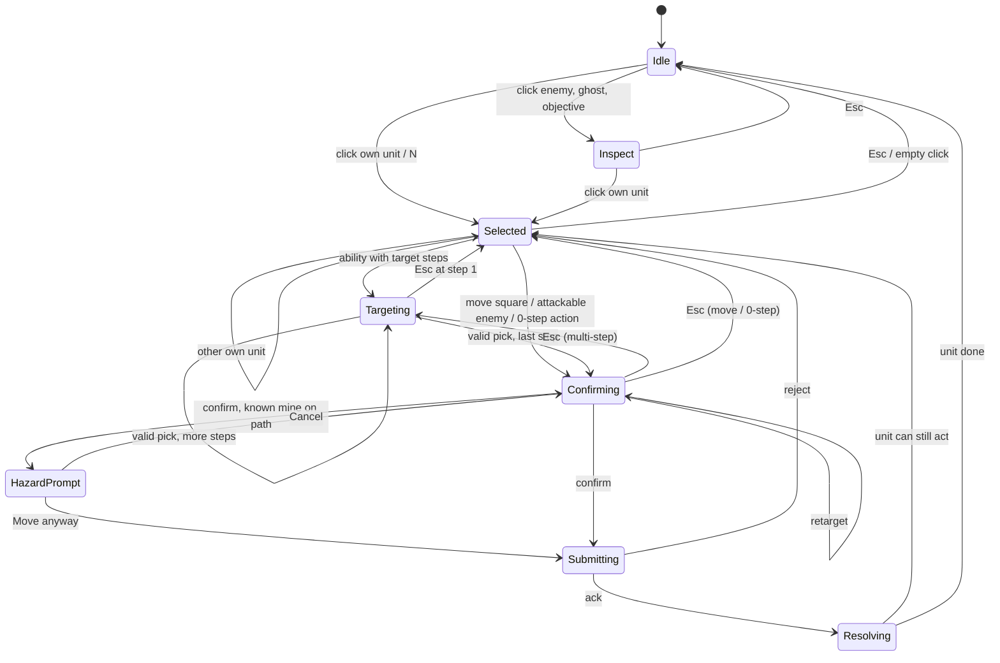
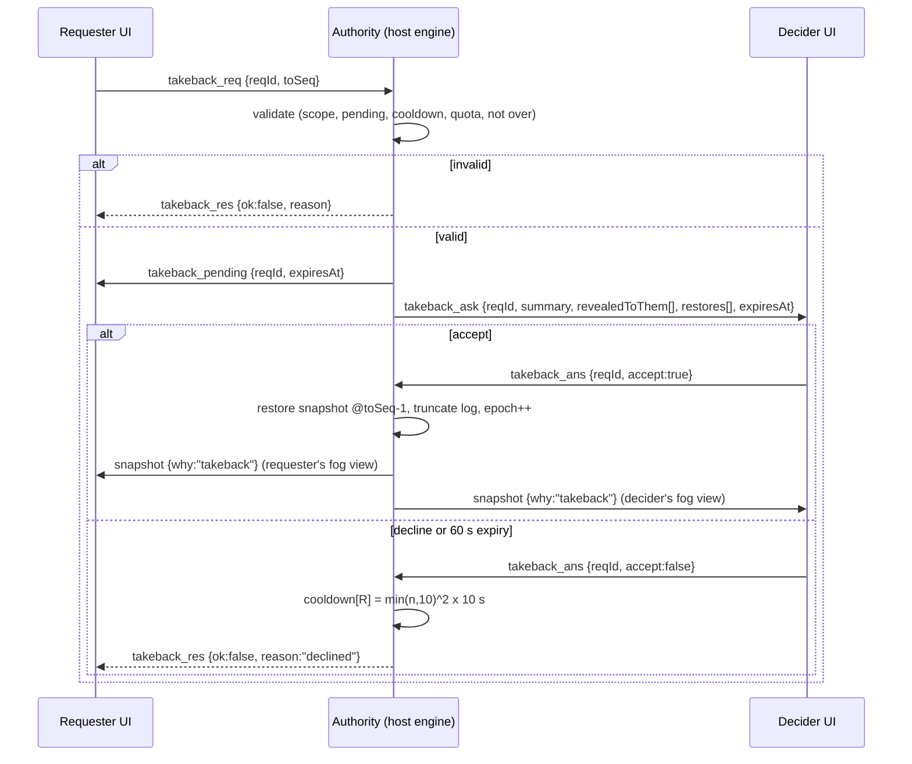

# UX conventions research: turn-based, fog-of-war grid tactics in the browser

- **Project:** 1v1 coin-unit tactics game (`docs/SPEC.md`, owner spec of 2026-10-24).
- **This document:** `docs/analysis/research-ux-conventions.md`. Research, then proposed UI specs and interaction state machines. Status: proposal for owner review.
- **Sister documents:** `rules-lawyer.md` (rules defaults, cited as **RL D-xx**), `research-netcode.md` (transport and protocol, cited as **NET §x**), `balance.md`, `research-art/`. When this document needs a rules answer, it uses the RL default and says so. Where it disagrees with a sister document, it says why (§4.3).

## How to read this

- **Confidence tags** on every default:
  - **[H]** high: build it.
  - **[M]** medium: build it, but the owner should confirm.
  - **[L]** low: a placeholder that needs an owner decision.
- **Spec quotes** are verbatim, with their line number in `docs/SPEC.md` (for example *L34*).
- **Q-xx** is a question this document raises (register in §4). **S-xx** is a numbered UI spec item that tickets can point to.
- Claims about other games are marked **(verified)** when a source in §30 backs them, or **(memory)** when they come from the author's knowledge and weren't re-checked today.

---

## 1. TL;DR: the decisions that matter most

1. **Hidden information overrides most genre conventions.** Free undo (Into the Breach, Tactical Breach Wizards, Hero Academy) works there because nothing is hidden. Here, any move can reveal enemy units, mines or a stealthed Rogue. So actions are committed to the authority one at a time, and the client never knows more than its player. Mistake prevention therefore happens *before* the commit (preview, then confirm). The opponent-approved take-back (*L39*) is the backup. [H]
2. **Two-step commit for every AP-spending action.** Hover shows the preview. The first click locks it and opens the forecast. A second click on the same target, Enter or Space commits. A per-player setting can drop this to one click, as Lichess's "move confirmation" and BGA's per-player confirm choice do. [M]
3. **A damage forecast with a step-by-step breakdown:** Power, then bonuses, then flat reductions, then Defend halving, in the order of RL D-C5. It's computed by the same pure rules function the authority uses, but on the player's fog-limited knowledge. It shows **"≈ may differ"** when squares that could change the result are in fog. [H]
4. **The path preview follows the pointer trail** (Advance Wars style) and avoids known mines automatically. A path that has to cross a known mine is drawn in hazard style and needs an explicit **Move anyway**, as the owner's note asks (*L102*). The warning can be turned off in Settings. [H]
5. **Movement interruptions are explicit, named events:** "Blocked!", "Ambushed!", "Mine!". The unit stops where it happened (Advance Wars "Trap", Wesnoth "Ambushed!", RL D-M4). [M]
6. **Fog is shading only.** The client never receives hidden units, so fog can't leak them. Terrain, blockers and objectives stay visible. Optional **last-seen ghosts** act as a memory aid. [H] for the shading, [M] for the ghosts.
7. **Stealthed units and mines are drawn for their owner only** (translucent, with a badge). The opponent gets nothing: no tile tint, no sound, no log line beyond what they could actually see. [H]
8. **Token colour already means grade (*L44*), so ownership needs its own channel:** a team-coloured rim plus a shape cue. [H]
9. **End turn uses a two-stage button when units can still act.** Wesnoth, Into the Breach and Tactical Breach Wizards all warn here. Auto-end is off by default. [H]
10. **Take-back undoes the requester's own last action of the current turn**, or their "end turn" if the opponent hasn't acted yet (NET §7.13). The opponent gets an Accept/Decline card that also says what the action revealed. Lichess-style rules apply: one pending request, a cooldown after declines, nothing after game over. [M]
11. **Waiting for the opponent is a full screen state.** You can inspect everything, plan with private arrows and replay the last enemy turn. The tab and a system notification tell you when it's your turn. [H]
12. **Reconnection is as silent as possible.** It relies on sequence numbers, idempotent intent IDs and a seat token in storage (NET §7.9–7.11). The opponent sees a calm "disconnected, waiting" banner. There's no automatic forfeit between friends. [M]
13. **Top view by default (*L48*), with an isometric toggle (V).** Isometric gets 90° rotation and fading for objects that block the view. Your own deployment edge is always at the bottom. [H]
14. **Desktop-first, but touch works.** The state machine never needs hover, so tap, tap works. Tablets are supported; phones are "playable, not optimised". [M]
15. **An optional turn timer, off by default:** a per-turn allowance plus a time bank. Running out ends your turn; it doesn't lose the game. [M]

---

## 2. Reference games: what they do, and what we take

### 2.1 Summary matrix

| Topic | Into the Breach | Advance Wars | Fire Emblem | Wesnoth | Hero Academy | Tactical Breach Wizards | Lichess / Chess.com | Tabletop Simulator |
|---|---|---|---|---|---|---|---|---|
| Move preview | Reachable tiles; per-mech "Undo Move" | Blue range; the arrow follows the cursor | Blue range | Reach plus turns-to-arrive footprints | Highlighted tiles | Previews with free rewind | Legal-move dots | Free-form drag |
| Attack preview | Full deterministic outcome on hover | Damage % on the target | Combat forecast, then confirm | Damage-calculation dialog | Plain | Exact outcome preview | n/a | n/a |
| Undo | Undo Move; Reset Turn (limited) | Cancel before the command | Turnwheel / Divine Pulse (single-player) | Blocked once fog is cleared | Unlimited before Submit | Unlimited in the turn | Takeback with opponent approval | Rewind (host/promoted only) |
| End-turn guard | Warns if a mech hasn't acted | (memory) menu "End" | Auto end turn option | 3 configurable confirms | Submit button | Warns before an accidental end | n/a | n/a |
| Fog | None | Units hidden, terrain visible; "Trap" stops moves | Some maps | Fog/shroud; ambush stops moves | None | None | n/a | Fog zones; GM sees all |
| Waiting state | n/a (AI) | n/a (hot-seat/AI) | n/a | Watch opponent moves live | Replay the opponent's turn | n/a | Premoves | Live cursors |

### 2.2 Into the Breach (Subset Games, 2018)

- Every attack's full result is previewed on hover before you commit: damage, push arrows, chain effects. The deterministic preview *is* the game's feel. (memory)
- **"Undo Move"** sits beside End Turn. It undoes a mech's *move* until that mech commits its action, but not a fired weapon. **"Reset Turn"** rewinds the whole turn; its uses are limited. (verified)
- **End Turn warns when a mech hasn't used its action.** Even self-targeted actions (repair) require "select the action, then click the mech", for consistency with every other action. (verified, Steam thread)
- Alt opens the attack-order overlay, and Ctrl plus hover shows an info overlay. (verified)
- **Take:** hover previews for everything, the same select-then-target flow even for self actions, the end-turn warning, and an info-overlay key.
- **Avoid:** free undo of moves. Our moves reveal information.

### 2.3 Advance Wars (Intelligent Systems)

- The movement arrow follows the route the cursor traces, so the player shapes the path. The move only becomes final when a command (Fire/Wait) is chosen; cancelling puts the unit back. (memory)
- While choosing a target, an expected damage % is shown. (verified)
- Fog hides units, not terrain. Units in forests and reefs stay hidden unless an enemy is adjacent. A unit that runs into a hidden enemy is **trapped**: it stops at once and can't take any more commands that turn. (verified)
- **Take:** the trail-following path, a damage readout on the target, and "Trap!" behaviour for hidden blockers.
- **Avoid:** the combined move-and-act menu. Here Move *is* the unit's action (RL D-A2).

### 2.4 Fire Emblem (series)

- Blue movement tiles and red attack tiles when a unit is selected. (memory)
- The **combat forecast** appears after you choose the target, and combat starts only when you press A, so a confirm step is built in. From Shadow Dragon on, moving onto an attackable enemy goes straight to the forecast. *Engage* shows per-hit damage and marks with a red X the values that could lead to defeat. (verified)
- **Danger zone:** in *Awakening*, X lays a purple filter over the map showing the danger area of every enemy. (verified)
- **Auto end turn:** *Heroes* has "Automatically starts the enemy turn when your units have completed their actions". *Path of Radiance* ends the turn once every character has orders. (verified)
- **Take:** forecast then confirm, a lethal marker, a danger-zone toggle and pinning a single enemy's range.
- **Avoid:** hit and crit percentages. Our rules have no dice.

### 2.5 Battle for Wesnoth

- **Undo stops at fog.** "If a player does something that causes a hex to be cleared of fog, that action (and all prior actions) cannot be undone." The workarounds are *Delay Shroud Updates* and *Planning Mode*. (verified, wiki)
- **Moves get interrupted.** A unit stops when it becomes adjacent to an invisible enemy ("Ambushed!"). A move also stops when new units come into sight ("Enemy unit sighted!"), with the hint "(press $hotkey to keep moving)". (verified, `src/actions/move.cpp`)
- **Three separate end-turn confirmations,** each its own preference:
  - "You have not started your turn yet. Do you really want to end your turn?"
  - "Some units have movement left. Do you really want to end your turn?"
  - "Some units have not moved. Do you really want to end your turn?"

  (verified, `src/menu_events.cpp`)
- Hotkey commands include End Turn, End Unit Turn, Hold Position, Next/Previous Unit, Undo/Redo, Show Enemy Moves, Best Possible Enemy Moves, Planning Mode, Delay Shroud Updates and Unit Type Description. (verified, `hotkey_command.cpp`) A third-party guide gives the default bindings Ctrl+Space (end turn), Space (end unit turn and cycle) and Shift+Space (hold).
- The multiplayer timer has four parameters: initial limit, reservoir, turn bonus and action bonus. (forum; partly verified)
- **Take:**
  - the principle that clearing fog gives information, so it can't be freely undone (we send it through opponent approval instead);
  - the interruption banners;
  - the end-turn wording;
  - next-unit cycling;
  - the enemy-moves overlay;
  - a side status pane that follows hover.

### 2.6 Hero Academy (Robot Entertainment, 2012)

- 5 action points per turn, one per action. The AP wheel doubles as undo (tap to undo one action, or reset all) until you **Submit**. Nothing reaches the opponent before Submit, and the opponent then **watches a replay** of your turn. (verified, 2012 reviews)
- **Take:** AP as a large, glanceable widget that previews costs, and "replay what the opponent did" for the player who was away.
- **Avoid:** staging the turn locally and submitting it at the end. With fog, the authority has to update vision after every move.

### 2.7 Tactical Breach Wizards (Suspicious Developments, 2024)

- Any action can be reversed until you end the turn. The game warns before you end a turn by accident. Previews show consequences, and the seer adds foresight. (verified, reviews)
- **Take:** generous previews and an explicit end-turn guard.
- **Avoid:** unlimited free rewind. It works there because it's single-player with nothing hidden to exploit.

### 2.8 Lichess and Chess.com

**Lichess (verified against the `lila` source code and translation strings):**
- **Takeback preference:** Never / In casual games only / Always (default Always). Both players' preferences must allow it.
- **When a proposal is allowed:** both players must have moved, and only one proposal can be pending.
- **What gets undone:** two plies if it's the proposer's turn, otherwise one.
- **Cooldown after a decline:** each decline (and a proposer cancelling) starts a cooldown of `min(n,10)² × 10 s` (10 s, 40 s, 90 s …, capped at 1000 s). It resets when a takeback is accepted.
- **No takebacks once the game is over.**
- **Strings:** "Propose a takeback", "Takeback sent", "Your opponent proposes a takeback", "Accept", "Decline".
- **Preferences:**
  - move confirmation (`submitMove`), on by default for correspondence games only;
  - confirm resignation, default yes;
  - premoves, default on;
  - animation speed: None 0 ms, Fast 120, Normal 250, Slow 500;
  - move input: "Click two squares", "Drag a piece" or "Both clicks and drag" (default both);
  - coordinates inside, outside or off.
- **Invite strings:** "To invite someone to play, give this URL", "The first person to come to this URL will play with you.", "Or let your opponent scan this QR code". The friend needs no account.
- **Disconnect strings:** "Your opponent left the game. You can claim victory in %s seconds.", then the choices "Claim victory", "Call draw", or wait.
- Board annotations: right-click to draw arrows and circles. (memory)

**Chess.com (verified, help centre):**
- Takebacks exist only in unrated *Daily* games with "Allow Takebacks" turned on, never in Live.
- Settings include:
  - Move Method (Drag or click / Drag / Click);
  - Show Legal Moves and Highlight Move;
  - Enable Premoves;
  - Confirm Resign/Draw;
  - "White Always on Bottom" (when off, you're always at the bottom).

**Take:**
- the takeback protocol and its anti-spam cooldown;
- the invite-link wording;
- per-player confirm preferences;
- input by click *or* drag;
- you-at-the-bottom orientation.

**Premoves don't carry over** (several actions per turn, hidden information), so private planning arrows replace them (§19).

### 2.9 Tabletop Simulator

- A Fog of War zone hides the objects inside it. Objects can "Reveal Fog of War" within a range, and only the GM (black seat) sees everything. Hidden zones can be shown to a single player colour. (verified, v11 notes, forums)
- **Rewind Time** is a privileged tool: the host, and since v13.1 promoted players. Undo is an authority there, not a negotiation. (verified)
- Every player's cursor (a coloured hand) is visible to everyone. (memory)
- **Take:** "visible to its owner only" as a first-class render flag.
- **Avoid:** showing the opponent's cursor, hover or selection. In a fog game that leaks intent and position. Also avoid unilateral rewind.

### 2.10 Bonus: Board Game Arena (browser board games)

- Studio guideline II-6 is "Avoid move confirmations", except for critical steps or a final "Done" after a complex turn. (verified)
- In the developer debate, confirmation is popular on mobile, while auto-confirm countdown timers split players roughly 50:50. Santorini's developer made it a **per-player** three-way setting (timer / confirm without timer / no confirmation) instead of a table option. (verified, forum)
- **Take:** confirmation is a *personal preference*, not a lobby rule, and no auto-confirm countdowns.

---

## 3. The governing constraint: hidden information

Every convention above was checked against one question: *does it still work when each player sees a different board?*

| Convention | Why it breaks with fog | Replacement here |
|---|---|---|
| Free undo (ITB, TBW, Hero Academy) | Undoing a move that revealed enemies leaves the player knowing where they are | Opponent-approved take-back (§25), plus a strong preview and confirm *before* committing (§23) |
| Stage the whole turn locally, then submit (Hero Academy) | Vision has to update after every step (RL D-F6) | Each action goes to the authority as soon as it's confirmed |
| Premoves (Lichess) | Queued actions walk into hidden units and mines, and their timing leaks | Private planning arrows and circles while you wait (§19) |
| Live opponent cursor (TTS) | Shows where they look and what they plan | Never send the cursor, hover or selection; pings are opt-in |
| Pathfinding around every unit | Routing around a hidden unit leaks that it exists | The client pathfinder uses only what you know. Hidden blockers produce a "Blocked!" interruption (NET §7.19 #8) |
| Enabling a button from the true state | e.g. Stealth greyed out because an *unseen* enemy is watching | Enable from what you know. Let the authority resolve and fail visibly (RL D-F8) |
| A forecast that uses true values | Shows hidden auras and formations | Forecast from what you know, flagged "≈" when fog could matter |
| Sounds and log lines for everything | "Something happened somewhere" leaks | Sound and log only for events you can see (RL D-F9) |
| Showing the opponent's AP and its spending | Reveals actions done in fog | The opponent's AP stays hidden during their turn |
| Mid-turn prompts to the waiting player | The pause itself leaks (for example, a revive prompt reveals that Queso is nearby) | Standing settings by default (RL D-T11); a live prompt only if the owner insists (§26) |

**Rule for designers [H]:** the UI may only *derive* information from the player's own view: their units, their visible events and their own memory (ghosts). Whenever a feature needs the true state to look right, the authority must resolve it, and the UI shows what happened afterwards.

---

## 4. Spec questions that change the UI

The owner invited questions. Each item below quotes the spec, gives the default the UI is built on, how confident that default is, and what the UI needs from it. Rules defaults come from `rules-lawyer.md` (RL) when it has one, so the documents agree. The UI is written so that most of these answers are **data changes, not redesigns**: overlays draw whatever squares the engine returns, and buttons show whatever cost the engine computes.

### 4.1 Register

#### A. Geometry and movement

**Q-01 · Movement shape**
> L15 "movement (1 square by default, including diagonals)" · L34 "The movement is orthogonal, a movement-piece cannot be diagonal."
- **Default:** steps are orthogonal, so the move range is a diamond (Manhattan distance ≤ MOV) (RL D-M3). **[H]** L34 is the specific rule. L37 says LOV uses "this logic", and its numbers (4 and 12 squares) match the diamond.
- **UI:** the move overlay is a diamond. A diagonal square needs MOV ≥ 2, and path arrows always turn at right angles.

**Q-02 · Three distance words**
> L37 LOV · L45 "in range of 1(including corners)" · L64 "adjacent" · L74 "range of 2" · L82 "melee range"
- **Default (RL D-G2–G4):**
  - "range N" is Manhattan distance ≤ N;
  - the default attack and "melee range" are range 1, the 4 orthogonal squares;
  - "adjacent" and "1 square away" are the 8 surrounding squares. **[M]**
- **UI:** range 1 has two different shapes: the attack cross (4 squares) and adjacency for auras and formations (8 squares).
- **UX risk:** "why can't I hit the Footman that is *adjacent* to me diagonally?"
- **Mitigations [H]:**
  - put attack markers only on enemies that can really be attacked;
  - write shapes as glyphs on cards: "Range 1 ◇ (4)" versus "Adjacent ▢ (8)";
  - when you hover a diagonal enemy that's out of reach, the hint reads "Diagonal: not in melee range".
- **Suggestion [L]:** the owner may prefer melee = adjacent (8), which matches L15's "including diagonals". It's one data flag.

**Q-03 · Exactly N squares, or up to N?**
> L34 "that unit moves as many squares as the movement stat."
- **Default:** up to N (RL D-M2). **[H]**

**Q-04 · Passing through units**
- The spec says nothing.
- **Default (RL D-M3):** a path may pass through friendly units but not enemy units, and must end on an empty square. **[M]**
- **UI:** the path arrow is drawn over friendly tokens, which dim under it.

**Q-05 · Moving into fog: interruptions**
> L101 "It explodes when any unit steps on it." · L82 "When an enemy unit comes into the melee range of this unit ..."
- **Default (RL D-M4):** the move stops early in three cases:
  - the next square holds a unit you couldn't see (you stop on the last legal square);
  - the mover takes damage;
  - the mover dies.

  The full AP cost is spent either way. **[M]**
- **UI:** interruption banners (S-8.8). Path segments inside fog are drawn as uncertain (§8.3, "How the path is drawn").

**Q-06 · Does sighting an enemy interrupt a move?**
- Wesnoth stops on "Enemy unit sighted!". The spec says nothing.
- **Default:** no. Moves are 1–3 steps, and RL D-M4 doesn't list sighting. **[M]**
- **UI:** a toast after the move: "2 enemy units sighted".

**Q-07 · What Size 2 occupies**
> L109 "Beast of Knorund, 20/40, 2, 2, 2, 3"
- **Default:** a 2×2 block with no rotation (RL D-G6). **[M]**
- **UI:** for Size-2 units the pointer picks a grid **corner**, and the footprint is the 4 squares around it. This applies to moves, deployment and previews. **[M]**

**Q-08 · Do blockers block vision?**
> L13 "There may be a scenario with blockers."
- **Default (RL D-G8, D-F2):** yes. Vision is a flood fill that stops at blockers and buildings. **[M]**
- **UI:** vision previews come from the engine's visibility function, never from a drawn diamond.

#### B. Turn economy

**Q-09 · One action per unit, and Move counts as one**
> L35 "A unit can only use one action per turn, unless stated otherwise." · L11 "a single unit can only move once per turn."
- **Default (RL D-A2):** Move, Attack, Defend and every active ability are actions. A unit gets one action per turn unless something grants more, and it can Move at most once (RL D-T5). **[H]**
- **UI:**
  - no move-then-attack for normal units;
  - a token is desaturated once it has acted;
  - units with several actions show action pips;
  - a 1-action enemy's threat is just its attack range from where it stands (§9.7).

**Q-10 · Size of the AP pool**
> L9 "that player will receive a number of Action points"
- **Default (RL D-A1):** 10 AP each turn, refilled every turn, unspent AP lost, configurable in the lobby. **[L]** for the number, **[M]** for "no carry-over".
- **UI:**
  - the AP widget shows pips for 1–20 and a number above that;
  - a tooltip says "Unspent AP is lost at end of turn";
  - the end-turn guard (§12) only makes sense because AP doesn't carry over.

**Q-11 · What an ability costs**
> L57 "Name, Power/Toughness, Size, LOV, Movement, AP, Ability:AbilityCost:Description"
- **Default (RL D-A4):** the ability's cost **replaces** the unit's AP cost. **[L]**
- **UI:** buttons always show the *effective* cost computed by the engine, so changing this rule is a data change.

**Q-12 · Abilities with no cost token**
> L87 "Shared wounds:" · L82 "Assault:" · L100 "Mad inventor:" · L117 "Holy Fervor:"
- **Default:**
  - text that describes a **choice** is an active ability that costs the unit's AP: Shared wounds, at 2;
  - text that describes a **trigger or a standing rule** is passive: Assault, Mad inventor, Holy Fervor. **[M]**
- **UI:** passives are listed on the card with a "Passive" tag and get no button.

**Q-13 · Defend: how long, and is it visible?**
> L15 "defend (a defending unit receives half the damage rounded up(never less than one))"
- **Default (RL D-C4):**
  - it lasts until its controller's next turn starts;
  - acting again cancels it;
  - it halves damage after flat reductions;
  - the opponent sees it. **[M]**
- **UI:** a shield badge on the token, and a "Defending ÷2" row in every forecast against it.

**Q-14 · What "CD 1 turn" means**
> L106 "CD 1 turn"
- **Default (RL D-T7):** usable every other turn. **[M]**
- **UI:** the button shows a clock badge, and its tooltip says "Ready on your turn 9" (an absolute turn, never "in 1").

**Q-15 · Durations**
> L107 "for 2 turns"
- **Default (RL D-T8):** lasts until the start of your turn T+N. **[L]**
- **UI:** always show the absolute expiry on the area marker: "Ends at the start of your turn 11".

**Q-16 · When Savagery's extra attack can be used**
> L78 "After attacking with the berserker, you can spend 2 AP to attack an additional time. Only once per turn."
- **Default:** offered right after the Berserker's attack resolves, and still available later in the same turn if skipped. **[L]** The abilities analyst may narrow it.
- **UI:** a follow-up chip "Savagery: attack again (2 AP)" opens targeting automatically. Esc keeps it on the action bar for later.

#### C. Combat and forecast

**Q-17 · Order of damage modifiers**
> L64 "reduce the incoming damage by 2 (not below 1)" · L95 "Reduce all damage dealt to this unit by 3 (can't be less than 1)" · L106 "reduced by 8" · L129 "deal 4 less damage"
- **Default (RL D-C5–C7):**
  1. Power, or the ability's fixed damage;
  2. attacker bonuses;
  3. attacker penalties, not going below 0;
  4. the sum of the target's flat reductions;
  5. Defend: halve and round up;
  6. a minimum of 1.

  **[M]**
- **UI:** the forecast rows follow exactly these steps (S-9.3), so players can learn the order from the screen.

**Q-18 · Does the target hit back?**
- **Default (RL D-C2):** no. **[M]**
- **UI:** the forecast is one-sided, unlike Fire Emblem's.

**Q-19 · Friendly fire**
> L101 "any unit" · L110 Forceful slam
- **Default (RL D-I1):** harmful area effects hit everyone in the area. **[M]**
- **UI:** each ally that would be hit gets a red chip, and the button reads "Confirm (hits 1 ally)" (S-9.5).

**Q-20 · Attacking a square**
> L101 "Mines can be triggered from distance by attacking the square with a ranged attack."
- **Default:**
  - a ranged attack may target any *visible* square in range, including one that looks empty;
  - it hits whatever is really there: a mine detonates, and a stealthed unit takes the hit and is revealed;
  - melee attacks can't target empty squares. **[M]**
- **UI:** an "attack ground" cursor, with the tooltip "Hits anything hidden here · detonates mines".

**Q-21 · What a defender learns from an attack out of the fog**
- The spec says nothing. NET §9 Q10–Q11 leave it open.
- **Default:** the defender sees the damage, plus an **origin marker** (a pulsing "?" on the attacker's square) until the end of that turn. The attacker's type isn't shown. **[L]**
- **Alternative:** a direction arrow only.
- **UI:** "Hit from fog" feedback (S-15.4).

#### D. Hidden things

**Q-22 · Who can see mines?**
> L101 "Deploy an invisible mine" · L90 "This unit reveals invisible units in its LOV"
- **Default:** mines aren't units. Mind's Eye doesn't reveal them; only triggering a mine does (NET §7.19 #6). **[L]**
- **UI:** the opponent never gets a mine overlay.

**Q-23 · Do your own mines hurt your own units?**
> L101 "It explodes when any unit steps on it."
- **Default:** yes. **[H]** This is why the owner's pathing note exists.
- **UI:** hazard warnings for your own mines (S-8.6, S-8.7).

**Q-24 · Through a mine, or onto it?**
> L102 "ally units will not go though mines automatically"
- **Default:** passing through a mine triggers it, and the mover stops on the mine square (RL D-M4 (b)). **[M]**

**Q-25 · Can the opponent see a mine being placed?**
- The spec says nothing.
- **Default:** if the Artificer is visible to the opponent, they see **"Enemy Artificer used an ability"**, with no name and no square. Otherwise they see nothing. **[L]**
- **UI:** abilities whose result is hidden play a generic "tinker" animation.

**Q-26 · Stealth when an unseen enemy is watching**
> L81 "Only activate this ability if not inside the LOV of another enemy creature."
- **Default (RL D-F8):** the button is enabled based on what you know. If an enemy you can't see is watching, the attempt resolves as **"Stealth failed: being watched"**, and the 1 AP and the action are spent. **[L]**
- **UI:** when fogged squares lie within the largest known enemy LOV, the tooltip warns "Unseen enemies may be watching; a failed attempt still costs 1 AP".

**Q-27 · Reveal distance versus Assault range**
> L81 "revealed when it's 1 square away from an enemy unit" · L82 "When an enemy unit comes into the melee range of this unit, if this unit is in stealth, perform an automatic attack"
- **Default:**
  - the reveal triggers at adjacency (8 squares) and Assault at melee range (4 squares), per RL's table;
  - when both happen on the same step, Assault resolves first, otherwise it could never fire. **[M]**
- **Consequence for the abilities analyst:** an enemy that comes *diagonally* adjacent reveals the Rogue without triggering Assault. Only a straight approach triggers it.
- **UI:** the Rogue's owner sees both rings when hovering: dotted for reveal (8), solid for Assault (4).

**Q-28 · "Revealed" isn't the same as "seen"**
- **Default (RL D-F7).** **[H]**
- **UI:** the owner's badge changes from "Stealthed" to "Not stealthed". Enemies still see the Rogue only if it's inside their vision.

**Q-29 · Army and commander secrecy**
- **Default (RL D-B9):** army lists are secret, and commanders are revealed when deployment starts. **[L–M]**
- **UI:** the opponent panel shows their commander portrait and a "units seen" counter that counts only what you've seen.

**Q-30 · Is the opponent's AP visible?**
- **Default (RL D-F9):** no. **[L]**
- **UI:** there's no opponent AP widget, only "Friend's turn" and the elapsed time.

#### E. Deployment

**Q-31 · Who may use the extended zone?**
> L29 "Some units can be deployed in the extended deployment area"
- **Default (RL D-P2):** type-1 and type-2 units, never the commander. **[L]**
- **UI:** the extended rows light up only while an eligible unit is picked up.

**Q-32 · Simultaneous or turn by turn? Secret?**
- **Default (RL D-P3):** simultaneous and hidden. **[M]**
- **UI:** the opponent's status shows only "deploying…" or "ready". No placement count: it would leak army size (NET §7.19 #3).

**Q-33 · Completeness rules**
- **Default (RL D-B3, D-P4):** every unit must be deployed, and the commander must go in the normal zone. **[M]**
- **UI:** Ready stays disabled until these hold, and its tooltip lists what's missing.

#### F. Objectives and winning

**Q-34 · Keep and Market**
> L52 "all units receive a bonus of 3 power" · L45 "conquered when at least one unit, without opposition, is in range of 1(including corners)"
- **Default:**
  - the bonus applies to your units (RL D-I1);
  - capture is checked at the end of every turn (RL D-O3);
  - the capture zone is the 12 squares around the building (RL D-O4);
  - "Contested" is shown when a capture is blocked (RL D-O5). **[M/L]**
- **UI:**
  - a capture-ring overlay;
  - ownership flags that stay visible even in fog (the global buff would reveal ownership anyway) **[M]**;
  - a HUD chip: "Keep: yours (+3 Power)" / "Contested" / "Neutral".

**Q-35 · The goal row**
> L32 "bring your commander to the opposite side of the board. More specifically, to the last row."
- **Default (RL D-K5):** you win as soon as the action that put your commander on the row has fully resolved. **[M]**
- **UI:**
  - the goal row gets a gold edge;
  - when your commander's move would end there, the confirm button reads "Move & WIN";
  - a warning appears when a *visible* enemy commander is within reach of your edge.

#### G. Presentation

**Q-36 · Token colour means grade, so how do you show ownership?**
> L44 "The color of the token will represent the grade of the unit. The symbol on top of the token will represent the particular unit"
- **Default:** owner is shown by a team-coloured rim plus a base shape. Grade is shown by the face material (§6.2). **[H]**

**Q-37 · The Empire has no units**
> L59 "### The Empire" is followed directly by L60 "### Lojrar Clan"
- **Default:** both players use the Lojrar list, so mirror matches will be the norm. That makes the ownership channel (Q-36) critical. **[M]**
- **UI:** hide the faction picker until a second roster exists.

**Q-38 · "Units of white"**
> L128 "Units of white gain the ability to regenerate 2 toughness for 2 AP"
- **Default (RL D-B8):** treated as all your units until a colour-to-grade table exists. **[L]**
- **UI:** units that get the ability show it on their card as "granted by Baba Yaga".

**Q-39 · Camera**
> L48 "The view can switch from top to isometric. Top by default."
- **Default:** as written. **[H]** Details in §7.

#### H. Social and session

**Q-40 · Take-back scope and quota**
> L39 "There will be a take back option for each player. The opponent player has to accept the take back."
- **Default (NET §7.13, extended in §25):**
  - your own most recent action this turn, one per request, repeatable;
  - or your "end turn", if the opponent hasn't acted yet;
  - one request pending at a time;
  - escalating cooldown after declines;
  - nothing after game over. **[M]**
- **Second reading:** "a take back option for each player" could mean **one take-back each per game**. A lobby setting covers it: "Take-backs per game: Unlimited (default) / 3 / 1 / Off". **[M]**

**Q-41 · Prompts for the waiting player (Queso)**
> L130 "When a unit in that area dies you can choose to sacrifice 1 max toughness to revive that unit"
- **On the opponent's turn:** a standing setting (RL D-T11), because a live prompt's pause reveals that a Queso is nearby. Setting: "Queso revive: Off / Grade 10+ (default) / Always / Ask each time". "Ask" uses the live prompt in §26, with a leak warning. **[L]**
- **On your own turn:** always an inline prompt. You're the active player, so nothing leaks. **[M]**

**Q-42 · Turn timer**
- The spec says nothing.
- **Default:** off, with an optional lobby setting (§18). **[M]**

**Q-43 · Disconnects and abandonment**
- **Default (NET §7.11):** no automatic forfeit, and "Abandon" counts as conceding. **[M]**

**Q-44 · First player**
- **Default (RL D-T1):** a coin flip. **[M]**
- **UI:** a literal 3D coin flip, about 1.5 s and skippable. It fits the coin theme.

### 4.2 Questions that only the owner can settle, in priority order for the UI

1. Q-02, melee as 4 or 8 squares. It decides the most-drawn overlay in the game.
2. Q-26, failed Stealth attempts and their cost.
3. Q-21, what a defender learns about an attacker hidden in fog.
4. Q-41, live prompts versus standing settings for reactions on the opponent's turn.
5. Q-40, take-back quota ("for each player").
6. Q-25, whether placing a mine is visible.

### 4.3 Where this document differs from its sister documents

| Topic | Sister doc says | This doc says | Why |
|---|---|---|---|
| Ghosts after a take-back | NET §7.13: "remove any last-seen markers that came from the undone action" | **Keep** them, labelled "seen (taken back)" [M] | The player *did* see those units. Removing the markers only handicaps players with a weaker memory, and the decider was told what was revealed before accepting. |
| Mid-turn prompts | NET §7.14: prompt the decider. RL D-T11: no prompts | Standing setting on the opponent's turn, inline prompt on your own turn (Q-41) | Avoids the pause leak while keeping the choice where it's free |
| Take-back cooldown | NET §7.13: flat 10 s after a decline | Lichess escalation: 10 s, 40 s, 90 s … up to 1000 s, reset on accept [M] | Stops request spam without punishing a single decline |
| Melee shape | RL D-G4: 4 squares | Follows RL, but flags the UX risk and offers 8 as an option (Q-02) | L15's "including diagonals" and player intuition |

---

## 5. Screen layout and HUD

**S-5.0 · Technology split [H].** The board is a WebGL canvas. Everything with text (HUD, cards, log, dialogs) is HTML/CSS layered above it. This gives crisp text, selectable log lines, screen-reader access and easy theming. The canvas never draws paragraphs.

### 5.1 Desktop layout (1920×1080 reference, still works at 1280×720)

```
+--------------------------------------------------------------------------------------+
| =  Turn 7 - YOUR TURN        (o) You - Kulega   [12:40]   Friend - Ratasius (o)  [*] |  top bar, 48 px
+--------------+------------------------------------------------------+----------------+
| INSPECTOR    |                                                      | LOG | CHAT     |
| card of the  |                                                      | T7 You: ...    |
| selected or  |                       BOARD                          | T7 You: ...    |
| hovered unit |            (canvas, takes all the free space)        | --- T6 ---     |
| 280 px       |                                                      | 300 px,        |
| collapsible  |                                                      | collapsible    |
+--------------+---- hint line: "Choose a square to move - Esc to cancel" ---+----------+
| [portrait] Paladin 20/20 | 1 Move .2 | 2 Attack .2 | 3 Defend .2 | ...  || AP 6/10 ||END TURN|
+--------------------------------------------------------------------------------------+
                                  action bar, 96 px
```

| ID | Region | Contents | Notes |
|---|---|---|---|
| S-5.1 | Top bar | Menu, turn number and whose turn it is, both players (name, commander portrait, connection dot), optional turn timer, settings | The active player's side is highlighted. The opponent shows **no AP** (Q-30) |
| S-5.2 | Inspector (left) | Full card of the selected unit. If nothing is selected, the card of whatever is hovered (Wesnoth's side pane) | Collapses to a 48 px rail below 1280 px width |
| S-5.3 | Log / Chat (right) | Tabs: Log (default) and Chat | Collapsible (L key). Unread badge on the Chat tab |
| S-5.4 | Action bar (bottom centre) | Portrait of the selected unit, then numbered action buttons with their effective AP cost, cooldown and a reason when disabled | Empty state: "Select a unit (N cycles units that can act)" |
| S-5.5 | AP widget + End Turn (bottom right) | §11 and §12 | Turns into "Waiting for Friend… 0:42" on the opponent's turn |
| S-5.6 | Hint line (above the action bar) | One sentence saying what the current state expects, plus the cancel key | Every state in §23 defines its hint text |
| S-5.7 | Banner slot (top centre, under the top bar) | Turn banners, take-back cards, disconnect notices, reaction prompts | At most one banner at a time; the rest queue. Never covers the board centre |
| S-5.8 | Toasts (top right) | Short notices such as "Revealed!" or "Link copied" | Fade after 4 s; a click jumps to the event |
| S-5.9 | Forecast popover | Anchored next to the target, clamped to the viewport | Docks above the action bar when space is short |

**Responsive behaviour [M]:**
- **1280 px and wider:** the full layout above.
- **1024–1279 px:** the log becomes a slide-over tab.
- **768–1023 px:** the inspector becomes a bottom sheet and the action bar wraps into two rows.
- **Under 768 px:** see §17.4.

---

## 6. Board, tokens and overlays

### 6.1 Coordinates and orientation

- **S-6.1 [H].** Coordinates are absolute: columns **A–Y** and rows **1–25**, with P1's edge at row 1.
  - P2's view is rotated 180°, so their own edge is also at the bottom.
  - Labels stay absolute (like a chess board flipped for Black), so both players' logs and chat name the same squares ("K12").
  - Edge labels can be toggled with **G**.
- **S-6.2 [H].** The cut-off corners (*L30*) are drawn as non-board ground (rock or void), with no grid lines and no hover.

### 6.2 Tokens (the coin metaphor)

The spec fixes the face colour as **grade** and the top symbol as **unit type** (*L44*). Ownership therefore needs a second, independent channel (Q-36):

| Channel | Encodes | Proposal | Conf. |
|---|---|---|---|
| Face material and colour | Grade (1…100) | A metal ladder that echoes real coins: copper (1), bronze (2), brass (5), silver (10), gold (20), blued steel (50), bimetal with a gold centre and silver ring like the €2 coin (100). The final palette belongs to `research-art` | [M] |
| Grade numeral engraved on the rim | Grade, readable in greyscale and by colour-blind players | Small "20" at the bottom of the rim | [H] |
| Symbol on the face | Unit type | High-contrast emboss. Faces upright for its owner | [H] |
| **Rim ring** | **Owner** | Team colour. Default: you are blue, the opponent is orange-red. Settings: "Always show me as blue" (on by default), plus a colour pick | [H] |
| **Rim shape** | **Owner (colour-blind backup)** | Your coins have a smooth rim; enemy coins have a *reeded* (serrated) rim, like real coin edges | [M] |
| Crown pip and a double gold rim | Commander | Same size as other tokens, so the grid stays regular | [M] |

**Token states:**

| State | Look | Conf. |
|---|---|---|
| Ready (can act) | Full colour, plus a faint pulse on the rim during your turn when the "Highlight units that can act" setting is on (default on) | [M] |
| Acted | Desaturated 60% and sunk 1 px, like Advance Wars' grey units | [H] |
| Selected | Lifted 4 px, bright outline, soft ring on the ground | [H] |
| Hovered | Thin outline. A tooltip after 300 ms (§16) | [H] |
| Defending | Shield badge (top left) | [H] |
| Several actions left | Action pips (top right), e.g. ●○ for Holy Fervor | [H] |
| Buffed / debuffed | ▲ / ▼ badge (bottom left). Details on the card | [M] |
| Ability cooling down | Clock badge (bottom right) | [M] |
| **Stealthed (owner only)** | 50% opacity, a shimmer shader, an eye-slash badge | [H] |
| **Last-seen ghost (enemy, your memory)** | Greyscale at 35% opacity, dashed rim, a "T6" badge | [M] |
| Size 2 (Beast) | One large disc covering its 2×2 squares | [M] |
| Dummy (No-ACB) | A simpler wood-and-gear token with its owner's rim | [M] |

**Health [H].**
- A thin bar under the token shows current/max toughness. It shades from green to amber to red as it drops, with a matching pattern for colour-blind players.
- Exact numbers appear on hover, in the inspector and in the stats overlay (**I**).
- Damage just taken shows as a white segment that shrinks over 600 ms, so you can see how much you lost.

**Size budget at 1080p, board fit to screen [M]:**
- a square is about 34 px, a token 28 px, its symbol 16 px;
- the health bar is 24×3 px and badges are 9 px.

When the zoom makes squares smaller than 28 px, every badge except Acted and Defend hides, and the stats overlay takes over.

### 6.3 Overlay vocabulary

Every overlay has a **fill**, an **edge** and a **glyph**, so meaning never depends on colour alone [H]. Hues are placeholders until `research-art` fixes a palette that's safe for colour-blind players.

| Overlay | Meaning | Fill | Edge | Glyph | Layer |
|---|---|---|---|---|---|
| Move reach | Squares this unit can end its move on | Blue, 30% | none | small dot | L3 |
| Hazard reach | Reachable only through or onto a **known** mine | Amber, 30% | none | dot with "!" | L3 |
| Path | The route the unit will take | n/a | White arrow with a 3 px dark outline. Dashed in fog, dashed amber over a hazard | arrowhead | L5 |
| Attack target | An enemy you can attack right now | n/a | Red-orange ring on the token | crosshair corners | L6 |
| Attack reach | Squares this unit could attack (empty or not) | none | Thin red-orange inner border | none | L4 |
| Ability targets | Valid squares or units for the current targeting step | Violet, 30% | none | rune dot | L3 |
| Area preview | The footprint of an area ability under the cursor | Violet, 50% | solid | a chip on each affected unit | L4 |
| Heal targets | Units that would be healed | Teal, 30% | none | "+" | L3 |
| Danger zone | Squares visible enemies could attack next turn | Red diagonal hatch, 18% | none | hatch | L2 |
| Known enemy vision | Squares seen by enemies you can see | none | Dotted red outline | eye on hover | L2 |
| Your vision frontier | Where your fog starts | none | Soft white line | none | L1 |
| Vision preview | What the unit would see from the hovered destination | none | Dashed white outline | none | L4 |
| Deployment zone | Your normal zone / extended rows (*L31*) | Team colour, 22% / the same plus hatch | none | hatch for extended | L2 |
| Capture ring | The 12 squares that capture an objective (Q-34) | none | Dotted gold | flag | L2 |
| Area effects | Forcefield, Pajazon | Ground decal in the owner's hue | solid | badge with turns left | L1 |
| Invalid | Hovering somewhere you can't act | none | none | "⊘" cursor, plus a reason on the hint line | cursor |

**Draw order, bottom to top [H]:**
1. L0 terrain (fog shading is part of the terrain material, §13);
2. L1 vision frontier and area decals;
3. L2 zones (deployment, danger, capture, enemy vision);
4. L3 square fills;
5. L4 previews;
6. L5 the path;
7. tokens;
8. L6 markers attached to tokens (target rings, badges, chips);
9. floating combat text;
10. hover outline and cursor.

The HTML HUD sits above all of it.

**Clutter rule [H].** At most **two** square-fill overlays at once: the current state's own fill, plus one optional analysis overlay (danger zone, *or* enemy vision). The others switch to edge-only.

---

## 7. Camera: top view and isometric

| ID | Spec | Conf. |
|---|---|---|
| S-7.1 | **Top view (default, *L48*).** Orthographic, looking straight down, your edge at the bottom, no rotation. | [H] |
| S-7.2 | **Isometric.** Orthographic, yaw 45° and pitch 35.264° (true isometric). **V** toggles. The 350 ms ease-in-out transition becomes instant under `prefers-reduced-motion`. The board point under the screen centre and the zoom level are kept. | [M] |
| S-7.3 | **Rotation (isometric only).** **Q/E** turn the view in 90° steps over 250 ms. A small compass shows where "your edge" is. Top view doesn't rotate. | [M] |
| S-7.4 | **Occlusion.** The 3D objective buildings (*L46*) and tall decorations fade to 30% opacity while they cover the hovered square, the selected unit, a path or a target. Tokens behind them get an x-ray outline. | [M] |
| S-7.5 | **Picking.** The pointer is raycast to the ground plane. A token is hit-tested as its whole square. In isometric view the hover outline is drawn on the ground, so it's always clear which square is picked. | [H] |
| S-7.6 | **Zoom.** The mouse wheel zooms towards the cursor (setting: "Wheel: Zoom (default) / Pan"). Trackpad pinch arrives as `ctrlKey` wheel events; over the canvas it zooms the board, and browser zoom stays on Ctrl +/−. Range: from the whole board down to about 6 squares across. Each player's last zoom is remembered locally. | [M] |
| S-7.7 | **Pan.** W A S D, middle-drag or right-drag (a right *click* without movement still means cancel), or left-drag that starts on a square with no action in the current state. The arrow keys are kept for the keyboard cursor (§17.2). Edge-scrolling is off by default. | [M] |
| S-7.8 | **Focus.** **F** centres on the selected unit; **Home** centres on your commander. The camera **never moves by itself** during your turn. During the opponent's turn, "Follow visible enemy actions" is off by default (§19). | [H] |
| S-7.9 | **Readability in isometric view.** Token symbols sit on the top face, squashed to about 58% of their height at this pitch. That's acceptable. Optionally, isometric view can draw the symbol upright as a billboard. | [L] |
| S-7.10 | **No minimap.** At default zoom the 25×25 board fits on screen, so a minimap would only add clutter. | [M] |

---

## 8. Movement preview and pathing

### 8.1 Entering move mode

- **S-8.1 [H].** Selecting your own unit that can still move shows its **move reach** at once (Fire Emblem / Advance Wars convention). Move is the default mode, so hovering a reachable square previews a move straight away. Pressing **1** selects Move explicitly.
- If the unit has already moved this turn (only possible with extra actions, Q-09), no reach is shown and the Move button says "Already moved this turn".

### 8.2 Computing reach (on the client, from known state only)

- **S-8.2 [H].** A breadth-first search over orthogonal steps up to MOV (Q-01, Q-03):

| Square contains (as the player knows it) | Can pass | Can end on |
|---|---|---|
| Empty board square | yes | yes |
| Fogged square (contents unknown) | yes (treated as empty) | yes |
| Friendly unit | yes (Q-04) | no |
| Visible enemy unit | no | no |
| Blocker, building, cut-off corner | no | no |
| Known mine (your own, or a revealed enemy mine) | yes, flagged as a hazard | yes, flagged as a hazard |

- A Size-2 unit searches over grid corners with its 2×2 footprint, and every one of its 4 squares must be legal at every step (RL D-M5).
- The client must never route around something it can't see (NET §7.19 #8). When an unseen unit is in the way, the authority interrupts the move (§8.6).

### 8.3 Choosing the path

**S-8.3 · Trail mode (default) [H], adapted from Advance Wars.**
- As the pointer moves out from the unit, each newly entered square that is orthogonally adjacent and reachable is **appended** to the path.
- Moving back onto the previous square **pops** it, so you can backtrack.
- If the pointer jumps to a non-adjacent square, leaves the reach, or the trail grows longer than MOV, the path is recomputed as the **best path** to the hovered square.

**S-8.4 · Best path, minimised in this order [M]:**
1. fewest known-hazard squares;
2. fewest steps;
3. fewest fogged squares (prefer known ground);
4. fewest turns (straighter routes read better);
5. a fixed direction order (N, E, S, W from the viewer), so hovering the same square always shows the same path.

**S-8.5 · Waypoints [M].**
- **Shift+click** a reachable square to pin a numbered waypoint. The path becomes best(start→wp1) + best(wp1→…) + …→destination.
- **Backspace** removes the last waypoint. At most MOV−1 waypoints.

**Keyboard [M].** In keyboard cursor mode (§17.2), the arrow keys extend or retract the trail one square at a time, like Advance Wars.

**How the path is drawn [H]:**
- a solid arrow with a step badge at the head ("2/3");
- segments over **fogged** squares are dashed and lighter, with the tooltip "Path enters fog: hidden units or traps may interrupt this move";
- segments over **known mines** are amber and dashed, with a mine glyph and the expected damage.

### 8.4 Destination preview (while hovering)

| Element | Content | Conf. |
|---|---|---|
| Ghost token | The unit at 60% opacity on the destination | [H] |
| Vision preview | Dashed outline of what it would see from there, from the engine's visibility function (Q-08), plus a "+7 squares" chip for newly revealed ground | [M] |
| Warning chips | "Enters danger zone (Ranger K14)" · "Through fog" · "Mine −5, LETHAL" · "Next to 2 enemies" | [M] |
| Commander chips | "Goal row: WIN" (Q-35) · "In reach of visible enemies" | [H] |
| Cost | Hint line: "Move to K12 · 2 AP · click again or Enter to confirm" | [H] |

### 8.5 Mine hazard confirmation (the owner's note, *L102*)

> L102 "(NOTE about pathing ... when pathfinding, ally units will not go though mines automatically. Ask the player if he wants a unit to go to a mined square. The player can deactivate this warning from options)"

**S-8.6 · When it triggers [H].** You commit a path that includes at least one square with a **known** mine, and the setting **"Warn before moving through known mines"** is on (default on). Because the best path avoids mines whenever a safe route exists within MOV, the prompt only appears when:
- the destination is the mine square;
- every route within MOV crosses a mine (the reach is already shown in amber, so the prompt comes as no surprise); or
- the player routed through a mine on purpose with the trail or waypoints.

**S-8.7 · The prompt.** A popover anchored on the first mine square, not a full-screen modal:

```
+----------------------------------------------------+
|  (!) Walk into your mine?                          |
|  Footman will trigger your mine at K12.            |
|  5 damage - Footman has 2 toughness -> LETHAL.     |
|  The move stops on K12.                            |
|                                                    |
|  [ ] Don't ask again  (Settings > Gameplay)        |
|                      [ Cancel ]   [ Move anyway ]  |
+----------------------------------------------------+
```

- **Focus [H].** The safe button (**Cancel**) has default focus, so Enter cancels. **Move anyway** needs a click or **M**. Esc cancels.
- **Wording variants [H]:**
  - "your mine" or "a revealed enemy mine";
  - "+5 because Size 2: 10 damage" (*L101*) when the mover is the Beast;
  - "This will also end its move", from RL D-M4 (b).
- **Independence [H].** This prompt still appears when "Action confirmation" is set to Never (§22). It's a separate safety net with its own switch, exactly as the note asks.
- **Opponent mines** are unknown to the mover, so there's nothing to warn about. The unit just runs into them (§8.6).

### 8.6 Interruptions (the authority resolves them; the UI explains them)

**S-8.8.** The authority walks the path one step at a time (RL D-M4). When it stops early, the client plays the **actual** path and then names the cause:

| Cause | Banner | What you see | Log line (mover's side) |
|---|---|---|---|
| An unseen unit on the next square | **Blocked!** | The unit stops; the blocker appears on its square; the rest of the path fades out with a red ✕ | "Footman stopped at K11: blocked by an unseen unit at K12" |
| Mine | **Mine!** | Explosion, damage numbers, unit stops *on* the mine square | "Footman triggered a mine at K12 (−5)" |
| Assault from a stealthed Rogue | **Ambushed!** | The Rogue fades in with a strike; damage; the mover stops where it entered melee range | "Footman was ambushed by an enemy Rogue at L12 (−7)" |
| Any other damage on the way | **Interrupted** | Damage numbers; stop | "Footman was hit while moving (−3) and stopped at K11" |
| Death on the way | **Unit lost** | Death animation where it fell | "Footman died at K12" |

- **AP is spent in full (RL D-M4) [H].** The first time it happens, the AP widget shows the tip "AP is spent even when a move is cut short".
- **What's left of the path is dropped [H].** A unit can only move once (Q-09), so there's no Wesnoth-style "continue move".
- **The other side [H].** The owner of the trap, Rogue or blocker sees the same event from their side: "Your mine at K12 hit an enemy Footman (−5)", "Your Rogue ambushed an enemy Footman". They see the target only if it's inside their vision; otherwise they see "an unseen unit".

### 8.7 Watching the opponent move

**S-8.9 [H]:**
- Visible enemy movement animates along the squares of its real path that are inside your vision.
- A unit coming out of the fog fades in on the first visible square.
- A unit leaving into the fog fades out on the last visible square and leaves a ghost (§13.3).
- Only movement *inside* your vision makes sound.

---

## 9. Attack preview, damage forecast and danger zone

### 9.1 Targets

- **S-9.1 [H].** When the selected unit can still attack, every **visible** enemy within reach gets a crosshair ring (Q-02).
- The thin reach border shows the whole area it can attack.
- For ranged units, squares that look empty and are visible are also targets for **attack ground** (Q-20, §9.6).

### 9.2 Quick forecast on hover

**S-9.2 [H].** A chip on the target shows:
- **"−6 → 14/20"**: the large number is the damage, the small one the target's toughness afterwards;
- **💀 LETHAL** when the toughness afterwards is 0 or less;
- **👑 WIN** when the target is the enemy commander;
- a leading **"≈"** when the result is uncertain (§9.4).

Text labels go with the icons, so the meaning doesn't depend on emoji rendering.

### 9.3 The full forecast panel

**S-9.3.** It opens on the **first click** on a target (that click locks the preview, §23). The rows follow the damage steps of RL D-C5 exactly, which teaches players the order:

```
+--------------------------------------------------------+
| ATTACK   Berserker (C7) -> Paladin (C8)          1 AP  |
|--------------------------------------------------------|
| Power                              12                  |
| + Keep (you hold it)               +3          = 15    |
| - Weakness (Ratasius, range 1)     -4          = 11    |
| - Reinforced Armor (target)        -3          =  8    |
| / Defending: half, round up        /2          =  4    |
|--------------------------------------------------------|
| DAMAGE 4            Paladin  20 -> 16                  |
| Next: Savagery available (attack again for 2 AP)       |
| ~ 2 squares next to the target are in fog. Hidden      |
|   formations or auras could change this result.        |
|                        [ Cancel  Esc ]  [ Attack  Enter ] |
+--------------------------------------------------------+
```

**Row rules [H]:**
- one row per step that changes the number, and steps that change nothing are hidden;
- every row names its source, and its square when known;
- the minimum-1 rule appears as its own row ("Minimum damage: 1") when it applies;
- fixed-damage abilities (RL D-C7) start their first row at "Smite 8" instead of Power.

**Changing target [H].**
- Inside the panel, clicking another valid target switches the forecast (Fire Emblem's left/right).
- **[** and **]** cycle through the valid targets.
- The panel never closes on its own.

**No counter-attack column [H].** Q-18.

### 9.4 Uncertainty

**S-9.4 [M].** Every damage modifier in the rules engine declares the squares it depends on:
- Line Formation: the target's adjacent squares;
- Fierce attacker: the target's adjacent squares;
- Strong aura: squares next to the possible Priestesses;
- Forcefield: the target's square.

The client marks the forecast **"≈ may differ"** if any of those squares is fogged *and* the modifier could apply to this attacker and target. This is honest and leaks nothing, because it's computed only from the player's own view.

**After the attack [M].** If the real damage differs from the forecast, the log says **"Actual 2 (forecast 4): hidden effects applied"**. It doesn't name the effects: they're the defender's secrets, and only the result is visible.

### 9.5 Forecasts for areas, several units, sacrifices and heals

**S-9.5 [H]:**
- **Chips on every affected unit:**
  - enemies in orange, "−3";
  - your own units in red with an exclamation mark, "−3 ally";
  - heals in teal, "+5 (capped 15)".
- **Panel order:** lethal results first, then allies hit, then everything else.
- **Confirm label adapts to the outcome:**
  - "Attack" / "Cast";
  - "Confirm (hits 1 ally)";
  - "Sacrifice & cast";
  - "Attack & WIN".
- **Sacrifices (Julio Vernification, Feast, Shared wounds)** show the sacrificed unit with a skull and its toughness as the "fuel" value. The confirm button names the sacrifice: "Sacrifice Footman & cast".

### 9.6 Attack ground (ranged units, Q-20)

**S-9.6 [M]:**
- In Attack mode, visible empty squares within range show a crosshair-with-"?" cursor.
- The forecast reads: "Attack K12: detonates a mine if there is one, and hits a hidden unit if there is one (3 damage before its reductions)". The confirm button reads "Fire at K12".
- Melee units can't attack ground; the hint line explains why.

### 9.7 Danger zone (threat overlay)

**S-9.7.** **T** cycles: off → danger zone → danger zone + known enemy vision → off.

- **What the zone covers [M].** The union of squares that *visible* enemies could attack on their next turn:
  - a 1-action enemy: its attack and ability reach from where it stands (Smite 3, Julio Vernification 2, Pajazon's centre at 3 plus its area, Forceful slam);
  - an enemy with 2+ actions (Holy Fervor, Market, Command Aura): its move reach, then its attack reach from every reachable square.
- **Pinning a single enemy's threat [H].** With nothing selected, clicking an enemy pins its personal threat outline (Fire Emblem). Up to 3 can be pinned; Esc clears them.
- **Ghosts [M].** With the "Include last-seen enemies" option, ghosts add a lighter hatch labelled "possible threat (seen T6)".
- **Tooltip on a hatched square [H].** Lists the threats: "Ranger (K14) · Smite: Celestial (M15)".
- **Danger zone on by default?** No. It's a toggle, remembered per player. **[M]**

---

## 10. Abilities: multi-step targeting

### 10.1 One pattern for everything

**S-10.1 [H].** Every action follows the same flow: **select the unit → choose the action → pick targets step by step → confirm.** Into the Breach keeps "select, then click" even for self-targeted repair, and we do the same.

- A **stepper** in the hint line shows progress, for example `(1) Sacrifice > (2) Target > Confirm`.
- Each step highlights only valid picks. Hovering an invalid square shows *why* on the hint line ("Not adjacent to the Juliomancer").
- **Esc / right-click** goes back one step (§23).
- After the last pick, the action enters **Confirming**, with its forecast panel.

**S-10.2 [H].** Targeting is **data-driven**. Each ability declares its steps (`TargetStep[]`, §27.3) and the shared rules engine answers "is this pick valid?" and "what is the preview?". No ability has hand-written UI code.

### 10.2 Ability-by-ability targeting spec

Effective costs follow RL D-A4 (the ability cost replaces the unit's AP). Holy Fervor adds +1 to the Celestial Emissary's second action (*L117*). Distances follow Q-02.

| Action (unit, line) | Cost | Steps | Valid picks | Preview | Confirm label |
|---|---|---|---|---|---|
| **Move** (all) | unit AP | 1: destination | §8 | path, ghost, vision preview | "Move" / "Move & WIN" |
| **Attack** (all) | unit AP | 1: enemy, or ground for ranged | visible, in reach (Q-02, Q-20) | forecast (§9) | "Attack" / "Fire at K12" |
| **Defend** (all) | unit AP | 0 | itself | shield on the token, "until your next turn" (Q-13) | "Defend" |
| **Stealth** (Rogue, L81) | 1 | 0 | itself, if no **visible** enemy's vision covers it (Q-26) | token fades; reveal ring (8) and Assault ring (4); a warning if unseen watchers are possible | "Stealth" |
| **Shared wounds** (Priestess, L87) | 2 (Q-12) | 1: source = the Priestess or an adjacent ally · 2: recipient = the Priestess or an adjacent ally, not the source | allies only [M] | two bars: source −X, recipient +X (capped at max) | "Transfer X" |
| **Julio Vernification** (Juliomancer, L91) | 2 | 1: an adjacent unit of yours, never the commander (RL D-H5) · 2: a visible enemy within range 2 of the Juliomancer (RL D-I1) | per step | skull on the sacrifice; damage = its current toughness (fixed damage, RL D-C7) | "Sacrifice & cast" |
| **Prototype No-ACB** (Artificer, L99) | 2 | 1: a free adjacent square | free as far as you know; under the dummy limit | 0/7 dummy ghost; counter "Dummies 2/3 → 3/3" | "Build dummy" |
| **Trip Mine B20** (Artificer, L101) | 2 | 1: a free adjacent square | under the mine limit; not with Sabrina (L126) | ghost mine only you can see; "Mines 4/5"; reminder "Your own units trigger it too" | "Lay mine" |
| **Forcefield** (Royal wizard, L106) | 2 | 1: paint 4 squares (§10.3) | each in the wizard's vision, orthogonally connected [M] | violet field; list of your units inside ("−8 damage taken"); expiry | "Raise forcefield" |
| **Pajazon** (Royal wizard, L107) | 3 | 1: centre square | within range 3 and in vision | a 3×3 decal follows the cursor; chips "+3 at end of your turn" (allies) and "−3 at end of enemy turn" (enemies); expiry (Q-15) | "Cast Pajazon" |
| **Forceful slam** (Beast, L110) | 4 | 1: a square adjacent to its 2×2 | any adjacent square | 10 on the square; 3 on the 5 "opposite adjacent" squares (the engine computes them from the direction); chips for allies hit | "Slam" / "Slam (hits 1 ally)" |
| **Feast** (Beast, L111) | 2 | 1: an adjacent unit of yours, not the commander | per step | skull, plus "+X toughness" | "Sacrifice & feast" |
| **Holy blessing** (Celestial, L115) | 3 | 0 | automatic: allies within range 2 | teal area, "+5" chips (capped) | "Bless (4 allies)" |
| **Smite** (Celestial, L116) | 3 | 1: a visible enemy within range 3 (RL D-I1) | per step | forecast (fixed 8, then reductions) | "Smite" |
| **Savagery** (Berserker, L78) | 2 | 1: an enemy in reach | after its attack this turn, once (Q-16) | forecast | "Attack again" |
| **Regenerate** (Baba Yaga grant, L128) | 2 | 0 (the selected unit) | at most 2 units per turn, at most 2 uses per unit, CD 1 | "+2" | "Regenerate" |

**Passive and automatic abilities get no button.** They're listed on cards, and their rings appear on hover:
- Line Formation (L64), Fierce attacker (L67), Perseverance (L71), Ranged attack (L74);
- Assault (L82), Strong aura (L86), Mind's Eye (L90, L98), Reinforced Armor (L95);
- Mad inventor (L100), Holy Fervor (L117), Command Aura (L120);
- commander effects (L124–L130).

**Nothing hidden can be adjacent [H].** A stealthed enemy is revealed as soon as it's 1 square from one of your units (Q-27). So a square adjacent to your Artificer can't hide an invisible unit, and "free adjacent square" is always fully known. Hidden **mines** are the exception; what happens when a dummy lands on one is for RL to decide.

### 10.3 Forcefield painting

**S-10.3 [M].**
- Click squares one at a time, or drag to paint them. Each new square must touch the group orthogonally, and the squares that would be valid next glow.
- **Right-click / Backspace** removes the last square. With 4 squares chosen, the ability enters Confirming.
- **Shortcut:** **R** cycles the tetromino shapes (I, O, L, T, S) anchored at the cursor, and **Q/E** rotate the shape while painting.

### 10.4 Follow-up actions

**S-10.4 [H].** When an action resolves, the engine can report **follow-ups**: Savagery, Holy Fervor's second action, the Market's extra action, Command Aura's extra action.
- The action bar highlights them with a "Next" glow and keeps the unit selected.
- Savagery also opens its targeting automatically. Esc closes it and leaves it on the bar (Q-16).
- There's never a modal.

### 10.5 Why a button is disabled

**S-10.5 [H].** Every disabled button explains itself on hover, or on tap on touch screens:

| Reason | Text |
|---|---|
| AP | "Not enough AP: needs 3, you have 2" |
| Already acted | "Already acted this turn" |
| Already moved | "Already moved this turn (one Move per turn)" |
| Cooldown | "On cooldown: ready on your turn 9" |
| No target | "No valid target in range" |
| Limit | "Limit reached: Mines 5/5 (+1 per extra Artificer)" |
| Commander rule | "Not available with Sabrina" |
| Being seen (Stealth) | "A visible enemy can see this unit: Ranger at K10" |
| Not your turn | "Friend's turn: you can inspect but not act" |
| Waiting on a take-back | "Waiting for Friend to answer your take-back request" |

---

## 11. AP display and unit status

```
 AP   (o)(o)(o)(o)(o)(o)( )( )( )( )   6 / 10        3 units can act  >
                  ^^^ hovering "Smite (3)": these three pips turn amber and hollow -> "3 left"
```

| ID | Spec | Conf. |
|---|---|---|
| S-11.1 | **AP widget**, next to End Turn: a large "6 / 10" and up to 20 pips (just the number above 20). | [H] |
| S-11.2 | **Cost preview.** Hovering or locking an action makes the pips it would spend hollow and amber, with "→ 3 left", like the mana preview in card games. If the action is unaffordable, the number flashes red and the button shows the shortfall. | [H] |
| S-11.3 | **Refill.** At the start of your turn the pips fill one by one (300 ms total, instant under reduced motion), with a soft chime. | [M] |
| S-11.4 | **Tooltip.** "10 AP each turn · unspent AP is lost" (Q-10). It's built from lobby settings, so it stays correct if the owner changes the rule. | [H] |
| S-11.5 | **"3 units can act" counter.** Clicking it (or pressing **N**) selects the next unit with an affordable action. | [H] |
| S-11.6 | **Per-unit costs** appear on every action button. A cost change shows as an annotated delta, e.g. "Attack 4 **+1**" for Holy Fervor's second action. | [H] |
| S-11.7 | **Nothing affordable.** When every action left costs more than your AP, the widget reads "No affordable actions" and End Turn glows (§12). | [H] |
| S-11.8 | **No AP for the opponent** (Q-30). Their side of the top bar only shows "Friend's turn · 0:42". | [L] (tracks RL D-F9) |

---

## 12. Ending the turn

### 12.1 Button states

| State | Label | Look | Click |
|---|---|---|---|
| Your turn, nothing affordable left | **End turn** | primary, soft glow | ends the turn immediately |
| Your turn, units can still act | **End turn · 6 AP left** | neutral | arms the button (S-12.2), or ends at once if the setting is Never |
| Armed (for 4 s) | **Confirm end turn? 6 AP will be lost** | amber, pulsing | ends the turn |
| Ending | **Ending…** | disabled | n/a |
| Opponent's turn | **Friend's turn · 0:42** | disabled, shows the elapsed time | n/a |
| Your take-back is pending | **Waiting for approval** | disabled | n/a |

### 12.2 Confirmation rules

- **S-12.1 · "Can still act" [H].** At least one of your units has an action left *and* at least one of its actions is enabled and affordable. Defend almost always counts.
- **S-12.2 · Two-stage button, no modal [H].**
  - The first click (or **Ctrl+Enter**) arms the button for 4 s. A second click or Ctrl+Enter confirms. Esc, clicking elsewhere or the timeout disarms it.
  - It's in place, not a dialog, following BGA guideline II-6 ("avoid dialogs") and TBW / ITB / Wesnoth, which all warn here.
  - Wording follows Wesnoth's three cases:
    - "You haven't acted yet this turn. End it anyway?";
    - "Some units can still act. End turn?";
    - "Confirm end turn? 6 AP will be lost".
- **S-12.3 · Double-click guard [M].** A confirming click that arrives less than 250 ms after the arming click is ignored, so a double-click can't pass both stages.
- **S-12.4 · Setting (per player) [H].** "Confirm end turn: **When units can still act** (default) / Always / Never".
- **S-12.5 · Auto end turn (per player) [M].** Default **off**. When on, the turn ends 1.5 s after the last affordable action resolves, with a ring on the button you can click to cancel. It's opt-in, because BGA players split 50:50 on automatic countdowns, while Fire Emblem Heroes offers it as a setting.

### 12.3 End-of-turn phase

**S-12.6 [H].** After the confirm, the authority resolves end-of-turn effects:
- regeneration (L71 Perseverance, L130 Queso);
- Pajazon ticks (L107);
- objective capture checks (RL D-O3).

The client plays them as one short sequence: floating "+1" and "−3" numbers, and a flag animation when an objective changes hands. It lasts at most 1.5 s at normal speed, **Space** skips it, and the log summarises it under "End of turn 7".

**S-12.7 [M].** Undoing "End turn" goes through take-back (§25), and is allowed until the opponent commits their first action (NET §7.13). The take-back button (Ctrl+Z) is labelled **"Ask to undo end turn"** while that's possible.

---

## 13. Fog of war rendering

### 13.1 What the client knows

**S-13.1 [H].** The client holds:
- its own units and effects;
- the enemy units and effects that are visible right now;
- terrain;
- its own memory (ghosts).

It **never** receives hidden units or mines (NET §7.19). So fog is just **shading on terrain** plus a visible / not-visible flag per square, and a client bug can't leak a hidden unit, because there's nothing to leak.

### 13.2 Look

| Area | Treatment | Conf. |
|---|---|---|
| Inside your vision | Full colour and contrast | [H] |
| Outside your vision | Terrain desaturated to about 30%, darkened about 45%, a cool tint; grid lines at lower contrast; a slow noise texture (static under `prefers-reduced-motion`) | [M] |
| Frontier | A soft white line along the edge of vision | [M] |
| Always shown, even in fog | Terrain, blockers, buildings, **objective ownership** (Q-34), map edges, deployment zones (during deployment), your own units and effects | [M] |
| Never shown in fog | Enemy units, enemy mines, enemy area effects (unless the squares are in your vision) | [H] |

- **Style setting:** "Fog style: Soft (default) / Crisp". Crisp gives flat shading for clarity and low-end GPUs. **[M]** `research-art/fog-styles-*.png` has mock-ups to choose from.
- **Changes in vision [H].** Vision is recomputed after every step (RL D-F6). A square that gains or loses vision fades in 150 ms (instantly under reduced motion).

### 13.3 Last-seen ghosts (a memory aid)

> L17 "Everything outside will be in the fog of war."

A ghost doesn't break this rule: it's information the player legitimately had, shown as a memory, never as live data.

**S-13.2 · Behaviour [M].**
- **Setting:** "Show last-seen enemies: On (default) / Off".
- **Created** when a visible enemy leaves your vision, either because it moved into fog or because your vision receded. The ghost stays on its last seen square with a "T6" badge and the toughness it had then.
- **Removed** when:
  - the square comes into vision and the unit isn't there;
  - the same unit is seen somewhere else. This needs unit IDs that stay the same for the whole game. NET §7.19 #2 asks for random, opaque IDs, which is compatible, but rules out per-sighting aliases. **[M]**
  - the unit is known to be dead.
- **Built from the player's own visible-event history,** so ghosts come back after a reload or reconnect, with no extra protocol.
- **Pathing:** a ghost doesn't block your path. If a path crosses one, a chip warns "Last seen here on T6".
- **Clicking a ghost** gives: "Paladin · last seen turn 6 at K12 · 13/20 · it may have moved".

### 13.4 Vision analysis overlays

- **S-13.3 [M].** **Known enemy vision** (T, second step): the combined vision of the enemies you can see, computed with the same visibility function on known terrain. Label: "Seen by visible enemies". Use it before sneaking a commander or a Rogue (Q-26).
- **S-13.4 [H].** **Vision preview** when hovering a move destination (§8.4).

### 13.5 After the game

**S-13.5 [M].** When the game ends, the fog lifts. A full replay is available with three views: Fog off, Your view and Friend's view (§19.6). This is the payoff friends want: "so *that's* where your Rogue was".

---

## 14. Hidden units and hidden traps (drawn for their owner only)

### 14.1 Your stealthed units

| ID | Spec | Conf. |
|---|---|---|
| S-14.1 | **Look:** 50% opacity, shimmer, an eye-slash badge. Card status: "Stealthed since your turn 5". | [H] |
| S-14.2 | **Hover rings:** a dotted **reveal ring** (adjacent, 8 squares) and a solid **Assault ring** (melee, 4 squares) (Q-27). | [M] |
| S-14.3 | **Proximity warning:** when a visible enemy is 2 squares away, a chip on your Rogue: "Footman 2 squares away: adjacent = revealed". | [M] |
| S-14.4 | **Reveal:** a "Revealed!" toast with the cause ("adjacent to enemy Footman" / "took damage in enemy vision", L81). The token goes back to full opacity and the badge changes (Q-28). | [H] |
| S-14.5 | **Assault, which can happen on the opponent's turn (L82):** both players see "Ambushed!" if it's in their vision. The Rogue's owner always gets a reaction entry in the log: "↯ Your Rogue ambushed an enemy Footman at L12 (−7)". | [H] |
| S-14.6 | **The opponent's view:** nothing at all until the reveal: no square tint, no sound, no log line. When it's revealed inside their vision, the Rogue fades in with "Enemy Rogue revealed!". | [H] |

### 14.2 Your mines

| ID | Spec | Conf. |
|---|---|---|
| S-14.7 | **Look:** a small mine glyph in your team colour on the square, with a faint pulse and a number in placement order. | [H] |
| S-14.8 | **Hover:** "Your mine #3 · placed on turn 4 · triggers on ANY unit, yours too · 5 damage, +5 against Size 2" (L101, Q-23). | [H] |
| S-14.9 | **Counters:** "Mines 3/5" and "Dummies 2/3" on the Artificer card and as a HUD chip. They count all your Artificers (L99, L101 limits), and the tooltip explains how the limit grows. | [H] |
| S-14.10 | **Pathing:** your mines are hazards (§8.5). | [H] |
| S-14.11 | **A detonation in your vision:** explosion, damage numbers, log. | [H] |
| S-14.12 | **Your mine going off in fog:** you know it's spent (it's yours), but not who hit it. Log: "Your mine at K12 exploded (out of sight)". The mine marker turns into a scorch mark for one turn. | [M] |
| S-14.13 | **The opponent's view:** never the mine. They only see the explosion if it's in their vision, or the damage if it's their unit. Placement follows Q-25. | [H] |

### 14.3 Public "reveal" ranges

**S-14.14 [H].** Unit stats are public, so showing them leaks nothing. Hovering any Mind's Eye unit (Juliomancer L90, Artificer L98) or Ratasius (L129 "Reveals all invisible enemies in range of 3") shows an **eye ring** over its reveal area. This works for your units and for visible enemies. Stealth players can then see the danger without memorising stats.

---

## 15. Event visibility, combat log and feedback

### 15.1 What each player is told

**S-15.1 [H].** An event reaches a player only as far as their vision covers it (RL D-F9, NET `VisibleEvent`):

| Case | What you get |
|---|---|
| Your own actions | Full detail |
| An opponent action fully in your vision | Full detail: actor, target, numbers and steps |
| An opponent action partly in your vision | Only the visible part: "An unseen unit hit your Soldier at F6 (−3)" · "Enemy Paladin moved out of sight" |
| An opponent action entirely outside your vision | **Nothing.** No count, no "3 hidden actions" |
| Anything that happens to your own units | Always, because you own them |

### 15.2 The log

**S-15.2 [H].** Each entry is `[turn] [side icon] text`.
- **Hover** highlights the squares involved on the board: source in blue, target in orange. This is like a chess move list or Hearthstone's history bar.
- **Click** centres the camera there.
- Entries are grouped under separators ("— Turn 8 · Friend —"). End-of-turn effects collapse into one expandable line.

Examples, from your point of view:

```
T7  You     Footman moved E4 -> E6                                   (2 AP)
T7  You     Ranger K10 attacked Footman K12: 3 - 2 Line Formation = 1   Footman 2 -> 1
T7  You     Footman triggered your mine at K12 (-5)  MINE!
T7  ---     End of turn: +1 Soldier (Perseverance), Keep captured  >
T8  Friend  Enemy Berserker L14 attacked your Paladin L13: 12 - 3 = 9   Paladin 20 -> 11
T8  Friend  Your Soldier F6 was hit from the fog (-3)
T8  Friend  ↯ Your Rogue ambushed an enemy Footman at L12 (-7)   Rogue revealed
T9  System  You asked to take back "Footman E4 -> E6" - Friend accepted
T9  You     ↶ Footman E4 -> E6  (taken back)
```

- **Filters:** All / Combat / Movement / System. **[M]**
- **"Copy log as text"** for bug reports. The copy holds only what you saw. **[M]**
- **Taken-back actions stay in the log, struck through,** for transparency. **[H]**

### 15.3 Feedback on the board

| ID | Spec | Conf. |
|---|---|---|
| S-15.3 | **Floating combat text:** "−7" in red, "+3" in teal, and status words: Defending, Revealed!, Blocked!, Ambushed!, Mine!, Captured!. Stacked so they don't overlap; 900 ms at normal speed. | [H] |
| S-15.4 | **Hit from fog (Q-21):** the damage, plus a pulsing "?" origin marker until the end of that turn. Alternative: a direction arrow. | [L] |
| S-15.5 | **Visible events off screen:** an arrow at the screen edge plus a toast, e.g. "Enemy Ranger attacked your Footman at F6 [Show]". | [H] |
| S-15.6 | **Sound:** only for your own actions and for events you can see. A distinct "your turn" chime, a sting for reactions (Assault), and an optional low-time tick. | [H] |
| S-15.7 | **Animation speed:** Normal / Fast (2×) / Instant (Lichess offers 0, 120, 250 and 500 ms). Space or a click skips the current animation. Reduced motion swaps movement for crossfades. | [H] |

---

## 16. Unit cards, tooltips and the codex

| ID | Spec | Conf. |
|---|---|---|
| S-16.1 | **Hover tooltip** after 300 ms, instant when moving from one token to the next. At most 6 lines: name, owner, grade coin, Power and Toughness (current/max), MOV · LOV · AP cost · Size, actions left, status icons. | [H] |
| S-16.2 | **Inspector card** (left panel), described below. | [H] |
| S-16.3 | **Comparison:** while your unit is selected, the inspector keeps *its* card, and hovering an enemy shows the enemy's tooltip plus a mini forecast if it's attackable. | [M] |
| S-16.4 | **Grade coin tooltip:** "Grade 20 · costs 20 (24 with Sabrina)" (RL D-B4). | [M] |
| S-16.5 | **Codex:** every unit and commander with its full text. Reachable from the main menu, the army builder and a "?" on every card. | [M] |
| S-16.6 | **One source of truth:** card text is generated from the same unit data file the engine runs on, so the rules and their description can't drift apart. | [H] |

**What the inspector card shows (S-16.2):**
- **Header:** symbol, name, grade coin, owner, and a commander crown if it is one.
- **Stats,** each with a list of the modifiers acting on it: "Power 13 = 12 base + 1 Strong aura (Priestess K11)".
- **Abilities, text verbatim from the data file.** Each one shows:
  - whether it's passive or active, its cost and its cooldown state;
  - a live evaluation line, e.g. "Line Formation: **active** (2 adjacent Footmen), incoming damage −2".
- **Statuses with source and expiry:** "Defending until your turn 9" · "Weakness −4 (Ratasius, range 1)".
- **Abilities granted by your commander:** Kulega's type-20 ability, Baba Yaga's regeneration.
- **Counters:** Dummies and Mines.

**Enemy cards** show the static stats and visible statuses. A modifier whose source is hidden reads "**+1 Power (source not visible)**". The number itself is visible, so saying it's buffed leaks nothing new. **[M]**

---

## 17. Input: mouse, keyboard, touch

### 17.1 Mouse

| Input | Idle | Unit selected | Targeting / Confirming | Deployment |
|---|---|---|---|---|
| Left click | select your unit / inspect | move or attack (contextual), or switch unit | pick / confirm (same target) / retarget | place or pick up a token |
| Left drag | pan, if it starts on a square with no action | pan (same rule) | paint the Forcefield | drag a token |
| Right click (no movement) | n/a | deselect | go back one step | send the token back to the tray |
| Right drag / middle drag | pan | pan | pan | pan |
| Wheel / pinch | zoom (S-7.6) | zoom | zoom | zoom |
| Shift + left click | n/a | n/a | add a waypoint (Move) | n/a |
| Hover | tooltip | previews | previews | placement ghost |

- **Contextual click [H].** With a unit selected, clicking a reachable square starts **Move**, and clicking an attackable enemy starts **Attack**.
- **Abilities always need their button or number key [H],** even when their target is under the cursor. There's no guessing which ability was meant.

### 17.2 Keyboard

| Key | Action | When |
|---|---|---|
| **Esc** | Cancel / go back one step / close | always |
| **Enter** or **Space** | Confirm the locked action · skip the current animation | Confirming / Resolving |
| **Ctrl+Enter** (or **Ctrl+Space**) | End turn (twice if the confirm rule applies) | your turn |
| **N** / **Shift+N** | Next / previous unit that can act | your turn |
| **1 / 2 / 3** | Move / Attack / Defend | unit selected |
| **4–9** | Abilities, in the order on the card | unit selected |
| **[** / **]** | Previous / next valid target | Targeting, Confirming |
| **Backspace** | Remove the last waypoint or painted square | Targeting |
| **R** | Cycle Forcefield shapes | Forcefield |
| **W A S D** | Pan | always |
| **Arrow keys** | Move the keyboard cursor (it appears on first use) | always |
| **+ / −** | Zoom | always |
| **V** | Top view ↔ isometric | always |
| **Q / E** | Rotate 90° | isometric |
| **F** / **Home** | Focus the selected unit / centre on your commander | always |
| **T** | Cycle threat overlays (§9.7) | always |
| **I** | Stats overlay on every token. Tap to toggle, hold to peek (the Into the Breach overlay idea) | always |
| **G** | Grid lines and coordinates | always |
| **P** | Plan mode: private arrows and circles (§19.4) | always |
| **L** | Show or hide the log | always |
| **/** | Open chat | always |
| **Ctrl+Z** | Ask for a take-back (opens the confirmation, §25) | your turn, or right after your end turn |
| **?** | Shortcut sheet | always |

- **Keyboard cursor mode [M]**, as in console tactics games:
  - the arrow keys move a highlighted square;
  - **Enter** acts as a click and **Shift+Enter** adds a waypoint;
  - **Esc** cancels;
  - the cursor hides as soon as the mouse moves.

  The whole game can then be played without a mouse.
- **Focus rules [H]:**
  - game keys are disabled while a text field (chat, names) has focus;
  - **Tab** moves through the HUD in a logical order (action bar → AP → End turn → log) with visible focus rings;
  - Tab is never taken over by the game.
- **The Take-back *accept* button has no shortcut [M].** It needs a click, or keyboard focus plus Enter, so it can't be triggered by accident while typing.

### 17.3 Browser conflicts to avoid [H]

- **Never bind:** Ctrl+W, T, N, R, L or Tab; F1 (Chrome help); F5; Alt+Left/Right (history); Alt on its own (it shows Firefox's menu bar).
- **Call `preventDefault` only while the canvas has focus:** Space (page scroll), Backspace, `/` (Firefox Quick Find) and the context menu.
- **Ctrl+wheel:** taken over only above the canvas (S-7.6).
- **Clipboard:** call the Clipboard API only from a user gesture (the "Copy link" button), with a fallback of a text field that's already selected.

### 17.4 Touch and mobile: should we?

**Recommendation: desktop-first, touch-capable from day one, with tablets fully supported and phones "playable, not optimised". [M]**

Why:
1. **The board is dense.** On a phone 390 px wide in portrait, the 25×25 board makes a square about **15 px**, far below the roughly 44-point target size recommended for touch. Phone players would zoom constantly.
2. **The game teaches through hover** (forecasts, cards), and phones need a different layout for that.
3. **Touch is still cheap to support.** The state machine (§23) never depends on hover: "first tap locks the preview, second tap confirms" works on touch exactly as on a mouse. Building with Pointer Events from the start costs almost nothing.
4. **The netcode needs no changes** (NET §7.4 already mentions `navigator.share()` and QR codes for phone players).

| Tier | Device | Support |
|---|---|---|
| 1 | Desktop / laptop, mouse or trackpad, 1280 px and up | Full experience; the reference for design and testing |
| 2 | Tablet, 768 px and up, either orientation | Fully supported: bottom sheets, on-screen Confirm/Cancel |
| 3 | Phone | Landscape works with zoom. Portrait shows "Rotate for the best experience". Not optimised |

| Gesture | Effect | Conf. |
|---|---|---|
| Tap | Acts as hover plus click. On a unit: select. On a target: show and lock the preview. Tap the same target again: confirm | [H] |
| Long press (450 ms) | Open the card as a bottom sheet (replaces hover) | [H] |
| Drag on a token (deployment) | Drag the token | [H] |
| Drag anywhere else | Pan | [H] |
| Pinch | Zoom | [H] |
| Two-finger tap | Cancel / go back (like right-click). An on-screen **Cancel** is always shown while targeting | [M] |
| Tap snapping | When squares are smaller than 32 px, a tap snaps to the nearest valid target within half a square, and a loupe magnifies the area above the finger | [M] |
| No drag-to-move in battle | The finger would hide the destination, so it's tap, tap | [M] |
| Haptics | `navigator.vibrate(10)` on confirm, where available (Android) | [L] |

---

## 18. Turn timer (optional; the spec has none)

**S-18.1 · Lobby setting "Turn timer" (Q-42) [M]:**

| Preset | Per-turn allowance | Bank (whole game) | At zero |
|---|---|---|---|
| **Off (default)** | n/a | n/a | n/a |
| Relaxed | 3:00 | 10:00 | the turn ends automatically |
| Standard | 1:30 | 5:00 | the turn ends automatically |
| Quick | 0:45 | 2:00 | the turn ends automatically |
| Custom | any | any | the turn ends automatically |

**Mechanics:**
- **S-18.2 [M].** The per-turn allowance runs first, then the bank drains.
- **S-18.3 [M].** When both reach zero, the authority **ends the turn**. Committed actions stay; any locked but unconfirmed preview is dropped. The log says "Turn ended by the timer". **Running out of time never loses the game.** These are two friends, and a forced loss would be harsh.
- **S-18.4 [M].** The allowance doesn't build up, and the bank doesn't refill. An optional "+10 s per turn" increment works like Wesnoth's *turn bonus*. There's deliberately no Wesnoth-style *action bonus*: it would reward spamming cheap actions. **[L]** for the increment.

**When the clocks stop [M]:**
- during take-back negotiation (both clocks);
- while the authority is unreachable, or while the active player is disconnected (§20);
- during live reaction prompts, if enabled (§26), which have their own 20 s timer.

**Deployment timer:** separate and optional, default off. When it runs out, any units left are auto-deployed with the "Auto-deploy" heuristic (§24). **[M]**

**Display [H]:**
- a ring around the active player's avatar, plus "1:12 · bank 4:30";
- under 15 s: red, with an optional tick sound;
- the bank phase uses its own colour and the label "Bank".

**Nudge, for when the timer is off [L].** After 2 minutes of the opponent's turn, the waiting player can press **Nudge** (at most once every 2 minutes). The opponent gets a soft chime and the toast "Friend is waiting for you".

---

## 19. Waiting for the opponent

The two players spend half of every game here, so it's a designed state, not a spinner.

### 19.1 Screen state

**S-19.1 [H]:**
- The top bar reads **"Friend's turn · Turn 8"**, with a slow pulsing dot on the opponent's side.
- The End Turn area shows **"Waiting for Friend… 0:42"** (time elapsed in their turn).
- The action bar still works for **inspection**. Select your units to see their reach, attack area and vision. Every action button is disabled with the reason "Friend's turn".

### 19.2 What you can and can't do

| You can | You can't |
|---|---|
| Inspect units, ghosts, objectives; open cards and the codex | Commit any action |
| Use the threat and vision overlays (T), the stats overlay (I) and the camera | See the opponent's cursor, selection or AP (§3) |
| Read the log, replay their last turn, chat, send emotes | Change lobby rules |
| Draw private plans (§19.4) | |
| Answer a take-back request (§25) or, if enabled, a reaction prompt (§26) | |

### 19.3 Watching their actions live

**S-19.2 [M]:**
- Visible enemy events animate as they arrive, in order, at the chosen speed.
- If events pile up while an animation is playing, playback speeds up to 2× until it has caught up.
- **"Follow visible enemy actions"** is off by default. Visible events off screen get edge arrows and toasts instead (S-15.5), so the camera is never taken over.

### 19.4 Planning mode (replacing premoves)

**S-19.3.** **P** toggles plan mode:
- **Left-drag** draws an arrow from square centre to square centre, and **click** toggles a circle on a square, like Lichess's board annotations. **[H]**
- **Three colours:** plain, Shift and Ctrl, matching Lichess habits. **[M]**
- **Private:** marks are never sent. A single mark can be shared on purpose with "Share this mark", which sends only that mark. **[H]** for private, **[L]** for sharing.
- **Planned moves:** dragging from one of your units in plan mode draws a ghost path under the real path rules, with its cost. When your turn starts, each one becomes a chip such as **"Planned: Footman → E6 (2 AP) [Do it]"**. **[Do it]** goes through the normal Confirming state and validation, so a plan can never skip the rules or walk blindly into something new. **[M]**
- **Lifetime:** plans clear at the end of your next turn. Setting: "Keep plans until cleared". **[L]**

### 19.5 The turn passes to you

**S-19.4 [H]:**
- A brief **"Your turn · Turn 9"** banner (1 s, doesn't block, clicks pass through) and a chime.
- **Tab title and favicon.** The title flashes "● Your turn · <game>" and the favicon gets a badge until the tab has focus.
- **System notification** if the tab is hidden and permission was granted: "Your turn (turn 9): Friend ended their turn".
- **Permission** is requested from a toggle in the lobby ("Notify me when it's my turn"), which is a user gesture, as browsers require. Never on page load.

### 19.6 Replays

**S-19.5 [M]:**
- **"Replay Friend's last turn"** plays the visible events of their last turn at 2×, as Hero Academy does for an asynchronous opponent.
- **After the game:** a full replay with "Fog off / Your view / Friend's view" (S-13.5), plus "Copy game record" (JSON).

### 19.7 Chat and emotes

**S-19.6 [M]:**
- Text chat in the right panel.
- Quick emotes: "GG", "Nice!", "Oops", "Thinking…".
- A mute toggle.
- Emotes never carry board positions.

---

## 20. Connection, reconnection and presence

These states and thresholds follow NET §7.5 and §7.11 so the UI and the protocol agree. NET's primary transport is **host-authoritative peer-to-peer**: the browser of the player who created the lobby runs the rules. That changes what "disconnected" means, and the UI has to say it honestly.

### 20.1 Presence badge

**S-20.1 [H].** A badge on each player in the top bar:

| State | Look | Trigger (NET §7.5) |
|---|---|---|
| Connected | green dot | handshake done |
| Unstable | amber dot | no message received for 15 s |
| Lost | red dot | transport closed, or 90 s of silence |
| Reconnecting | amber spinner | automatic retry with backoff of 1, 2, 4, 8 … 30 s |

Its tooltip shows how old the last message is and the transport ("direct" or "relay").

### 20.2 When *you* lose the connection

**S-20.2 [M]:**
- After 2 s, a **"Reconnecting…"** pill appears in the top bar.
- When the state becomes **Lost**, a semi-transparent overlay covers the board (the board stays visible): **"Connection lost · reconnecting (attempt 3, next in 4 s) [Retry now]"**.
- All command input is disabled. Intents are **not** queued: queuing would cause surprises after the state changed.

**S-20.3 [H].** An intent that was in flight (state *Submitting*, §23) keeps its intent ID. On reconnect the UI reports either:
- "Your last action (Move Footman → E6) **was applied**", or
- "…**was not applied**, try again".

### 20.3 Coming back

**S-20.4 [M]:**
- **Missed events.** With 10 or fewer, they're animated at 3× under a "Catching up…" chip. With more, the board snaps to the new state and a toast says "While you were away: Friend's turn 8 · 3 visible events [View]", which opens the log at that point.
- **Local UI state.** If it's your turn and the state version hasn't changed, a locked preview is restored. Otherwise the selection resets to Idle.

### 20.4 When the *opponent* is disconnected

| Situation | Banner | Buttons | Conf. |
|---|---|---|---|
| The guest drops during the host's turn | "Friend disconnected · waiting for them · 0:47" | none. The host keeps playing and Friend catches up | [H] |
| The guest drops during their own turn | "Friend disconnected during their turn. The game is paused · 0:47" | after 2 min: **Keep waiting** · **Leave & resume later** · **Abandon (concede)** | [M] |
| The host drops (seen by the guest) | "Host disconnected · the game is paused until they're back" | none. With a host authority, the guest **can't act even on their own turn** | [H] |
| The host closed the tab | "Friend (host) is offline · they need to reopen the game. This link will still work." | **Leave & resume later** | [H] |

- **No automatic forfeit (NET §7.11) [M].** "Abandon" counts as conceding. A "claim victory after N minutes" option (Lichess's "You can claim victory in %s seconds") is a later, optional lobby rule (NET §9 Q18).
- **S-20.5 · New device for the guest [H].** The host gets a banner: **"A new device wants to take Friend's seat. Allow?" [Allow] [Deny]** (NET §7.11).
- **S-20.6 · Second tab [M].** A second tab for the same seat shows "This game is open in another tab [Use here]". Only one host tab is allowed, enforced with Web Locks (NET §7.11).
- **S-20.7 · Version mismatch [H].** "A new version is available: reload to continue [Reload]" (NET §7.17).
- **S-20.8 · Host tab warning [M].**
  - The invite screen tells the host "Keep this tab open until your friend joins" (NET §7.4).
  - During a game, closing the host tab triggers the browser's `beforeunload` prompt, since leaving pauses the game for both players.
- **S-20.9 · Background tabs [M].** Browsers slow down timers in background tabs. Heartbeat thresholds (15 s and 90 s) tolerate that. **Test** that the "your turn" notification still fires from a background tab with the chosen transport.

---

## 21. Invite and lobby flow

> L22 "Choose to play, in which case he will create a lobby and will have a link to invite another player." · L26 "If a player wants to create a new one when a game starts, he can do so there aswell." · L135 "This should be done in a way that requires the least setup."

The flow follows NET §7.4–7.5. The wording is borrowed from Lichess, whose friend flow needs no account.

1. **Main menu** (L21–24): **Play** · **Armies** · **Achievements**.
2. **Play** creates the room and shows the invite card:

   ```
   +-------------------------------------------------------------+
   |  Invite a friend                                            |
   |  https://<owner>.github.io/<repo>/#/join/9F3K.../Q2xh...    |
   |  [ Copy link ]  [ Share ]            +---------+            |
   |                                      |  QR     |  Or let    |
   |  Room code 9F3K-Q2M7-TX              |  code   |  your friend|
   |  (does your friend see the same?)    +---------+  scan this |
   |  The first person to open this link plays against you.     |
   |  Keep this tab open until your friend joins.                |
   |  ... Waiting for your friend                                |
   +-------------------------------------------------------------+
   ```

   - **Copy link** gives "Link copied ✓".
   - **Share** uses `navigator.share()` and only appears where it's supported.
3. **The friend opens the link.** They're asked for a display name only (filled in from last time) and join. No account is needed.
4. **Lobby (both players):**
   - two columns, You and Friend, with names, connection dots and **Ready** toggles;
   - a settings panel the host edits and the guest can see (§22.2);
   - **any change to a setting is highlighted and un-readies both players [H]**, so nobody starts under rules they didn't see.
5. **Army phase:** simultaneous and secret (RL D-B10). Each player:
   - picks a commander, then a saved army, or **Build new** right there (L26);
   - sees a budget bar ("176 / 200") and grade coins, with costs adjusted for the commander (RL D-B4);
   - gets a "fits your deployment zones" check (RL D-B3).

   Lock in, then "Waiting for Friend to lock in…".
6. **Deployment** (§24).
7. **Coin flip** (Q-44), then the battle.
8. **Game over:**
   - the result ("Victory: enemy commander defeated" / "Victory: your commander reached the far edge");
   - a few stats and the full replay with fog off (S-13.5);
   - **Rematch** (same link, NET §7.4) and **Back to menu**;
   - achievement toasts appear **here only**, never mid-game. **[M]**

---

## 22. Settings: personal preferences versus lobby rules

BGA's lesson: things that only change *your* comfort are personal; things that change *fairness* are lobby rules that both players can see. **[H]**

### 22.1 Personal preferences (stored locally)

| Setting | Options | Default | Precedent |
|---|---|---|---|
| Action confirmation | Always / Attacks & abilities only / Never | **Always** | Lichess `submitMove`; BGA Santorini |
| Warn before moving through known mines | On / Off | **On** | owner's note L102 |
| Confirm end turn | When units can act / Always / Never | **When units can act** | Wesnoth's three confirms |
| Auto end turn | On / Off | **Off** | FE Heroes |
| Auto-select next unit after acting | On / Off | **Off** | Wesnoth's Space-to-cycle |
| Highlight units that can act | On / Off | **On** | n/a |
| Show last-seen enemies | On / Off | **On** | n/a |
| Threat overlay at start | Off / Danger / Danger + vision | **Off** | FE danger zone |
| Camera at start | Top / Isometric | **Top** | L48 |
| Follow visible enemy actions | On / Off | **Off** | n/a |
| Mouse wheel | Zoom / Pan | **Zoom** | n/a |
| Right-drag | Pan / Draw arrows | **Pan** | Lichess arrows |
| Animation speed | Normal / Fast / Instant | **Normal** | Lichess 0/120/250/500 ms |
| Reduced motion | Follow system / On / Off | **Follow system** | `prefers-reduced-motion` |
| Colour vision | Default / Deutan-protan / Tritan | **Default** | `research-art/palettes-cvd.png` |
| Team colours | Me blue, enemy orange / custom | **Me blue** | RTS convention |
| Fog style | Soft / Crisp | **Soft** | n/a |
| Coordinates | On / Off | **On** | Lichess coords |
| Sounds and volume | n/a | **On, 70%** | n/a |
| Notify me when it's my turn | On / Off | **Off until permission is granted** | n/a |
| Take-back requests from Friend | Ask / Auto-accept / Auto-decline | **Ask** | new (friend games) |
| Queso revive on the opponent's turn | Off / Grade 10+ / Always / Ask each time | **Grade 10+** | RL D-T11 (Q-41) |
| Chat | On / Emotes only / Off | **On** | Chess.com "Game Chat" |

### 22.2 Lobby rules (the host sets them, both see them, locked at start)

| Rule | Options | Default | Conf. |
|---|---|---|---|
| Army budget | number | **200** (L27) | [H] |
| AP per turn | number | **10** (RL D-A1) | [L] |
| Map | list | default scenario | [M] |
| Optional objectives | Keep and Market, each on/off | **both on** (L45 calls them "optional") | [L] |
| Take-backs per game, each | Unlimited / 3 / 1 / Off | **Unlimited** (Q-40) | [M] |
| Turn timer | Off / Relaxed / Standard / Quick / Custom | **Off** | [M] |
| Deployment timer | Off / 2 / 5 min | **Off** | [M] |
| First player | Coin flip / Host / Guest | **Coin flip** | [M] |
| Abandonment claims | Off / after 5 / after 15 min | **Off** | [M] |

---

## 23. State machine A: unit command (select → action → targeting → confirm/cancel)

### 23.1 Structure

The command UI is **one pure reducer**, `(state, event, ctx) → (state, effects)`, plus an **input gate** running alongside it. Rendering is derived from the state and the player's view, so the reducer can be unit-tested without a canvas. **[H]**

```
canCommand = myTurn && authorityReachable && !takebackPending && !reactionPending && !gameOver
```

When the gate is closed:
- inspection still works (Idle, Inspect, and a read-only Selected);
- Targeting, Confirming and HazardPrompt collapse back to a read-only Selected (row 39);
- Submitting waits for its acknowledgement.

### 23.2 States

| State | What's shown | Hint line | Inputs accepted |
|---|---|---|---|
| **Idle** | hover tooltips; pulse on units that can act | "Select a unit · N cycles units that can act" | click a unit or objective, N, overlays, camera |
| **Inspect(x)** | x's card pinned; for an enemy, its threat outline pinned | "Inspecting enemy Paladin · Esc to close" | Esc, click elsewhere |
| **Selected(u)** | u's move reach (if it can move), attack markers, the action bar | "Paladin · click a square to move or an enemy to attack, or choose an action" | contextual click, 1–9, N, Esc |
| **Targeting(u,a,k,picks)** | valid picks for step k, the stepper, a partial preview | the step's prompt, e.g. "Choose an adjacent unit to sacrifice (1/2)" | valid pick, [ ], Backspace, another action key, Esc |
| **Confirming(u,a,picks,preview)** | locked preview, forecast panel (§9.3) | "Enter, or click the target again, to confirm · Esc to go back" | Enter / Space / Confirm button / same target; another valid target (retarget); Esc |
| **HazardPrompt** | the mine popover (§8.5) | "Move anyway? Esc cancels" | Move anyway (click or M), Cancel / Esc / Enter |
| **Submitting(intentId)** | a dimmed optimistic ghost, a spinner on the unit; input locked | "Sending…" | none (Esc ignored) |
| **Resolving(events)** | animations of the **authority's** events (not the optimistic ghost) | "Space to skip" | Space / click to skip |

### 23.3 Transitions

`pref` is the "Action confirmation" setting (§22.1): **A** = Always, **AA** = attacks & abilities only, **N** = never. "→ commit" means: go to Confirming, unless the preference skips confirmation for this kind of action, in which case go straight to Submitting (or to HazardPrompt if a mine is in the way).

| # | From | Event | Guard | To | Effects |
|---|---|---|---|---|---|
| 1 | Idle | click own unit `u` | n/a | Selected(u) | compute reach and targets **from the player's view** |
| 2 | Idle | click an enemy, ghost or objective `x` | n/a | Inspect(x) | pin its card and threat |
| 3 | Idle / Selected | N / Shift+N | some unit can act | Selected(next) | the camera pans only if that unit is off screen |
| 4 | Inspect | Esc, or click empty | n/a | Idle | n/a |
| 5 | Inspect | click own unit `u` | n/a | Selected(u) | n/a |
| 6 | Selected | hover a square | n/a | (same) | path preview (§8) or forecast chip (§9.2) |
| 7 | Selected | click a reachable square | gate open, can move | → commit **Move** | lock the path |
| 8 | Selected | click enemy `v` | gate open, `v` attackable | → commit **Attack** | open the forecast |
| 9 | Selected | click enemy `v` | not attackable | (same) | hint: "Out of reach (distance 3, reach 1)" / "Diagonal: not in melee range" |
| 10 | Selected | click own unit `w ≠ u` | n/a | Selected(w) | n/a |
| 11 | Selected | action key `a` | enabled, at least 1 step | Targeting(u,a,1,[]) | highlight valid picks |
| 12 | Selected | action key `a` | enabled, 0 steps (Defend, Stealth, Holy blessing) | → commit `a` | preview on the unit or area |
| 13 | Selected | action key `a` | disabled | (same) | the button shakes; the reason shows as a toast (S-10.5) |
| 14 | Selected | Esc / right-click / click a square with no action | n/a | Idle | n/a |
| 15 | Targeting | hover `t` | n/a | (same) | partial preview (area footprint, line to the target) |
| 16 | Targeting(k<n) | pick `t` | valid | Targeting(k+1, picks+t) | the stepper advances |
| 17 | Targeting(k=n) | pick `t` | valid | → commit `a` | the full preview locks |
| 18 | Targeting | pick `t` | invalid | (same) | hint with the reason |
| 19 | Targeting(k=1) | Esc | n/a | Selected(u) | n/a |
| 20 | Targeting(k>1) | Esc / Backspace | n/a | Targeting(k−1, picks−last) | n/a |
| 21 | Targeting | another action key `b` | enabled | Targeting(u,b,1,[]) or → commit `b` | switch action |
| 22 | Confirming | confirm | ≥ 250 ms since the lock; path crosses a known mine; warning on | HazardPrompt | n/a |
| 23 | Confirming | confirm | ≥ 250 ms; no hazard prompt needed | Submitting(i) | **send the intent** `{intentId, stateVersion, unit, action, picks}` |
| 24 | Confirming | confirm | < 250 ms since the lock | (same) | ignored (double-click guard, S-12.3) |
| 25 | Confirming | pick `t'` | valid for the last step | Confirming(picks with the last pick replaced) | retarget; the forecast updates |
| 26 | Confirming(Move) | click another reachable square | n/a | Confirming(new path) | re-lock on the new destination |
| 27 | Confirming | Esc | the action has steps, and isn't Move | Targeting(n, picks−last) | n/a |
| 28 | Confirming | Esc | Move, or a 0-step action | Selected(u) | n/a |
| 29 | HazardPrompt | Move anyway | n/a | Submitting(i) | send the intent, flagged "hazard acknowledged" |
| 30 | HazardPrompt | Cancel / Esc / Enter | n/a | Confirming | n/a |
| 31 | Submitting | ack(i, events) | n/a | Resolving(events) | update AP from the events, not locally |
| 32 | Submitting | reject(i, reason) | n/a | Selected(u) | toast with the reason, worded from the requester's view (NET §7.19 #4) |
| 33 | Submitting | connection lost | n/a | (same) | overlay (§20); reconcile by `intentId` on reconnect |
| 34 | Submitting | 10 s without an ack while connected | n/a | (same) | "Still waiting for the host…" chip; resend the same `intentId` (idempotent) |
| 35 | Resolving | done / skip | `u` alive, with an action or follow-up left | Selected(u) | highlight follow-ups (S-10.4) |
| 36 | Resolving | done / skip | otherwise, auto-select on | Selected(next unit that can act) | n/a |
| 37 | Resolving | done / skip | otherwise | Idle | End Turn glows if nothing is affordable (S-11.7) |
| 38 | Resolving | the events include `GameOver` | n/a | game-over screen | fog lifts (S-13.5) |
| 39 | Targeting / Confirming / HazardPrompt | gate closes | n/a | Selected(u), read-only | picks dropped; the hint gives the gate's reason |
| 40 | any | sync, `why = takeback` | the undone action was mine | Selected(restored unit) | so it can be redone straight away |
| 41 | any | sync, `why = resync` | n/a | Idle | toast: "Board refreshed" |

**On the opponent's turn [H]:** Selected(u) works read-only. Reach, attack area and vision are shown, and every action key shows the disabled reason "Friend's turn" (S-10.5).

### 23.4 Diagram



(The `pref = Never` shortcuts skip Confirming; rows 7, 8, 12 and 17.)

### 23.5 TypeScript skeleton

```ts
type Pick =
  | { kind: 'square'; sq: Square }
  | { kind: 'unit'; id: UnitId }
  | { kind: 'squares'; sqs: Square[] };          // Forcefield painting

type CommandState =
  | { t: 'idle' }
  | { t: 'inspect'; target: InspectTarget }
  | { t: 'selected'; unit: UnitId }
  | { t: 'targeting'; unit: UnitId; action: ActionId; step: number; picks: Pick[] }
  | { t: 'confirming'; unit: UnitId; action: ActionId; picks: Pick[]; preview: Preview; lockedAt: number }
  | { t: 'hazard'; unit: UnitId; picks: Pick[]; hazards: Square[]; preview: Preview }
  | { t: 'submitting'; unit: UnitId; intentId: string; sentAt: number; optimistic: Preview }
  | { t: 'resolving'; unit: UnitId | null; queue: VisibleEvent[] };

interface Gate {
  myTurn: boolean; authorityReachable: boolean;
  takebackPending: boolean; reactionPending: boolean; gameOver: boolean;
}
const canCommand = (g: Gate) =>
  g.myTurn && g.authorityReachable && !g.takebackPending && !g.reactionPending && !g.gameOver;

type UiEvent =
  | { t: 'clickSquare'; sq: Square; shift: boolean }
  | { t: 'clickUnit'; id: UnitId }
  | { t: 'hover'; sq: Square | null }
  | { t: 'actionKey'; action: ActionId }
  | { t: 'confirm'; at: number }
  | { t: 'cancel' }
  | { t: 'hazardAccept' } | { t: 'hazardCancel' }
  | { t: 'ack'; intentId: string; events: VisibleEvent[] }
  | { t: 'reject'; intentId: string; reason: RejectCode }
  | { t: 'animationsDone' } | { t: 'skip' }
  | { t: 'gate'; gate: Gate }
  | { t: 'sync'; why: 'takeback' | 'resync'; restoredUnit?: UnitId };

interface Ctx {
  view: PlayerView;                // fog-filtered: the only game data the UI may read
  rules: RulesPreview;             // pure functions shared with the authority (section 27)
  prefs: Preferences;              // section 22.1
  now: () => number;
}

type Effect =
  | { t: 'sendIntent'; intent: Intent }
  | { t: 'play'; events: VisibleEvent[] }
  | { t: 'hint'; text: string }
  | { t: 'toast'; text: string; jumpTo?: Square }
  | { t: 'focus'; sq: Square };

declare function reduce(s: CommandState, e: UiEvent, ctx: Ctx): [CommandState, Effect[]];
```

### 23.6 Acceptance scenarios (each one is a reducer test)

1. Footman: select → hover a square → path → click (Confirming) → click the same square (Submitting) → ack → Resolving → **Idle** (1-action unit, row 37).
2. Double-click on an enemy within 250 ms → **locks only**, never commits (row 24).
3. Esc chain for Julio Vernification: Confirming → Targeting step 2 → Targeting step 1 → Selected → Idle.
4. A path onto your own mine with the warning on → HazardPrompt; Cancel → Confirming. With the warning off → straight to Submitting.
5. `pref = Never`: clicking an attackable enemy goes **straight to Submitting**. A mine path still raises HazardPrompt.
6. Stealth rejected because "being watched" → Selected, with a toast. AP is updated from the authority's events, not by the client.
7. The connection drops while Submitting → overlay → reconnect → "applied" → Resolving.
8. Take-back accepted → sync → Selected(restored unit) (row 40).
9. On the opponent's turn: Selected is read-only, every action key is disabled with "Friend's turn", and Confirming can't be reached.
10. Holy Fervor: after the first action resolves → Selected(u) with "Next" highlighted, and the second action's cost shows **+1** (rows 35, S-11.6).

---

## 24. State machine B: deployment (drag or click)

> L29 "Each player gets a portion of the map, at the edges and usually opposing each other, where they can deploy the units. Some units can be deployed in the extended deployment area" · L31 "The normal deployment zone covers the first 5 rows closest to the player. The extended deployment zone covers 2 extra rows."

### 24.1 Screen

```
+--------------------------------------------------------------------------------+
| DEPLOYMENT - place every unit           Friend: deploying...      [timer off]  |
+--------------------------------------------------------------------------------+
|                         (board: whole map terrain visible;                     |
|                          your rows 1-5 tinted, rows 6-7 hatched                |
|                          only while an eligible unit is picked up)             |
+--------------------------------------------------------------------------------+
| TRAY: [Commander x1 *] [Footman x4] [Ranger x2] [Paladin x1] [Rogue x1]  ...  |
| [Auto-deploy rest] [Load last formation] [Clear all]  [x] save formation       |
|                                                       [ READY ] (place 3 more) |
+--------------------------------------------------------------------------------+
```

- **Tray [H].** Chips are grouped by unit type, with a count badge that goes down as you place them. The commander chip comes first and is marked as required. A chip greys out when all its copies are placed.
- **What the opponent sees of you [H].** Only "deploying…" or "ready ✓", never a count (Q-32, NET §7.19 #3). Deployments are locked with commit-reveal, which shows as a "sealed ✓" icon (NET §7.15).

### 24.2 Valid squares (from the engine; the UI only draws them)

A square is valid for unit `u` when **all** of these hold:
1. it's inside your normal zone, or inside the extended rows if `u` is eligible (Q-31, RL D-P2);
2. it isn't cut off, a blocker or a building;
3. it's empty, or holds one of your tokens (which means a swap);
4. if `u` is the commander, it's in the normal zone (RL D-P4);
5. if `u` is Size 2, its whole 2×2 footprint satisfies 1–4, using corner snapping (Q-07).

**Feedback [H]:** valid squares glow. Hovering an invalid one shows "⊘" and a reason on the hint line: "Extended rows: only type 1–2 units" · "Commander must be in rows 1–5" · "Beast needs a 2×2 space".

### 24.3 Interactions

| Gesture | Effect |
|---|---|
| Click a tray chip | Pick up a *brush* of that type. A ghost follows the pointer |
| Click a valid square while holding a brush | Place a copy. The brush **stays** on that type while copies remain (sticky), then empties |
| Drag a chip onto a square | Place a copy (drag and drop) |
| Click a placed token | Lift it. Its square shows a dashed "origin" outline |
| Click a square while a token is lifted | Put it down there |
| Click or drop onto another of your tokens | **Swap** them |
| Drag a placed token | Move it. Dropping it on the tray or outside the zone unplaces it |
| Right-click / Delete on a token | Send it back to the tray |
| Esc | Put down the brush, or return a lifted token to its origin |
| Arrows + Enter | Keyboard cursor: place or lift. **Delete** unplaces. **Tab** cycles tray chips |
| Touch | Tap a chip then tap a square; drag works; long-press a token for its card |

### 24.4 States and transitions

| # | From | Event | Guard | To | Effects |
|---|---|---|---|---|---|
| 1 | Browsing | click chip `T` | copies of `T` left | Armed(tray `T`) | highlight valid squares for `T` |
| 2 | Browsing | click placed token `k` | n/a | Armed(board `k`, origin) | lift `k`; outline its origin |
| 3 | Browsing | drag starts on a chip or token | n/a | Dragging(brush) | ghost under the pointer |
| 4 | Armed(tray `T`) | click square `s` | valid | Armed(tray `T`) or Browsing | place a copy; stay armed while copies remain |
| 5 | Armed(board `k`) | click square `s` | valid, empty | Browsing | move `k` to `s` |
| 6 | Armed(any) | click token `j` | swap is valid for both | Browsing | swap (tray brush: `j` goes back to the tray) |
| 7 | Armed | click invalid square | n/a | (same) | hint with the reason |
| 8 | Armed(board `k`) | Esc | n/a | Browsing | `k` goes back to its origin |
| 9 | Armed(tray) | Esc / right-click | n/a | Browsing | n/a |
| 10 | Dragging | drop on square `s` | valid | Browsing | place, move or swap |
| 11 | Dragging | drop on tray / invalid square | n/a | Browsing | unplace, or snap back if it came from the tray |
| 12 | Browsing | right-click / Delete on token `k` | n/a | Browsing | `k` goes back to the tray |
| 13 | Browsing | Auto-deploy rest | n/a | Browsing | heuristic placement (§24.5); every changed square flashes |
| 14 | Browsing | Clear all | confirm (inline, 2-stage) | Browsing | everything back to the tray |
| 15 | Browsing | Ready | all placed, commander valid | Ready | **commit** the deployment (NET §7.15); the board is locked |
| 16 | Ready | Unready | opponent not ready yet | Browsing | withdraw the commitment |
| 17 | Ready | opponent ready | n/a | Countdown | "Both ready · battle in 3…2…1" |
| 18 | Countdown | 3 s elapsed | n/a | Done | coin flip (Q-44), then battle |
| 19 | any (not Done) | deployment timer runs out | timer on | Ready | auto-deploy the rest, then commit |

**Locking [M].** Once both players are Ready, nothing can be changed (the countdown is cosmetic). That avoids the race of one player un-readying during the countdown.

### 24.5 Auto-deploy heuristic (deterministic, simple) [L]

1. The commander goes in the centre of the back row (row 1, or row 2 if row 1 is short).
2. The toughest units fill the front row (row 5) from the centre outwards.
3. Units with LOV 3 or more and the ranged units go in rows 3–4.
4. Everything else fills the remaining squares from the centre outwards.
5. Eligible cheap units may go into rows 6–7 as a screen.

It's also used when the deployment timer runs out. "Save formation with this army" stores the final squares relative to your own edge.

---

## 25. State machine C: take-back (request, accept, decline)

> L39 "There will be a take back option for each player. The opponent player has to accept the take back."

### 25.1 Policy (defaults: NET §7.13 plus Lichess refinements)

| Rule | Default | Conf. |
|---|---|---|
| What can be undone | (a) your own **most recent action** in the current turn, one per request, and repeatable down the turn's stack; or (b) your **End turn**, while the opponent hasn't committed an action | [M] |
| What an undo includes | Everything the action caused: Assault, mines that went off, deaths, reveals, end-of-turn effects (for b) | [H] |
| Pending requests | At most one in the whole game at a time, and none while a reaction prompt is pending | [H] |
| Cooldown after a decline, expiry or cancel | `min(n,10)² × 10 s` per requester (10 s, 40 s, 90 s … 1000 s), reset when one is accepted (Lichess) | [M] |
| Quota | Lobby rule "Take-backs per game, each": **Unlimited** / 3 / 1 / Off. Only *accepted* take-backs count | [M] |
| Expiry | 60 s without an answer counts as a decline | [L] |
| Never | After game over, or across an opponent's action | [H] |

### 25.2 Requester side

| State | UI | Exits |
|---|---|---|
| **None** | The "↶ Take back" button (Ctrl+Z) is enabled when the authority's policy allows it. Otherwise it's disabled with the reason: "Nothing to take back" · "Available in 0:32" · "No take-backs left" · "Off in this lobby" | click → Composing |
| **Composing** | A popover: "Take back your last action? **Ranger K10 attacked Footman K12 (−1)**. Friend must approve. Take-backs left: ∞" with **[Cancel] [Send request]** | Send → Pending · Cancel/Esc → None |
| **Pending** | Banner: "Waiting for Friend to approve ↶ Ranger attack · [Cancel request] · 0:52". The command gate is closed; inspection, chat and the camera still work | accepted → Applying · declined / expired → None + toast + cooldown · cancel → None + cooldown |
| **Applying** | A short "rewind": units slide back over 400 ms (instant under reduced motion); AP is refunded; the log entry is struck through | done → None, and the restored unit is re-selected (§23 row 40) |

### 25.3 Decider side

```
+----------------------------------------------------------------+
|  ↶  Friend asks to take back their last action                 |
|     Footman E4 -> E5: hit your mine at E5 (-5) and stopped     |
|     It revealed to them: 2 of your units (Ranger F8, Soldier G7)|
|     Undoing it also restores: your mine at E5 (hidden again)   |
|                                   [ Decline ]   [ Accept ]  0:52|
+----------------------------------------------------------------+
```

| State | UI | Exits |
|---|---|---|
| **None** | n/a | request arrives → Deciding (or an automatic answer if the preference is Auto-accept / Auto-decline) |
| **Deciding** | The card above, in the banner slot, with a chime. **Buttons only: no keyboard shortcut** for Accept or Decline. If this is an *End turn* undo, the decider's own command gate closes while deciding (it's their turn) | Accept → None · Decline → None · expiry → None |

**What the card may say [H] (NET §7.19 #9).** Only facts about the decider's own units, plus what the decider can already see. Naming *which* of your units the action revealed is allowed: they're your units. Counting the requester's hidden units, or naming them, is not.

### 25.4 Authority side



While a request is pending, the authority rejects **every** intent with "take-back pending". **[H]**

### 25.5 Edge cases

| Case | Behaviour | Conf. |
|---|---|---|
| The undone move had set off an enemy mine | The mine comes back (invisible again for the requester). The requester keeps a **remembered hazard** marker, "mine seen here (taken back)", which their pathfinder treats as known | [M] |
| The undone move had triggered an Assault | The Rogue goes back into stealth. The requester keeps a ghost: "Rogue seen at L12 (taken back)" | [M] |
| The undone action had killed a unit | It comes back with its death animation reversed | [H] |
| Undoing End turn | End-of-turn effects are rolled back too (snapshot). The decider's "Your turn" banner is replaced by the toast "Friend's end turn was undone: it's their turn again" | [M] |
| The requester disconnects while a request is pending | The request stays until it expires. The answer is applied when they reconnect | [M] |
| Several take-backs in a row | Allowed down the current turn's stack, one request each | [H] |
| The action ended the game | No take-back: the game is over | [H] |

---

## 26. State machine D: reaction window (only if live prompts are enabled)

This is used only when a player chooses **"Ask each time"** for a reaction during the opponent's turn (Q-41). The default (RL D-T11) is a standing setting, which never pauses. The settings screen warns: *"Ask each time: your opponent will notice the pause."*

| Side | State | UI |
|---|---|---|
| Authority | Paused(promptId) | Resolution stops at the trigger. The prompt goes to the decider, and every other intent is rejected with "reaction pending" |
| Decider | Prompted | A card: "Your Footman (D5) died within Queso's aura. Revive it with 2 toughness by spending 1 of Queso's max toughness (3 → 2)? **[Let it fall] [Revive]** · 0:20". On timeout, the standing setting's rule applies (§22.1) |
| Active player | Waiting | Gate closed. The banner says "Friend is reacting… 0:12" |

**On your own turn**, the same card appears inline, as part of Resolving. There's nothing to leak, so the authority waits as long as you need. **[M]**

---

## 27. The client/engine contract this UI needs

### 27.1 Shared pure functions

These are the **same rules package** the authority runs, but called on the player's **fog-filtered view**. Previews and validation then can't drift apart, and can't leak. **[H]**

```ts
interface RulesPreview {
  reach(view: PlayerView, unit: UnitId): ReachResult;          // squares, best paths, hazard flags
  bestPath(view: PlayerView, unit: UnitId, to: Square, waypoints?: Square[]): Path | null;
  actions(view: PlayerView, unit: UnitId): ActionInfo[];       // effective cost, enabled, reason, steps
  validPicks(view: PlayerView, unit: UnitId, action: ActionId, picks: Pick[]): PickSet;
  preview(view: PlayerView, unit: UnitId, action: ActionId, picks: Pick[]): Preview;
  visibility(view: PlayerView, from: Square[], lov: number): Square[];  // vision preview (Q-08)
  threat(view: PlayerView, enemy: UnitId): Square[];           // danger zone (S-9.7)
}

interface Preview {
  costAp: number; apAfter: number;
  steps: { label: string; source?: string; op: '+' | '-' | '/' | '=' | 'min'; value: number }[]; // forecast rows
  deltas: { unit: UnitRef; ally: boolean; toughness: [before: number, after: number]; dies: boolean }[];
  hazards: Square[];                         // known mines on the path (section 8.5)
  uncertain: boolean; uncertainReasons: string[];   // section 9.4
  wins?: boolean;                            // commander kill or goal row
  followUps?: ActionId[];                    // Savagery, second actions
}
```

### 27.2 What `PlayerView` must contain [H]

- **Units:** your own units and every visible enemy unit, with current and max stats, statuses, and **modifier sources** where they're visible. IDs are random and opaque (NET §7.19 #2) and stay the same for the whole game, which ghosts need (§13.3).
- **Your hidden things:** your own mines and dummies, plus the counters and limits that apply to them.
- **Effects and objectives:** visible area effects with **absolute** expiry turns, and objective ownership.
- **Turn state:** your AP, cooldowns as absolute turn numbers, `stateVersion` and `lastSeq`.

### 27.3 Targeting descriptor (data, not code)

```ts
interface TargetStep {
  kind: 'unit' | 'square' | 'squares';
  count?: number;                       // Forcefield: 4
  connected?: 'orthogonal';             // Forcefield shape rule (section 10.3)
  side?: 'own' | 'enemy' | 'any';
  includeSelf?: boolean; notCommander?: boolean;
  relation?: { from: 'caster' | 'previousPick'; metric: 'manhattan' | 'chebyshev'; max: number; min?: number };
  mustBeVisible?: boolean; mustBeFree?: boolean;
  prompt: string;                       // hint-line text for this step
}

// Example: Julio Vernification (L91), using Q-02 and RL D-H5 / D-I1
const julio: TargetStep[] = [
  { kind: 'unit', side: 'own', notCommander: true,
    relation: { from: 'caster', metric: 'chebyshev', max: 1 },
    prompt: 'Choose an adjacent unit to sacrifice' },
  { kind: 'unit', side: 'enemy', mustBeVisible: true,
    relation: { from: 'caster', metric: 'manhattan', max: 2 },
    prompt: 'Choose a target within range 2' },
];
```

### 27.4 Intents, events and rejections

- **Intent:** `{ intentId (UUID), stateVersion, unitId, action, picks, flags: { hazardAcknowledged? } }`. Resending the same `intentId` is idempotent (§23 row 34). **[H]**
- **Visible events the UI renders:**
  - movement: `moved` (the visible part of the path), `interrupted{cause: blocked|mine|ambush|damage|death}`;
  - combat and toughness: `damaged{steps}`, `healed`, `died`;
  - visibility: `revealed`, `stealthEntered` (owner only), `stealthFailed{reason: observed}`;
  - statuses and hidden objects: `statusAdded`/`statusRemoved`, `mineArmed` (owner only), `mineExploded`;
  - areas and objectives: `areaCreated`/`areaExpired`, `objectiveChanged`;
  - turn flow: `apChanged`, `turnStarted`/`turnEnded`;
  - session: `takebackApplied`, `prompt`, `gameOver`.

  Each carries `seq`, `turn`, `actorSide` and a `cause` used to write the log text. **The UI never infers anything that isn't in an event.** **[H]**
- **Rejection codes, worded from the requester's view:**
  - `NOT_YOUR_TURN`, `NOT_ENOUGH_AP`, `INVALID_TARGET`, `ON_COOLDOWN`, `LIMIT_REACHED`;
  - `TAKEBACK_PENDING`, `REACTION_PENDING`;
  - `STALE_STATE`, shown as "The board changed, so it was refreshed".

  A failed Stealth and a blocked move are **not** rejections. They resolve and show as events (RL D-F8, D-M4). **[H]**

### 27.5 Performance budget [M]

| Work | Budget (mid-range laptop) | Notes |
|---|---|---|
| Reach + best path on hover | < 2 ms | at most 24 squares at MOV 3 |
| Forecast | < 1 ms | n/a |
| Danger zone | < 10 ms | recomputed only when the view changes |
| Rendering | 60 fps | instanced tokens; fog as a terrain shader uniform; overlays in a single draw per layer |

---

## 28. Accessibility checklist

- [ ] Every overlay and the ownership cue have a non-colour channel: glyph, pattern or rim shape (§6.2–6.3). **[H]**
- [ ] Colour-blind palettes are tested with simulation (`research-art/cvd_check.py` exists). **[H]**
- [ ] A whole game can be played from the keyboard (cursor mode, §17.2). **[M]**
- [ ] Visible focus rings, a logical Tab order, no keyboard traps, game keys off while typing. **[H]**
- [ ] All text is HTML and readable at 200% zoom. **[H]**
- [ ] `prefers-reduced-motion`: crossfades instead of tweens, static fog, instant camera transitions. **[H]**
- [ ] An `aria-live` region announces "Your turn" (assertive), take-back requests and new log entries (polite). **[M]**
- [ ] No information is conveyed by sound alone. **[H]**
- [ ] HUD text contrast is at least 4.5:1. Overlay edges are at least 3:1 against both clear and fogged terrain. **[M]**
- [ ] Timers are off by default and never decide the game (§18). **[H]**
- [ ] Hit targets are at least 32 px with a mouse and 44 px on touch (zoom, snapping and the loupe help, §17.4). **[M]**

---

## 29. Build order

**P0: a complete game can be played**
1. Top view: board, tokens (grade face plus owner rim), coordinates, fog shading.
2. State machine A with Move, Attack and Defend:
   - reach and paths (trail mode plus best path);
   - the forecast panel;
   - the mine hazard prompt;
   - interruption banners.
3. The AP widget, the two-stage End Turn button and the end-of-turn phase.
4. Data-driven targeting for all 16 actions in §10.2.
5. Rendering for the owner only (stealth, mines), event visibility and the log.
6. The hover tooltip and the inspector card.
7. The invite link, the lobby, army selection (with building in the lobby), and deployment with click and drag (state machine B).
8. Take-back (state machine C), presence and reconnection, and the basic waiting state (banner, tab title, notifications).

**P1: comfort**
- isometric view and rotation;
- danger-zone and enemy-vision overlays;
- last-seen ghosts;
- keyboard cursor mode and the full shortcut set;
- replay of the last enemy turn;
- plan mode;
- chat and emotes;
- animation speed;
- colour-blind palettes;
- the settings screen.

**P2: polish**
- the optional turn timer;
- touch and tablet layout;
- a post-game replay with the fog lifted;
- auto-deploy and saved formations;
- nudge;
- achievement toasts;
- live reaction prompts (state machine D), if the owner wants them.

**Suggestion [M]:** before writing engine code, build a **clickable HTML mock** of the §5 layout running state machines A and C on a fake 25×25 view. It's the cheapest way for the owner to feel the two-click confirm, the forecast and the take-back card. It also fits the owner's request for "a quick mock in a page" (L136).

---

## 30. Sources

**Verified today (2026-10-24):**

- **Lichess (lila source code and strings)**
  - [Takebacker.scala](https://raw.githubusercontent.com/lichess-org/lila/master/modules/round/src/main/Takebacker.scala) (plies, cooldown, conditions)
  - [Pref.scala](https://raw.githubusercontent.com/lichess-org/lila/master/modules/pref/src/main/Pref.scala) (preference values and defaults)
  - [translation/source/site.xml](https://raw.githubusercontent.com/lichess-org/lila/master/translation/source/site.xml) (invite, takeback and disconnect strings)
  - [Games feature overview](https://mintlify.wiki/lichess-org/lila/features/games)
  - [ICCA Lichess preferences (PDF)](https://WWW.Ihsa.org/documents/ct/2020-21/ICCA%20LiChess%20Preferences.pdf)
  - [Forum: takeback policy](https://lichess.org/forum/general-chess-discussion/what-is-your-policy-on-takebacks?page=2)
- **Chess.com**
  - [Live Chess settings](https://support.chess.com/en/articles/8614003-live-chess-settings)
  - [Can I take back a bad move?](https://support.chess.com/en/articles/8594400-can-i-take-back-a-bad-move)
- **Battle for Wesnoth**
  - [Wiki: Fog](https://wiki.wesnoth.org/Fog)
  - [src/menu_events.cpp](https://raw.githubusercontent.com/wesnoth/wesnoth/master/src/menu_events.cpp) (end-turn confirmations)
  - [src/actions/move.cpp](https://raw.githubusercontent.com/wesnoth/wesnoth/master/src/actions/move.cpp) (Ambushed!, sighted interrupts)
  - [src/hotkey/hotkey_command.cpp](https://raw.githubusercontent.com/wesnoth/wesnoth/master/src/hotkey/hotkey_command.cpp)
  - [Hotkey guide (third party)](https://www.magicgameworld.com/?p=18044)
  - [Forum: timer parameters](https://forums.wesnoth.org/viewtopic.php?p=424430)
- **Advance Wars**
  - [AW Wiki: Fog of War](https://advancewars.fandom.com/wiki/Fog_of_War?oldid=8666)
  - [StrategyWiki: Dual Strike gameplay](https://strategywiki.org/wiki/Advance_Wars:_Dual_Strike/Gameplay)
  - [AWBW Wiki: Luck](https://awbw.fandom.com/wiki/Luck)
  - [TASVideos 2497S](https://tasvideos.org/2497S)
- **Fire Emblem**
  - [Fire Emblem Wiki: Combat forecast](https://www.fireemblemwiki.org/wiki/Combat_forecast)
  - [Nintendo UK: Awakening tips](https://www.nintendo.co.uk/Support/Nintendo-3DS-2DS/Game-Tips/Fire-Emblem-Awakening/Fire-Emblem-Awakening-772119.html) (danger zone)
  - [FE Heroes settings guide](https://new-guide.fire-emblem-heroes.com/en-GB/feh-3540.html) (auto end turn)
  - [Wikipedia: Path of Radiance](https://en.wikipedia.org/wiki/Fire_Emblem:_Path_of_Radiance)
- **Into the Breach**
  - [Pixel Twelve beginner guide](https://pixeltwelve.com/guides/into-the-breach-beginner-guide-enemy-attacks-grid) (Undo Move, Reset Turn)
  - [Steam: end-turn warning](https://steamcommunity.com/app/590380/discussions/0/1694914735994664785)
  - [Steam: preview and undo](https://steamcommunity.com/app/590380/discussions/0/2650805212053351822/?ctp=2)
  - [Gamepressure tips](https://www.gamepressure.com/into-the-breach/beginners-guide-tips/zfaa76) (Alt/Ctrl overlays)
- **Hero Academy**
  - [TouchArcade](https://toucharcade.com/?p=87461)
  - [Destructoid](https://destructoid.com/?p=122360)
  - [Cult of Mac](https://www.cultofmac.com/?p=227004)
  - [AOL preview](https://www.aol.com/news/2012-01-17-hero-academy-ios-preview.html)
- **Tactical Breach Wizards**
  - [Wikipedia](https://en.wikipedia.org/wiki/Tactical_Breach_Wizards)
  - [Shacknews review](https://www.shacknews.com/article/141015/tactical-breach-wizards-review-score)
  - [Gameluster review](https://gameluster.com/?p=107266)
- **Tabletop Simulator**
  - [v11.0.0 patch notes](https://tabletopsimulator.com/news/patch-notes/update-v11-0-0) (Fog of War)
  - [v13.1 patch notes](https://tabletopsimulator.com/news/patch-notes/v13-1-native-file-browser-cloud-manager-and-rewind-time-improvements-optimizations-and-much-more) (rewind for promoted players)
  - [Steam: fog setup](https://steamcommunity.com/app/286160/discussions/0/412447524179164765)
- **Board Game Arena**
  - [Forum: End Turn button and BGA guidelines](https://forum.boardgamearena.com/viewtopic.php?p=66646)
  - [Studio guidelines (PDF)](https://be.doc.boardgamearena.com/images/7/76/5-guidelines.pdf)

**From memory, not re-checked today:**
- Advance Wars' trail-following path arrow and its "move is final only after a command" rule;
- Fire Emblem's blue and red range tiles, and its single-player rewind features;
- Into the Breach's full hover previews;
- TTS showing every player's cursor;
- Lichess's right-click arrows and circles.

**Sister documents in this repo:** `docs/analysis/rules-lawyer.md` (RL D-xx defaults) and `docs/analysis/research-netcode.md` (NET §7.4–7.19).

